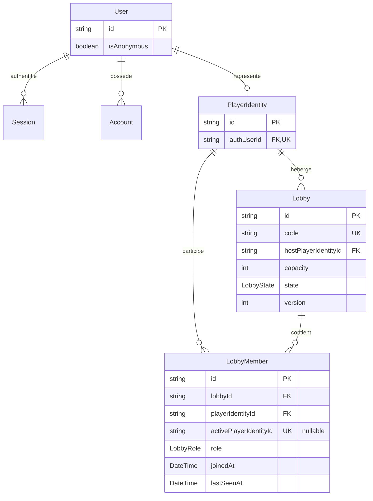
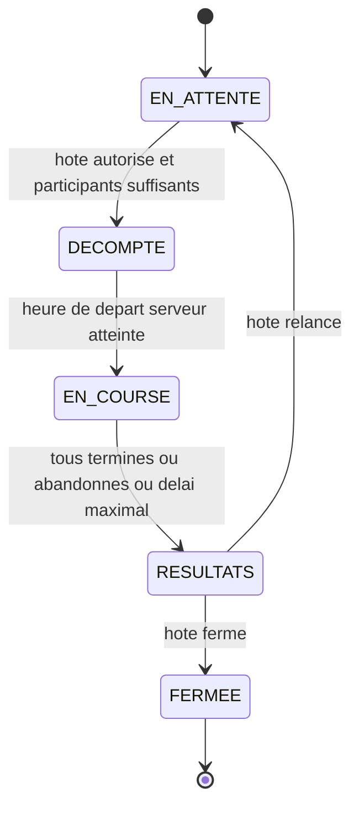

# Architecture et règles de développement

Version initiale du checkpoint 1, 3 octobre 2026. Ce document fixe les frontières à respecter avant toute modification du code. Il ne constitue pas une preuve de fonctionnalité livrée : le statut de chaque exigence appartient à [EXIGENCES.md](EXIGENCES.md), les contrôles réellement exécutés à `docs/verification.md`.

## 1. Références et périmètre

Le projet est un **monolithe modulaire Next.js App Router**, en TypeScript strict, avec Better Auth, Prisma et PostgreSQL. L'interface reste simple : démontrer les opérations réelles avant d'élargir le design ou le jeu.

La structure reprend [l'architecture de Type](https://github.com/Ap0llonn/Type/blob/eb3cbf0943a227d66e8e53ba2d2988d777e4d19c/tempo/docs/architecture.md), vérifiée avec son code à la révision `eb3cbf0943a227d66e8e53ba2d2988d777e4d19c`. On reprend la séparation routes/composition/modules/shared et l'injection superviseur/repository. On ne copie ni son authentification, ni ses secrets, ni son identité visuelle, ni ses données de démonstration.

Le cahier des charges « Web V — Course de frappe multijoueur en temps réel » et les décisions explicites les plus récentes prévalent sur les anciens documents de planification. En particulier, le checkpoint inclut maintenant création de salle, entrée par code et liste des présents en direct. Les anciennes mentions « contrats de salon seulement », « pas de temps réel » et « FR toujours par défaut » ne définissent plus le périmètre actuel. Toute ambiguïté produit doit être nommée et justifiée dans `EXIGENCES.md`, jamais résolue silencieusement dans le code.

Les modules actuels sont `identity` et `lobby`. Course, bots, bonus, corpus et historique sont des extensions futures ; les décrire ne justifie ni faux services opérationnels, ni tables inutilisées, ni succès simulés.

### Audit borné de la référence Type

L’audit porte sur les fichiers versionnés à `eb3cbf0943a227d66e8e53ba2d2988d777e4d19c`, dont l’arbre récursif complet compte 268 entrées, sans extrapolation aux services externes éventuels :

- **CI absente du dépôt :** aucun workflow GitHub Actions ni autre pipeline dans l’[arbre épinglé](https://github.com/Ap0llonn/Type/tree/eb3cbf0943a227d66e8e53ba2d2988d777e4d19c). Les commandes locales de [package.json](https://github.com/Ap0llonn/Type/blob/eb3cbf0943a227d66e8e53ba2d2988d777e4d19c/tempo/package.json) ne prouvent pas une exécution automatique.
- **Migrations Prisma absentes :** le [dossier Prisma](https://github.com/Ap0llonn/Type/tree/eb3cbf0943a227d66e8e53ba2d2988d777e4d19c/tempo/prisma) contient uniquement le schéma ; le chemin déclaré dans [prisma.config.ts](https://github.com/Ap0llonn/Type/blob/eb3cbf0943a227d66e8e53ba2d2988d777e4d19c/tempo/prisma.config.ts) n’est pas une migration livrée.
- **Serveur WebSocket réel absent :** [realtime/server.ts](https://github.com/Ap0llonn/Type/blob/eb3cbf0943a227d66e8e53ba2d2988d777e4d19c/tempo/src/realtime/server.ts) est un placeholder avec `export {}` ; ses sous-dossiers n’ont que des `.gitkeep`. La [page multijoueur](https://github.com/Ap0llonn/Type/blob/eb3cbf0943a227d66e8e53ba2d2988d777e4d19c/tempo/src/composition/multiplayer/multiplayer-page.tsx) est aussi un placeholder. Aucune dépendance WebSocket directe ou commande de serveur de jeu n’est déclarée ; une bibliothèque ou un client ne suffirait pas à prouver le serveur.
- **FR/EN réutilisable :** [routage next-intl](https://github.com/Ap0llonn/Type/blob/eb3cbf0943a227d66e8e53ba2d2988d777e4d19c/tempo/src/shared/presentation/i18n/routing.ts), [messages partagés](https://github.com/Ap0llonn/Type/blob/eb3cbf0943a227d66e8e53ba2d2988d777e4d19c/tempo/src/shared/presentation/i18n/messages.ts) et [sélecteur de langue](https://github.com/Ap0llonn/Type/blob/eb3cbf0943a227d66e8e53ba2d2988d777e4d19c/tempo/src/shared/presentation/components/navigation/language-switcher.tsx) donnent une référence de locales explicites, cookie et conservation chemin/paramètres/fragment. Le repli anglais de Type est remplacé ici par le repli français requis.
- **Thème sombre fixe :** le [CSS global](https://github.com/Ap0llonn/Type/blob/eb3cbf0943a227d66e8e53ba2d2988d777e4d19c/tempo/src/app/globals.css) impose `color-scheme: dark` et une palette sombre. Ce n’est pas un sélecteur clair/sombre ; le choix système et la préférence persistante sont réalisés séparément dans ce projet.

## 2. Répartition des fichiers

```text
src/
  app/                              Routes, layouts, metadata, redirects, fallbacks
  composition/
    home/ auth/ lobby/              Pages assemblées et workflows intermodules
  modules/
    identity/                       Identité applicative et pont vers Better Auth
    lobby/                          Salles, adhésions, rôles et règles de présence
      public.ts                     Exports de types partageables uniquement
      server.ts                     Façade serveur publique et parseurs serveur
      container.ts                  Câblage privé des dépendances
      contracts/                    Entrées, sorties, schémas de validation
      domain/                       Types, invariants et fonctions métier
      supervisors/interfaces/       Contrat des cas d'utilisation
      supervisors/implementations/  Règles métier et orchestration du module
      repositories/interfaces/      Contrat de persistance sans fournisseur
      repositories/implementations/ Adaptateurs Prisma et transactions
      infrastructure/               Adaptateurs propres au module
      presentation/                 Formulaires, composants et actions du module
  shared/
    contracts/                      OperationResult et types vraiment transverses
    infrastructure/                 DB, configuration, environnement, moteur auth
    presentation/                   UI générique, i18n, thèmes et styles
prisma/                             Schéma, migrations versionnées et seed
tests/                              Unitaires, intégration et navigateur
```

Créer un fichier parce qu'une opération en a besoin, jamais pour remplir cette arborescence. Ne pas ajouter une couche globale `services/`, un conteneur DI générique, un bus d'événements ou un repository générique sans besoin démontré.

## 3. Règles d'import obligatoires

| Emplacement | Dépendances autorisées | Interdit |
| --- | --- | --- |
| `app` | composition, adaptateurs de transport, infrastructure de framework | Règles métier et requêtes Prisma |
| `composition` | `shared`, API publique de plusieurs modules | Containers, repositories et implémentations de superviseurs |
| Module | Ses propres fichiers, `shared` compatible avec sa couche | Autre module, `composition`, `app` |
| `shared` | Autres fichiers partagés et bibliothèques | Tous les modules, `composition`, `app` |
| Superviseur | Contrats/domain du module, interfaces repository, contrats partagés | Next.js, React, Prisma, Better Auth, transport, variables d'environnement |
| Repository concret | Interface propre, mapping domain, infrastructure DB | HTTP, UI, session utilisateur, autre module |

Ces interdictions incluent les imports de types, réexports, imports dynamiques et chemins relatifs contournant les alias.

### Entrées publiques

- `public.ts` exporte uniquement des types sûrs pour le navigateur. Aucun singleton, secret, Prisma ou accès réseau.
- `server.ts` porte `import 'server-only'`. Il expose les opérations publiques typées, les schémas/parseurs nécessaires à la composition et les adaptateurs serveur prévus. Il utilise le container ; les consommateurs ne le font pas.
- `container.ts` est serveur et privé. Il construit repositories et superviseurs, les type par leurs interfaces, et n'exécute aucun workflow.
- Un composant ou une action dans `presentation/` peut être une entrée publique explicitement utilisée par la composition. Cela n'autorise pas les autres imports profonds.
- Les actions serveur sont dans des fichiers dédiés avec `'use server'`. Un composant client peut appeler une action, jamais importer une façade `server.ts` ou un container.
- Les adaptateurs DB/session/configuration sont serveur uniquement. Exception explicite : `identity/infrastructure/auth-client.ts` encapsule le client navigateur officiel Better Auth et ne doit importer aucune configuration serveur.

Conventions : chemins en `kebab-case`, types/interfaces/classes en `PascalCase`, fonctions/variables en `camelCase`. Employer `IdentitySupervisor`, `PlayerIdentityRepository`, `DefaultIdentitySupervisor`, `PrismaPlayerIdentityRepository`, plutôt que des préfixes variables `i` ou des classes en minuscules. Les contrats d'entrée finissent par `Input`, les réponses décrivent le résultat, les méthodes par un verbe. Éviter `utils.ts` ou `manager.ts` sans responsabilité précise.

## 4. Exécuter une opération

```text
Une opération d'un seul module
  page de composition → action du module → superviseur → interface repository
                                                           ↑
                                                  implémentation Prisma

Un workflow intermodules
  route/action/adaptateur temps réel → composition → identity/server
                                                  → lobby/server
```

Le superviseur dépend de l'interface injectée, jamais du repository concret. La composition porte l'ordre entre modules et le mapping de leurs contrats ; les règles de chaque domaine restent dans son superviseur. Un changement de transport ne déplace aucune règle métier.

### Exemple sans ambiguïté : créer une salle

1. Le formulaire de composition envoie uniquement les réglages de la salle. Aucun `playerIdentityId`, statut de compte ou droit d'hôte reçu du navigateur n'est accepté comme identité.
2. L'adaptateur HTTP/action valide l'entrée avec le schéma lobby exposé par `lobby/server.ts` et obtient les headers/cookies de la requête réelle.
3. `composition/lobby` appelle `getCurrentActor` depuis `identity/server.ts`. Cette façade lit la session serveur, puis résout l'identité applicative.
4. Si le résultat est un échec, le workflow le retourne immédiatement. Sinon, il construit un `LobbyActor` appartenant au module lobby depuis l'acteur vérifié, puis appelle son API publique serveur.
5. Le superviseur lobby refuse les invités pour la création, valide les règles métier, puis invoque l'interface repository. Il n'importe jamais `identity`.
6. Le repository crée salle et adhésion hôte atomiquement. L'hôte compte dans la capacité seulement s'il a choisi participant. Il retourne le DTO public et sa version après commit.
7. Le transport renvoie ce résultat. L'UI navigue uniquement sur `ok: true`. La liste temps réel relit un état déjà validé/commité.

Pour rejoindre une salle, la même chaîne autorise invité et compte, vérifie code/état/capacité/adhésion existante et retourne la même adhésion pour un deuxième onglet. Aucun `fetch` interne vers ses propres routes HTTP n'est nécessaire entre composition et superviseur.

## 5. Entrées, sorties et erreurs

Toutes les entrées serveur ont un schéma Zod ou équivalent : corps, paramètres, code, query string et commandes temps réel (`TECH-07`). Les schémas appartiennent au module qui possède l'opération ; les superviseurs n'importent jamais un type depuis un formulaire. Le contrôle client améliore l'expérience, mais ne remplace aucun contrôle serveur.

```ts
type OperationResult<T> =
  | { ok: true; value: T }
  | { ok: false; error: { code: ErrorCode; messageKey: `errors.${ErrorCode}` } };
```

La source des codes est `src/shared/contracts/operation-result.ts` : `VALIDATION`, `UNAUTHENTICATED`, `FORBIDDEN`, `CONFLICT`, `NOT_FOUND`, `ROOM_FULL`, `ROOM_CLOSED`, `RATE_LIMITED`, `PROVIDER_UNAVAILABLE`, `INTERNAL`. Ajouter un code exige son traitement exhaustif, ses traductions FR/EN et ses tests. Un booléen ne représente jamais le résultat d'une commande.

- Succès : DTO minimal sérialisable, pas de ligne Prisma complète ni de session/token. Les timestamps lobby (`joinedAt`, `lastSeenAt` interne) sont des nombres en millisecondes Unix ; `Date` reste un détail de l'adaptateur DB. Ne pas mélanger secondes, millisecondes et chaînes ISO dans un même contrat. La version de salle est un entier sérialisable.
- Échec attendu : résultat discriminé stable. Le repository traduit les erreurs fournisseur en erreurs neutres ; le superviseur les interprète dans son opération. Il ne teste aucun code Prisma `Pxxxx`.
- Échec imprévu : erreur générique `INTERNAL` au client et diagnostic expurgé côté serveur. Ne pas transformer une panne en liste vide ou faux succès.
- Le transport traduit les codes en statuts HTTP cohérents ; il ne réécrit pas les règles. `401` pour session absente, `403` pour droit refusé, `404` pour absent, `409` pour conflit d'état, `429` pour limitation, `500/503` pour panne.
- Les clés sont traduites à la présentation. Jamais de message SQL, stack trace, mot de passe, cookie, token, email ou secret dans les snapshots publics ou logs de routine.

Trois écarts auth de Type sont à éviter : `SignupResult` est importé mais absent de l’interface ; celle-ci annonce `Promise<boolean>`, alors que l’implémentation annonce `Promise<SignupResult>` sans retourner de résultat après création et que l’[action signup](https://github.com/Ap0llonn/Type/blob/eb3cbf0943a227d66e8e53ba2d2988d777e4d19c/tempo/src/modules/auth/presentation/signup/signup-action.ts) attend `created` ; enfin, login peut retourner `false` sans créer de session, mais son action ignore ce retour et redirige, produisant un faux succès apparent. Une opération réussie doit être démontrée par sa branche de résultat. Sources inspectées : [superviseur auth](https://github.com/Ap0llonn/Type/blob/eb3cbf0943a227d66e8e53ba2d2988d777e4d19c/tempo/src/modules/auth/supervisors/implementations/userSupervisor.ts), [interface auth](https://github.com/Ap0llonn/Type/blob/eb3cbf0943a227d66e8e53ba2d2988d777e4d19c/tempo/src/modules/auth/supervisors/interfaces/iUserSupervisor.ts), [action login](https://github.com/Ap0llonn/Type/blob/eb3cbf0943a227d66e8e53ba2d2988d777e4d19c/tempo/src/modules/auth/presentation/login/login-action.ts). La séparation des erreurs du [repository user](https://github.com/Ap0llonn/Type/blob/eb3cbf0943a227d66e8e53ba2d2988d777e4d19c/tempo/src/modules/user/repository/userRepo.ts) et du [superviseur user](https://github.com/Ap0llonn/Type/blob/eb3cbf0943a227d66e8e53ba2d2988d777e4d19c/tempo/src/modules/user/supervisors/userSupervisor.ts) sert de référence pour la frontière fournisseur/métier.

## 6. Authentification et autorisation

Better Auth possède le protocole d'authentification : endpoints officiels, callbacks, cookies, hachage, sessions et protections associées. `app/api/auth/[...all]/route.ts` est l'exception documentée à la chaîne métier : il branche le handler officiel, sans superviseur/repository artificiel. Les formulaires passent par son client encapsulé. Ne jamais recopier le hasher ou les sessions maison de Type.

L'inscription locale demande email, identifiant et mot de passe, selon la décision validée ; la connexion locale utilise identifiant/mot de passe. GitHub **et** Discord sont requis par `AUTH-01`, même si les E2E passent par les comptes locaux (`TEST-03`). Un provider non configuré est signalé comme indisponible ; ce n'est pas une preuve OAuth réussie.

Chaque opération protégée relit une session serveur valide et autorise l'acteur pour la salle demandée. Un layout, un proxy, un bouton caché ou un identifiant client ne sont pas des contrôles d'accès suffisants. L'ouverture d'un stream valide session et adhésion ; les connexions persistantes doivent aussi cesser d'exposer un état après révocation, expulsion ou fermeture.

Un invité possède une vraie session cookie et un pseudo validé de 3 à 20 caractères. Il peut rejoindre, pas créer ; il n'a ni photo ni historique de profil persistant (`AUTH-02/03`). Son identité technique peut survivre à un rechargement sans devenir un historique public. Aucune fusion invité→compte, suppression automatique d'identité invitée ou liaison de comptes par simple égalité d'email. Pas de récupération de mot de passe promise dans ce lot.

Toute mutation réservée à l'hôte est autorisée côté serveur (`SEC-01`). Les mutations cookie-authentifiées vérifient leur origine et ont une protection CSRF adaptée ; la validation Zod seule ne suffit pas. Limiter les tentatives de code côté serveur (`SALLE-10`). Les appels directs à `auth.api` ne doivent pas contourner silencieusement les protections du handler officiel.

## 7. Transactions et modèle de données

Le schéma exécutable est `prisma/schema.prisma`, accompagné de migrations versionnées. Ne pas maintenir un second schéma SQL divergent. Le diagramme ci-dessous décrit les relations du socle ; les noms finaux de champs sont ceux du schéma. `Verification` est géré par Better Auth selon son contrat et n'est pas relié artificiellement à un utilisateur.



Règles de stockage :

- `PlayerIdentity.authUserId` est unique ; la résolution concurrente du même utilisateur donne la même identité via upsert puis relecture du gagnant en cas de collision unique concurrente. Les autres erreurs restent des échecs.
- Le code de salle est unique, de six caractères alphanumériques excluant `0 O 1 I L`. Les collisions sont réessayées de façon bornée et sûre, avec une nouvelle transaction après rollback. Ne pas confondre collision de code et conflit d'adhésion : ce dernier ne se réessaie pas avec un autre code.
- Une adhésion représente une identité humaine, avec rôle participant/spectateur et ordre d'arrivée. La clé unique `(lobbyId, playerIdentityId)` empêche les doublons. `LobbyMember.activePlayerIdentityId`, unique et nullable, vaut l'identité pour une adhésion active et `null` quand elle ne l'est plus : elle garantit au plus une salle active par personne (`SALLE-06`). Le repository construit cette valeur depuis l'identité vérifiée, jamais depuis l'entrée client. Un simple `find` avant `insert` ne suffit pas.
- Créer salle+hôte, rejoindre avec contrôle de capacité, quitter avec transfert/fermeture et modifier la version de salle sont des opérations atomiques du repository lobby. Verrouillage ou isolation adéquate protège les dernières places contre les requêtes concurrentes.
- La capacité est de 2 à 30 **participants**, spectateurs exclus. Le propriétaire peut être spectateur ; son rôle d'hôte est indépendant.
- Le départ volontaire de l'hôte transfère à l'humain authentifié présent depuis le plus longtemps, participant ou spectateur ; sinon il ferme la salle. Une coupure réseau n'est pas immédiatement un départ volontaire.
- Le propriétaire de l'agrégat possède sa transaction. Ni la route ni la composition ne reçoit un `Prisma.TransactionClient`. Ne pas passer un client DB entre modules.
- Si un futur workflow doit écrire dans plusieurs modules, documenter atomicité, idempotence et compensation avant de coder. Une transaction d'un module ne garantit pas le commit d'un autre ; aucune infrastructure de saga/outbox n'est ajoutée sans ce besoin.

Modèle futur à détailler avec les cas métier : une salle aura plusieurs courses ; chaque course figera texte/configuration/seed et ses participants ; chaque résultat sera lié à la course et à un participant humain ou bot explicitement distingué. Les statistiques persistantes sont réservées aux comptes. Ces concepts ne sont pas des tables déjà livrées.

## 8. Machine à états de course

Contrat initial exigé par `COURSE-01`. La course complète reste future ; ne pas exposer une commande de lancement qui ne réalise pas ces transitions.



Le contrat `LobbyState` utilise `WAITING`, `COUNTDOWN`, `RACING`, `RESULTS`, `CLOSED`, correspondant respectivement à `EN_ATTENTE`, `DÉCOMPTE`, `EN_COURSE`, `RÉSULTATS`, `FERMÉE`. Le diagramme omet seulement les accents dans ses identifiants Mermaid. Les valeurs techniques ne sont jamais dérivées des traductions.

Le serveur déclenche le décompte seulement avec au moins deux participants dont un humain ; les bots comptent, les spectateurs non. Le texte n'est révélé qu'au début du décompte de trois secondes. Rejoindre est permis seulement en attente ou aux résultats. Les temps, progrès, classement et bonus restent autoritaires serveur. Une reconnexion dans les 30 secondes reprend la même place ; au-delà, le participant est abandonné (`COURSE-02/03/06/08/09`). Les fermetures administratives et absences d'hôte sont des événements de cycle de vie de salle, à distinguer du chemin normal de course.

## 9. ADR initial du temps réel

**Décision S1 :** commandes HTTP même origine et instantanés serveur via SSE sur un processus Next.js persistant hébergé sur VPS. Les ticks SSE observent sans renouveler la présence ; un heartbeat POST du navigateur renouvelle uniquement son adhésion vérifiée toutes les cinq secondes, avec timeout quatre secondes et arrêt à la sortie. Les seuils dix/trente secondes sont communs dans `lobby/contracts/presence.ts`. Voir le correctif de sémantique [ADR 0002](adr/0002-client-presence.md). `TECH-06` autorise cette technologie. Le détail opérationnel est consigné dans [ADR 0001](adr/0001-data-realtime.md).

**Pourquoi :** le checkpoint requiert une liste de présents partagée, pas encore un moteur de course bidirectionnel. SSE fournit un canal serveur→navigateur et une reconnexion native, sans service externe payant. HTTP garde des commandes explicites validables/testables. Une Server Action ne porte pas une connexion persistante.

**Alternatives :** le polling HTTP simple multiplie les requêtes et retarde l'affichage ; WebSocket autorise les échanges bidirectionnels fréquents mais demande son propre protocole et sa gestion de reconnexion. Il reste une option à mesurer pour la course, pas une dépendance ajoutée préventivement.

```text
Navigateur → commande HTTP → composition/lobby → façades → transaction PostgreSQL
Navigateur ← snapshot SSE  ← composition/lobby ← état commité et version de salle
```

Le transport SSE possède connexion, encodage, nettoyage et contrôle du débit ; la composition résout l'acteur et appelle les cas métier. Il ne lit ni repository ni Prisma et n'importe pas les modules entre eux. L'événement contient un DTO sûr et une version monotone. Le client remplace son état par l'instantané ; il ignore une version antérieure et redemande un instantané complet à la reconnexion/trou, sans considérer un accusé client comme état de référence.

**Conséquences et limites à tester :** cookies/session revalidés, plusieurs onglets sans doublon, présence expirée, ressources libérées à déconnexion, absence de cache/buffering proxy, reprise après redémarrage et limites de connexion. PostgreSQL, pas un `Map` mémoire, est l'autorité partagée. Les délais de rafraîchissement et de présence sont nommés/configurés/testés, jamais cachés dans plusieurs timers. Un flux construit en relisant périodiquement la DB reste du polling côté serveur et son coût doit être mesuré. Le futur rythme de course doit atteindre environ quatre mises à jour perçues par seconde (`COURSE-05`) : la validation du roster S1 ne démontre pas cette performance.

## 10. Approche prévue pour les bots

**Décision de conception future, pas moteur implémenté :** simulation pure déterministe dans le domaine de course, appelée par l'horloge serveur. Chaque course persiste sa seed, la version de l'algorithme et sa configuration. Chaque bot dérive un sous-flux pseudo-aléatoire stable ; aucune dépendance métier à `Math.random()`, au navigateur ou à l'heure murale.

Une fonction de transition reçoit l'état du bot, le texte, le temps logique écoulé et la configuration. Elle produit le nouvel état/progrès et les événements. À entrées identiques, la sortie est identique (`BOT-05`). Le calcul par pas temporels définis évite de changer le résultat selon la fréquence réseau.

Les cinq niveaux règlent des plages de vitesse et probabilités d'erreur documentées (`BOT-01`). Accélérations, hésitations et mots difficiles font varier la vitesse ; les erreurs ajoutent un temps de correction conforme au mode de frappe (`BOT-02/03`). Bots identifiés dans l'UI et mêmes règles de bonus/malus que les humains (`BOT-04`). L'état public n'expose que le résultat serveur, jamais une simulation faisant autorité chez le client.

Tests futurs : rejouer une seed, comparer plusieurs découpages de temps, vérifier les bornes et erreurs de chaque niveau, pause/reprise, mêmes bonus et classement. Ne pas inventer une identité Better Auth pour un bot. Si un module `race` ou `bots` devient nécessaire, le relier par composition et contrats publics, jamais par import direct depuis `lobby`.

## 11. UI, langues et contraintes transversales

- Tailwind CSS est requis (`TECH-03`). Les éléments restent accessibles, clavier/mobile, avec états pending/erreur/vide réels. Aucun bouton factice.
- `next-intl` porte `/fr` et `/en`. La sélection explicite persistée prime ; sinon utiliser la langue navigateur parmi FR/EN, avec repli FR pour les langues non prises en charge (`I18N-02`). La langue du texte de course est indépendante de celle de l'UI (`CONF-02`).
- Tous les libellés, erreurs, états vides et métadonnées sont traduits ; nombres/dates passent par le formatage localisé. Aucun texte UI métier codé en dur.
- `next-themes` porte clair/sombre persistant, avec préférence système au premier accès (`DES-05`) ; éviter flash du mauvais thème et divergences d'hydratation du sélecteur.
- Le nom et le logo finaux doivent venir de l'étudiant sans IA (`DES-01/02`). Aucun agent ne les invente, ne génère des croquis ou ne présente un placeholder comme identité finale.
- Versions exactes, lockfile pnpm et Node versionnés. Variables dans `.env.example`, secrets hors Git. PostgreSQL jetable pour les tests ; ne jamais réinitialiser une base non explicitement dédiée aux tests.

## 12. Contrôles obligatoires avant livraison

1. **Contrats/unitaires :** entrées invalides, branches succès/échec, acteur absent, création refusée à l'invité, droits hôte, capacité et transitions. Tests de superviseurs avec repository injecté, pas DB ou réseau caché.
2. **Frontières :** `pnpm check:boundaries` refuse module→module/app/composition, shared→module, composition→container/repository/implémentation et client→serveur, y compris alias et chemins relatifs. Ses fixtures négatives doivent réellement échouer. Un grep nominal ne prouve pas la fermeture transitive client→serveur ; le build complète ce contrôle.
3. **PostgreSQL réel :** migrations depuis zéro, identité concurrente, adhésion idempotente, dernière place concurrente, une seule salle active, collisions de code et rollback atomique. Aucun mock ne compte comme preuve DB.
4. **Sécurité/transport :** session expirée/révoquée, acteur falsifié, commande non-hôte, origine étrangère, limite de tentatives, reconnexion, deux clients recevant l'état partagé et fin propre du stream.
5. **Navigateur :** compte/invité, création/entrée autorisées, erreur sans redirection de succès, double clic, Retour/Avancer/reload, FR/EN et thèmes persistants, clavier/mobile. Les E2E utilisent les comptes locaux, pas OAuth.
6. **Agrégat :** installation verrouillée, Prisma validate/generate/migrations, lint, typecheck, boundaries, unitaires, intégration, build, E2E. GitHub Actions exécute au minimum lint/types/unitaires à chaque push (`TECH-09`).

Tout code applicatif et nouveau script est TypeScript, avec `strict: true`, `no-explicit-any` en erreur et justification précise des suppressions de type (`TECH-02`). Les contrôles non exécutés ou bloqués sont signalés ; une compilation réussie ne prouve ni OAuth réel ni déploiement HTTPS. Changer une frontière exige de modifier ce document et ses tests dans le même changement, avec une raison explicite.

## Précision après revue de concurrence

Les commandes structurelles de salon verrouillent la ligne Lobby en exclusif (FOR UPDATE) sous READ COMMITTED. Les heartbeats la verrouillent en partagé (FOR SHARE), ne réécrivent que le membre concerné et ne changent pas la version structurelle. Cela conserve la transaction d’adhésion/capacité tout en évitant de sérialiser trente mises à jour de présence sur la même ligne. Le superviseur déclenche séparément la réconciliation des expirations ; le repository possède ces primitives de persistance. Une erreur temporaire ne quitte pas le salon côté UI. Voir ADR0001 et les tests présence/reconnexion.
