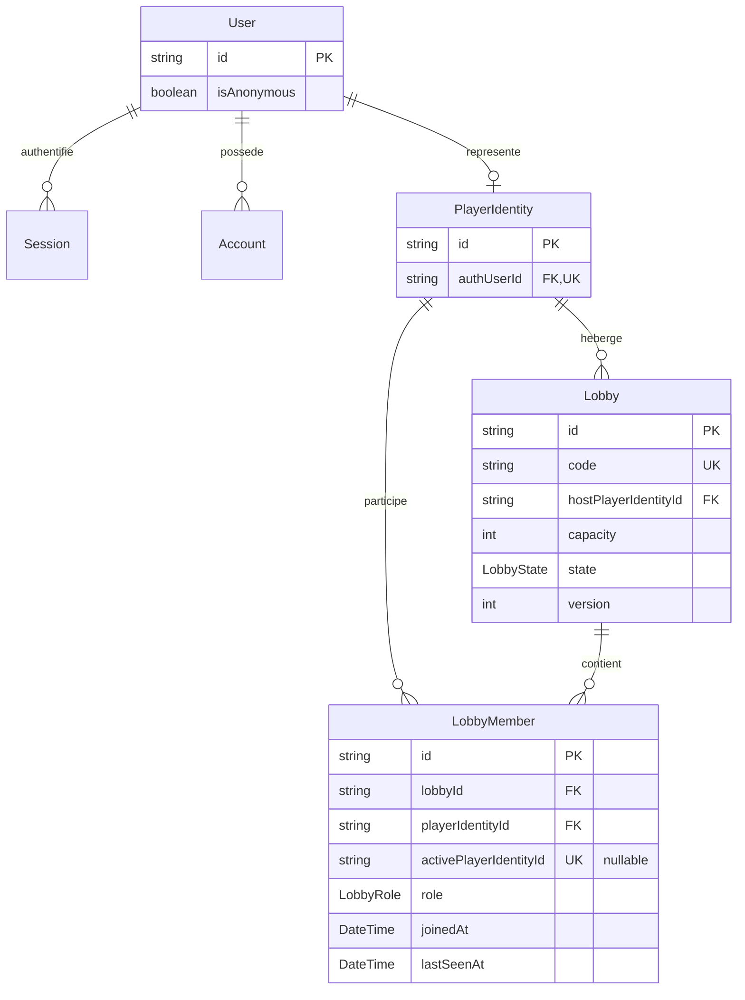
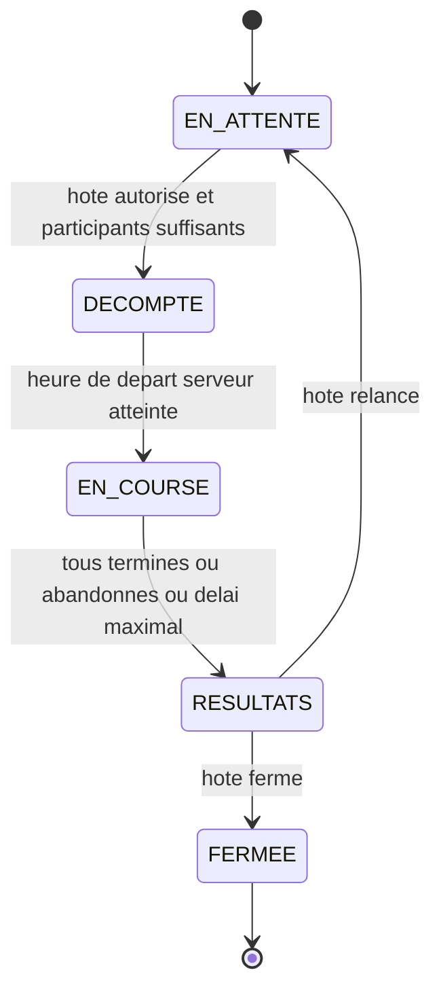

# Architecture et règles de développement

Version initiale du checkpoint 1, 3 octobre 2026. Ce document fixe les frontières à respecter avant toute modification du code. Il ne constitue pas une preuve de fonctionnalité livrée : le statut de chaque exigence appartient à [EXIGENCES.md](EXIGENCES.md), les contrôles réellement exécutés à `docs/verification.md`.

## 1. Références et périmètre

Le projet est un **monolithe modulaire Next.js App Router**, en TypeScript strict, avec Better Auth, Prisma et PostgreSQL. L'interface reste simple : démontrer les opérations réelles avant d'élargir le design ou le jeu.

La structure reprend [l'architecture de Type](https://github.com/Ap0llonn/Type/blob/eb3cbf0943a227d66e8e53ba2d2988d777e4d19c/tempo/docs/architecture.md), vérifiée avec son code à la révision `eb3cbf0943a227d66e8e53ba2d2988d777e4d19c`. On reprend la séparation routes/composition/modules/shared et l'injection superviseur/repository. On ne copie ni son authentification, ni ses secrets, ni son identité visuelle, ni ses données de démonstration.

Le cahier des charges « Web V — Course de frappe multijoueur en temps réel » et les décisions explicites les plus récentes prévalent sur les anciens documents de planification. En particulier, le checkpoint inclut maintenant création de salle, entrée par code et liste des présents en direct. Les anciennes mentions « contrats de salon seulement », « pas de temps réel » et « FR toujours par défaut » ne définissent plus le périmètre actuel. Toute ambiguïté produit doit être nommée et justifiée dans `EXIGENCES.md`, jamais résolue silencieusement dans le code.

Les modules actuels sont `identity` et `lobby`. Course, bots, bonus, corpus et historique sont des extensions futures ; les décrire ne justifie ni faux services opérationnels, ni tables inutilisées, ni succès simulés.

Le 6 octobre 2026, l’utilisateur demande le vrai lobby et précise ensuite que `/[locale]/play` sert uniquement à rejoindre : un champ de code de six caractères, comme dans la maquette, sans création et sans mention de démonstration. La création est désormais proposée à `/play/create` depuis la décision utilisateur suivante. `/play/player?code=…` valide le code côté serveur, résout l’identité et assemble la session invitée officielle puis l’adhésion lobby réelle ; `/play/room` affiche la salle active et sa présence HTTP/SSE. Le format alphanumérique de la maquette et de `SALLE-02` est conservé. La course, les bots, les bonus et la configuration restent futurs.

### Audit borné de la référence Type

L’audit porte sur les fichiers versionnés à `eb3cbf0943a227d66e8e53ba2d2988d777e4d19c`, dont l’arbre récursif complet compte 268 entrées, sans extrapolation aux services externes éventuels :

- **CI absente du dépôt :** aucun workflow GitHub Actions ni autre pipeline dans l’[arbre épinglé](https://github.com/Ap0llonn/Type/tree/eb3cbf0943a227d66e8e53ba2d2988d777e4d19c). Les commandes locales de [package.json](https://github.com/Ap0llonn/Type/blob/eb3cbf0943a227d66e8e53ba2d2988d777e4d19c/tempo/package.json) ne prouvent pas une exécution automatique.
- **Migrations Prisma absentes :** le [dossier Prisma](https://github.com/Ap0llonn/Type/tree/eb3cbf0943a227d66e8e53ba2d2988d777e4d19c/tempo/prisma) contient uniquement le schéma ; le chemin déclaré dans [prisma.config.ts](https://github.com/Ap0llonn/Type/blob/eb3cbf0943a227d66e8e53ba2d2988d777e4d19c/tempo/prisma.config.ts) n’est pas une migration livrée.
- **Serveur WebSocket réel absent :** [realtime/server.ts](https://github.com/Ap0llonn/Type/blob/eb3cbf0943a227d66e8e53ba2d2988d777e4d19c/tempo/src/realtime/server.ts) est un placeholder avec `export {}` ; ses sous-dossiers n’ont que des `.gitkeep`. La [page multijoueur](https://github.com/Ap0llonn/Type/blob/eb3cbf0943a227d66e8e53ba2d2988d777e4d19c/tempo/src/composition/multiplayer/multiplayer-page.tsx) est aussi un placeholder. Aucune dépendance WebSocket directe ou commande de serveur de jeu n’est déclarée ; une bibliothèque ou un client ne suffirait pas à prouver le serveur.
- **FR/EN réutilisable :** [routage next-intl](https://github.com/Ap0llonn/Type/blob/eb3cbf0943a227d66e8e53ba2d2988d777e4d19c/tempo/src/shared/presentation/i18n/routing.ts), [messages partagés](https://github.com/Ap0llonn/Type/blob/eb3cbf0943a227d66e8e53ba2d2988d777e4d19c/tempo/src/shared/presentation/i18n/messages.ts) et [sélecteur de langue](https://github.com/Ap0llonn/Type/blob/eb3cbf0943a227d66e8e53ba2d2988d777e4d19c/tempo/src/shared/presentation/components/navigation/language-switcher.tsx) donnent une référence de locales explicites, cookie et conservation chemin/paramètres/fragment. Le repli anglais de Type est remplacé ici par le repli français requis.
- **Thème sombre fixe :** le [CSS global](https://github.com/Ap0llonn/Type/blob/eb3cbf0943a227d66e8e53ba2d2988d777e4d19c/tempo/src/app/globals.css) impose `color-scheme: dark` et une palette sombre. Ce n’est pas un sélecteur clair/sombre ; le choix système et la préférence persistante sont réalisés séparément dans ce projet.

## 2. Répartition des fichiers

```text
src/
  app/                              Routes, layouts, metadata, redirects, fallbacks
  composition/
    home/ auth/ lobby/ site/ play/  Pages assemblées et workflows intermodules
  modules/
    identity/                       Identité applicative et pont vers Better Auth
    lobby/                          Salles, adhésions, rôles et règles de présence
      public.ts                     Exports de types partageables uniquement
      server.ts                     Façade serveur publique et parseurs serveur
      container.ts                  Câblage privé des dépendances
      contracts/                    Entrées, sorties, schémas de validation
      domain/                       Types, invariants et fonctions métier
      supervisors/interfaces/       Contrat des cas d'utilisation
      supervisors/implementations/  Règles métier et orchestration du module
      repositories/interfaces/      Contrat de persistance sans fournisseur
      repositories/implementations/ Adaptateurs Prisma et transactions
      infrastructure/               Adaptateurs propres au module
      presentation/                 Formulaires, composants et actions du module
  shared/
    contracts/                      OperationResult et types vraiment transverses
    infrastructure/                 DB, configuration, environnement, moteur auth
    presentation/                   UI générique, i18n, thèmes et styles
prisma/                             Schéma, migrations versionnées et seed
tests/                              Unitaires, intégration et navigateur
```

Créer un fichier parce qu'une opération en a besoin, jamais pour remplir cette arborescence. Ne pas ajouter une couche globale `services/`, un conteneur DI générique, un bus d'événements ou un repository générique sans besoin démontré.

## 3. Règles d'import obligatoires

| Emplacement | Dépendances autorisées | Interdit |
| --- | --- | --- |
| `app` | composition, adaptateurs de transport, infrastructure de framework | Règles métier et requêtes Prisma |
| `composition` | `shared`, API publique de plusieurs modules | Containers, repositories et implémentations de superviseurs |
| Module | Ses propres fichiers, `shared` compatible avec sa couche | Autre module, `composition`, `app` |
| `shared` | Autres fichiers partagés et bibliothèques | Tous les modules, `composition`, `app` |
| Superviseur | Contrats/domain du module, interfaces repository, contrats partagés | Next.js, React, Prisma, Better Auth, transport, variables d'environnement |
| Repository concret | Interface propre, mapping domain, infrastructure DB | HTTP, UI, session utilisateur, autre module |

Ces interdictions incluent les imports de types, réexports, imports dynamiques et chemins relatifs contournant les alias.

### Entrées publiques

- `public.ts` exporte uniquement des types sûrs pour le navigateur. Aucun singleton, secret, Prisma ou accès réseau.
- `server.ts` porte `import 'server-only'`. Il expose les opérations publiques typées, les schémas/parseurs nécessaires à la composition et les adaptateurs serveur prévus. Il utilise le container ; les consommateurs ne le font pas.
- `container.ts` est serveur et privé. Il construit repositories et superviseurs, les type par leurs interfaces, et n'exécute aucun workflow.
- Un composant ou une action dans `presentation/` peut être une entrée publique explicitement utilisée par la composition. Cela n'autorise pas les autres imports profonds.
- Les actions serveur sont dans des fichiers dédiés avec `'use server'`. Un composant client peut appeler une action, jamais importer une façade `server.ts` ou un container.
- Les adaptateurs DB/session/configuration sont serveur uniquement. Exception explicite : `identity/infrastructure/auth-client.ts` encapsule le client navigateur officiel Better Auth et ne doit importer aucune configuration serveur.

Conventions : chemins en `kebab-case`, types/interfaces/classes en `PascalCase`, fonctions/variables en `camelCase`. Employer `IdentitySupervisor`, `PlayerIdentityRepository`, `DefaultIdentitySupervisor`, `PrismaPlayerIdentityRepository`, plutôt que des préfixes variables `i` ou des classes en minuscules. Les contrats d'entrée finissent par `Input`, les réponses décrivent le résultat, les méthodes par un verbe. Éviter `utils.ts` ou `manager.ts` sans responsabilité précise.

## 4. Exécuter une opération

```text
Une opération d'un seul module
  page de composition → action du module → superviseur → interface repository
                                                           ↑
                                                  implémentation Prisma

Un workflow intermodules
  route/action/adaptateur temps réel → composition → identity/server
                                                  → lobby/server
```

Le superviseur dépend de l'interface injectée, jamais du repository concret. La composition porte l'ordre entre modules et le mapping de leurs contrats ; les règles de chaque domaine restent dans son superviseur. Un changement de transport ne déplace aucune règle métier.

### Exemple sans ambiguïté : créer une salle

1. Le formulaire de composition envoie uniquement les réglages de la salle. Aucun `playerIdentityId`, statut de compte ou droit d'hôte reçu du navigateur n'est accepté comme identité.
2. L'adaptateur HTTP/action valide l'entrée avec le schéma lobby exposé par `lobby/server.ts` et obtient les headers/cookies de la requête réelle.
3. `composition/lobby` appelle `getCurrentActor` depuis `identity/server.ts`. Cette façade lit la session serveur, puis résout l'identité applicative.
4. Si le résultat est un échec, le workflow le retourne immédiatement. Sinon, il construit un `LobbyActor` appartenant au module lobby depuis l'acteur vérifié, puis appelle son API publique serveur.
5. Le superviseur lobby refuse les invités pour la création, valide les règles métier, puis invoque l'interface repository. Il n'importe jamais `identity`.
6. Le repository crée salle et adhésion hôte atomiquement. L'hôte compte dans la capacité seulement s'il a choisi participant. Il retourne le DTO public et sa version après commit.
7. Le transport renvoie ce résultat. L'UI navigue uniquement sur `ok: true`. La liste temps réel relit un état déjà validé/commité.

Pour rejoindre une salle, la même chaîne autorise invité et compte, vérifie code/état/capacité/adhésion existante et retourne la même adhésion pour un deuxième onglet. Aucun `fetch` interne vers ses propres routes HTTP n'est nécessaire entre composition et superviseur.

## 5. Entrées, sorties et erreurs

Toutes les entrées serveur ont un schéma Zod ou équivalent : corps, paramètres, code, query string et commandes temps réel (`TECH-07`). Les schémas appartiennent au module qui possède l'opération ; les superviseurs n'importent jamais un type depuis un formulaire. Le contrôle client améliore l'expérience, mais ne remplace aucun contrôle serveur.

```ts
type OperationResult<T> =
  | { ok: true; value: T }
  | { ok: false; error: { code: ErrorCode; messageKey: `errors.${ErrorCode}` } };
```

La source des codes est `src/shared/contracts/operation-result.ts` : `VALIDATION`, `UNAUTHENTICATED`, `FORBIDDEN`, `CONFLICT`, `NOT_FOUND`, `ROOM_FULL`, `ROOM_CLOSED`, `RATE_LIMITED`, `PROVIDER_UNAVAILABLE`, `INTERNAL`. Ajouter un code exige son traitement exhaustif, ses traductions FR/EN et ses tests. Un booléen ne représente jamais le résultat d'une commande.

- Succès : DTO minimal sérialisable, pas de ligne Prisma complète ni de session/token. Les timestamps lobby (`joinedAt`, `lastSeenAt` interne) sont des nombres en millisecondes Unix ; `Date` reste un détail de l'adaptateur DB. Ne pas mélanger secondes, millisecondes et chaînes ISO dans un même contrat. La version de salle est un entier sérialisable.
- Échec attendu : résultat discriminé stable. Le repository traduit les erreurs fournisseur en erreurs neutres ; le superviseur les interprète dans son opération. Il ne teste aucun code Prisma `Pxxxx`.
- Échec imprévu : erreur générique `INTERNAL` au client et diagnostic expurgé côté serveur. Ne pas transformer une panne en liste vide ou faux succès. Les pages accueil/auth présentent l'échec sans formulaire lorsque l'identité est indisponible ; seul `UNAUTHENTICATED` autorise le parcours de connexion. `ServerConfigurationError` identifie uniquement les noms des variables invalides dans le diagnostic serveur, jamais leurs valeurs.
- Le transport traduit les codes en statuts HTTP cohérents ; il ne réécrit pas les règles. `401` pour session absente, `403` pour droit refusé, `404` pour absent, `409` pour conflit d'état, `429` pour limitation, `500/503` pour panne.
- Les clés sont traduites à la présentation. Jamais de message SQL, stack trace, mot de passe, cookie, token, email ou secret dans les snapshots publics ou logs de routine.

Trois écarts auth de Type sont à éviter : `SignupResult` est importé mais absent de l’interface ; celle-ci annonce `Promise<boolean>`, alors que l’implémentation annonce `Promise<SignupResult>` sans retourner de résultat après création et que l’[action signup](https://github.com/Ap0llonn/Type/blob/eb3cbf0943a227d66e8e53ba2d2988d777e4d19c/tempo/src/modules/auth/presentation/signup/signup-action.ts) attend `created` ; enfin, login peut retourner `false` sans créer de session, mais son action ignore ce retour et redirige, produisant un faux succès apparent. Une opération réussie doit être démontrée par sa branche de résultat. Sources inspectées : [superviseur auth](https://github.com/Ap0llonn/Type/blob/eb3cbf0943a227d66e8e53ba2d2988d777e4d19c/tempo/src/modules/auth/supervisors/implementations/userSupervisor.ts), [interface auth](https://github.com/Ap0llonn/Type/blob/eb3cbf0943a227d66e8e53ba2d2988d777e4d19c/tempo/src/modules/auth/supervisors/interfaces/iUserSupervisor.ts), [action login](https://github.com/Ap0llonn/Type/blob/eb3cbf0943a227d66e8e53ba2d2988d777e4d19c/tempo/src/modules/auth/presentation/login/login-action.ts). La séparation des erreurs du [repository user](https://github.com/Ap0llonn/Type/blob/eb3cbf0943a227d66e8e53ba2d2988d777e4d19c/tempo/src/modules/user/repository/userRepo.ts) et du [superviseur user](https://github.com/Ap0llonn/Type/blob/eb3cbf0943a227d66e8e53ba2d2988d777e4d19c/tempo/src/modules/user/supervisors/userSupervisor.ts) sert de référence pour la frontière fournisseur/métier.

## 6. Authentification et autorisation

Better Auth possède le protocole d'authentification : endpoints officiels, callbacks, cookies, hachage, sessions et protections associées. `app/api/auth/[...all]/route.ts` est l'exception documentée à la chaîne métier : il branche le handler officiel, sans superviseur/repository artificiel. Les formulaires passent par son client encapsulé. Ne jamais recopier le hasher ou les sessions maison de Type.

L'inscription locale demande email, identifiant et mot de passe, selon la décision validée ; la connexion locale utilise identifiant/mot de passe. GitHub **et** Discord sont requis par `AUTH-01`, même si les E2E passent par les comptes locaux (`TEST-03`). Un provider non configuré est signalé comme indisponible ; ce n'est pas une preuve OAuth réussie.

Chaque opération protégée relit une session serveur valide et autorise l'acteur pour la salle demandée. Un layout, un proxy, un bouton caché ou un identifiant client ne sont pas des contrôles d'accès suffisants. L'ouverture d'un stream valide session et adhésion ; les connexions persistantes doivent aussi cesser d'exposer un état après révocation, expulsion ou fermeture.

Un invité possède une vraie session cookie et un pseudo validé de 3 à 20 caractères. Il peut rejoindre, pas créer ; il n'a ni photo ni historique de profil persistant (`AUTH-02/03`). Son identité technique peut survivre à un rechargement sans devenir un historique public. Aucune fusion invité→compte, suppression automatique d'identité invitée ou liaison de comptes par simple égalité d'email. Pas de récupération de mot de passe promise dans ce lot.

Toute mutation réservée à l'hôte est autorisée côté serveur (`SEC-01`). Les mutations cookie-authentifiées vérifient leur origine et ont une protection CSRF adaptée ; la validation Zod seule ne suffit pas. Limiter les tentatives de code côté serveur (`SALLE-10`). Les appels directs à `auth.api` ne doivent pas contourner silencieusement les protections du handler officiel.

Pour `SALLE-10` (#9), la composition HTTP fixe un budget distinct de **10 commandes de création et 10 tentatives d'entrée par IP**, dans une fenêtre fixe de **60 000 ms depuis la première tentative**. L'infrastructure HTTP générique dans `shared` possède le compteur PostgreSQL atomique ; le module lobby conserve les règles de salle. La onzième tentative retourne `OperationResult` avec `RATE_LIMITED`, `errors.RATE_LIMITED` et HTTP 429. Les saisies invalides et codes inconnus consomment le budget après contrôle d'origine/session ; changer de code, session ou onglet ne le réinitialise pas. Les refus ne repoussent pas la fin de fenêtre, et le budget repart à exactement 60 000 ms. Lecture de salle, départ, SSE et heartbeat n'utilisent pas ce budget, afin de préserver la présence (#10). Le proxy doit écraser `X-Forwarded-For` ; sans en-tête, les appels partagent le budget `unknown`. Politique et limites d'exploitation : [ADR 0001](adr/0001-data-realtime.md).

## 7. Transactions et modèle de données

Le schéma exécutable est `prisma/schema.prisma`, accompagné de migrations versionnées. Ne pas maintenir un second schéma SQL divergent. Le diagramme ci-dessous décrit les relations du socle ; les noms finaux de champs sont ceux du schéma. `Verification` est géré par Better Auth selon son contrat et n'est pas relié artificiellement à un utilisateur.



Règles de stockage :

- `PlayerIdentity.authUserId` est unique ; la résolution concurrente du même utilisateur donne la même identité via upsert puis relecture du gagnant en cas de collision unique concurrente. Les autres erreurs restent des échecs.
- Le code de salle est unique, de six caractères alphanumériques excluant `0 O 1 I L`. Les collisions sont réessayées de façon bornée et sûre, avec une nouvelle transaction après rollback. Ne pas confondre collision de code et conflit d'adhésion : ce dernier ne se réessaie pas avec un autre code.
- Une adhésion représente une identité humaine, avec rôle participant/spectateur et ordre d'arrivée. La clé unique `(lobbyId, playerIdentityId)` empêche les doublons. `LobbyMember.activePlayerIdentityId`, unique et nullable, vaut l'identité pour une adhésion active et `null` quand elle ne l'est plus : elle garantit au plus une salle active par personne (`SALLE-06`). Le repository construit cette valeur depuis l'identité vérifiée, jamais depuis l'entrée client. Un simple `find` avant `insert` ne suffit pas.
- Créer salle+hôte, rejoindre avec contrôle de capacité, quitter avec transfert/fermeture et modifier la version de salle sont des opérations atomiques du repository lobby. Verrouillage ou isolation adéquate protège les dernières places contre les requêtes concurrentes.
- La capacité est de 2 à 30 **participants**, spectateurs exclus. Le propriétaire peut être spectateur ; son rôle d'hôte est indépendant.
- Le départ volontaire de l'hôte transfère à l'humain authentifié présent depuis le plus longtemps, participant ou spectateur ; sinon il ferme la salle. Une coupure réseau n'est pas immédiatement un départ volontaire.
- Le propriétaire de l'agrégat possède sa transaction. Ni la route ni la composition ne reçoit un `Prisma.TransactionClient`. Ne pas passer un client DB entre modules.
- Si un futur workflow doit écrire dans plusieurs modules, documenter atomicité, idempotence et compensation avant de coder. Une transaction d'un module ne garantit pas le commit d'un autre ; aucune infrastructure de saga/outbox n'est ajoutée sans ce besoin.

Modèle futur à détailler avec les cas métier : une salle aura plusieurs courses ; chaque course figera texte/configuration/seed et ses participants ; chaque résultat sera lié à la course et à un participant humain ou bot explicitement distingué. Les statistiques persistantes sont réservées aux comptes. Ces concepts ne sont pas des tables déjà livrées.

## 8. Machine à états de course

Contrat initial exigé par `COURSE-01`. La course complète reste future ; ne pas exposer une commande de lancement qui ne réalise pas ces transitions.



Le contrat `LobbyState` utilise `WAITING`, `COUNTDOWN`, `RACING`, `RESULTS`, `CLOSED`, correspondant respectivement à `EN_ATTENTE`, `DÉCOMPTE`, `EN_COURSE`, `RÉSULTATS`, `FERMÉE`. Le diagramme omet seulement les accents dans ses identifiants Mermaid. Les valeurs techniques ne sont jamais dérivées des traductions.

Le serveur déclenche le décompte seulement avec au moins deux participants dont un humain ; les bots comptent, les spectateurs non. Le texte n'est révélé qu'au début du décompte de trois secondes. Rejoindre est permis seulement en attente ou aux résultats. Les temps, progrès, classement et bonus restent autoritaires serveur. Une reconnexion dans les 30 secondes reprend la même place ; au-delà, le participant est abandonné (`COURSE-02/03/06/08/09`). Les fermetures administratives et absences d'hôte sont des événements de cycle de vie de salle, à distinguer du chemin normal de course.

## 9. ADR initial du temps réel

**Décision S1 :** commandes HTTP même origine et instantanés serveur via SSE sur un processus Next.js persistant hébergé sur VPS. Les ticks SSE observent sans renouveler la présence ; un heartbeat POST du navigateur renouvelle uniquement son adhésion vérifiée toutes les cinq secondes, avec timeout quatre secondes et arrêt à la sortie. Les seuils dix/trente secondes sont communs dans `lobby/contracts/presence.ts`. Voir le correctif de sémantique [ADR 0002](adr/0002-client-presence.md). `TECH-06` autorise cette technologie. Le détail opérationnel est consigné dans [ADR 0001](adr/0001-data-realtime.md).

**Pourquoi :** le checkpoint requiert une liste de présents partagée, pas encore un moteur de course bidirectionnel. SSE fournit un canal serveur→navigateur et une reconnexion native, sans service externe payant. HTTP garde des commandes explicites validables/testables. Une Server Action ne porte pas une connexion persistante.

**Alternatives :** le polling HTTP simple multiplie les requêtes et retarde l'affichage ; WebSocket autorise les échanges bidirectionnels fréquents mais demande son propre protocole et sa gestion de reconnexion. Il reste une option à mesurer pour la course, pas une dépendance ajoutée préventivement.

```text
Navigateur → commande HTTP → composition/lobby → façades → transaction PostgreSQL
Navigateur ← snapshot SSE  ← composition/lobby ← état commité et version de salle
```

Le transport SSE possède connexion, encodage, nettoyage et contrôle du débit ; la composition résout l'acteur et appelle les cas métier. Il ne lit ni repository ni Prisma et n'importe pas les modules entre eux. L'événement contient un DTO sûr et une version monotone. Le client remplace son état par l'instantané ; il ignore une version antérieure et redemande un instantané complet à la reconnexion/trou, sans considérer un accusé client comme état de référence.

**Conséquences et limites à tester :** cookies/session revalidés, plusieurs onglets sans doublon, présence expirée, ressources libérées à déconnexion, absence de cache/buffering proxy, reprise après redémarrage et limites de connexion. PostgreSQL, pas un `Map` mémoire, est l'autorité partagée. Les délais de rafraîchissement et de présence sont nommés/configurés/testés, jamais cachés dans plusieurs timers. Un flux construit en relisant périodiquement la DB reste du polling côté serveur et son coût doit être mesuré. Le futur rythme de course doit atteindre environ quatre mises à jour perçues par seconde (`COURSE-05`) : la validation du roster S1 ne démontre pas cette performance.

## 10. Approche prévue pour les bots

**Décision de conception future, pas moteur implémenté :** simulation pure déterministe dans le domaine de course, appelée par l'horloge serveur. Chaque course persiste sa seed, la version de l'algorithme et sa configuration. Chaque bot dérive un sous-flux pseudo-aléatoire stable ; aucune dépendance métier à `Math.random()`, au navigateur ou à l'heure murale.

Une fonction de transition reçoit l'état du bot, le texte, le temps logique écoulé et la configuration. Elle produit le nouvel état/progrès et les événements. À entrées identiques, la sortie est identique (`BOT-05`). Le calcul par pas temporels définis évite de changer le résultat selon la fréquence réseau.

Les cinq niveaux règlent des plages de vitesse et probabilités d'erreur documentées (`BOT-01`). Accélérations, hésitations et mots difficiles font varier la vitesse ; les erreurs ajoutent un temps de correction conforme au mode de frappe (`BOT-02/03`). Bots identifiés dans l'UI et mêmes règles de bonus/malus que les humains (`BOT-04`). L'état public n'expose que le résultat serveur, jamais une simulation faisant autorité chez le client.

Tests futurs : rejouer une seed, comparer plusieurs découpages de temps, vérifier les bornes et erreurs de chaque niveau, pause/reprise, mêmes bonus et classement. Ne pas inventer une identité Better Auth pour un bot. Si un module `race` ou `bots` devient nécessaire, le relier par composition et contrats publics, jamais par import direct depuis `lobby`.

## 11. UI, langues et contraintes transversales

- Tailwind CSS est requis (`TECH-03`). Les éléments restent accessibles, clavier/mobile, avec états pending/erreur/vide réels. Aucun bouton factice.
- `next-intl` porte `/fr` et `/en`. La sélection explicite persistée prime ; sinon utiliser la langue navigateur parmi FR/EN, avec repli FR pour les langues non prises en charge (`I18N-02`). La langue du texte de course est indépendante de celle de l'UI (`CONF-02`).
- Tous les libellés, erreurs, états vides et métadonnées sont traduits ; nombres/dates passent par le formatage localisé. Aucun texte UI métier codé en dur.
- `next-themes` porte clair/sombre persistant, avec préférence système au premier accès (`DES-05`) ; éviter flash du mauvais thème et divergences d'hydratation du sélecteur. L'adaptateur `shared/presentation/theme/provider.tsx` conserve le bootstrap exécutable en SSR et pendant l'hydratation initiale, puis le rend inerte lors des remontages client ; les effets officiels continuent d'appliquer le thème.
- Le nom et le logo finaux doivent venir de l'étudiant sans IA (`DES-01/02`). Aucun agent ne les invente, ne génère des croquis ou ne présente un placeholder comme identité finale.
- Versions exactes, lockfile pnpm et Node versionnés. Variables dans `.env.example`, secrets hors Git. PostgreSQL jetable pour les tests ; ne jamais réinitialiser une base non explicitement dédiée aux tests.

La configuration de déploiement (`DOC-S1-DEPLOY`, `DOC-FINAL-README`) appartient à l’infrastructure, sans règle métier ajoutée aux modules : `compose.production.yaml` relie explicitement `app` au réseau externe existant `dokploy-network` pour résoudre les hôtes internes des bases Dokploy. `DATABASE_URL` utilise les paramètres internes exacts de la base sur ce réseau. `infra:validate` contrôle le Compose résolu avec des exemples publics ; la connectivité réelle de production reste une preuve distincte. Voir le [guide Dokploy et diagnostic DNS](DEVELOPPEMENT-LOCAL.md#production-avec-dokploy).

Le 7 octobre 2026, après une erreur de table absente dans Dokploy, la demande utilisateur remplace la migration manuelle documentée par une migration automatique au démarrage de l’image de production : le `CMD` du `Dockerfile` applique les migrations versionnées avec `prisma migrate deploy` avant de lancer Next.js. Un échec interrompt cette chaîne. Le build conserve son URL factice et génère seulement le client Prisma ; aucune mutation DB ne lui appartient. Ce changement reste dans l’infrastructure de livraison, sans déplacement de règles ni modification de migrations existantes.

### Historique : présentation rétro arcade — 4 octobre 2026

La seconde maquette de cette conversation a été approuvée par l’utilisateur, puis demandée en frontend. Elle remplace la direction visuelle provisoire neutre, sans changer le périmètre métier S1. `shared/presentation/ui` possède les primitives génériques Button (type button par défaut), Card, Badge, Field/Input/Select, Icon, Brand, AuthLayout, SiteNavigation, SiteFooter et Shell. Les champs et boutons de soumission métier restent dans identity/lobby ; les submit portent explicitement leur type. `composition/site/SiteLayout` résout l’identité réelle et injecte les contrôles de compte au shell générique. `app/[locale]/layout.tsx` conserve locale/providers et délègue cet assemblage. Les boutons langue conservent chemin, query et fragment ; les thèmes continuent d’utiliser le provider existant.

L’accueil anonyme garde deux entrées visuelles, mais demande la session invitée avant le code et la connexion d’un compte avant la création ; les vrais champs nom, capacité et rôle restent disponibles aux comptes. L’illustration clavier est un SVG décoratif, pas un logo. Le PNG CLAK! fourni par l’utilisateur est copié sans modification dans `public/brand/clak-logo.png`, utilisé par Brand dans la navigation et le footer. L’intégration ne certifie ni la provenance personnelle sans IA, ni l’originalité du nom, ni les croquis ou le favicon requis par DES-01/02. Les deux catalogues et les tokens clair/sombre portent la nouvelle présentation.

### Présentation actuelle : terrain de jeu des claviers — 4 octobre 2026

La demande utilisateur suivante remplace explicitement la direction rétro arcade par une interface ludique inspirée de Kahoot, avec recherche de références, composants réutilisables et illustrations originales. Le [contrat de refonte](ui-playful.md) a été rédigé avant cette réalisation ; le [moodboard, la palette et les typographies](DEMARCHE-CREATIVE.md) consignent les choix et la chronologie sans les attribuer au socle initial. Le thème « terrain de jeu des claviers » décrit la présentation, pas un nouveau nom ou logo. Le PNG CLAK! reste inchangé.

`shared/presentation/ui` conserve les primitives existantes et possède `ActionHeading` (en-tête d’action), `DecorativeImage` (images décoratives sans information nécessaire aux formulaires) et `AuthLayout` (introduction illustrée et panneau de formulaire). `composition/home/HowItWorks` assemble une aide en trois étapes traduites pour les parcours de salle existants. Les formulaires restent dans identity/lobby ; la composition conserve l’identité réelle et les workflows. Aucun contrat serveur, invariant de salle ou transport ne change.

Les illustrations `public/illustrations/keyboard-playground.png` et `keycap-friends.png` ont été générées avec `image_gen`. Ce sont des décors de clavier, pas des logos, favicons ou croquis de marque. Les icônes simples restent des SVG. La police variable Nunito, issue du [dépôt officiel Google Fonts](https://github.com/google/fonts/tree/main/ofl/nunito), est auto-hébergée dans `public/fonts/nunito-variable.ttf` avec sa licence SIL OFL 1.1 dans `public/fonts/OFL.txt` ; le layout de locale la fournit via `--font-nunito`. Les codes de salle conservent une police monospace.

`shared/presentation/styles/tokens.css` porte les surfaces crème/encre, le bleu électrique, le jaune, le corail et la menthe, ainsi que les états clair/sombre, le focus et la réduction de mouvement. Les catalogues FR/EN portent les nouveaux textes. Les vérifications de cette refonte doivent être consignées séparément dans [verification.md](verification.md) : les résultats de la version rétro arcade ne constituent pas une preuve de cette nouvelle présentation. Course, piste de progression, bonus et bots restent futurs.

### Décomposition des composants et menus — 4 octobre 2026

La demande suivante remplace le sélecteur de rôle natif et extrait les blocs de présentation. `shared/presentation/ui/Select` est un contrôle générique avec options non vides, label, nom, valeur initiale et état désactivé. Le bouton combobox commande une liste DOM stylée, avec identifiants par instance, focus conservé, flèches, Home/End, recherche par caractères, Entrée/Espace/Tab et Échap. Un input masqué transmet la valeur du champ à `FormData` ; aucune validation métier n'est déplacée dans ce contrôle. Le menu choisit de s’ouvrir au-dessus ou au-dessous selon l’espace disponible. `LanguageSwitcher` et `ThemeSwitcher` encapsulent les interactions existantes des providers.

`composition/home/HomeEntryCards` assemble les cartes anonymes. `identity/presentation/GuestNameField`, `CredentialFields` et `SocialSignInButtons` affichent les champs et providers ; `AuthForm` conserve verrou, état, protocole Better Auth, erreurs et navigation. `lobby/presentation/LobbyRoleField` fournit les deux rôles traduits au Select partagé. `JoinRoomCard` et `CreateRoomCard` transmettent un `FormData` au callback du parent ; `GuestCreateCard` affiche la restriction réelle. Capacité et rôle passent sur deux colonnes seulement quand l’intérieur de la carte atteint 400 px (container query), afin de conserver la place du libellé et du chevron sur tablette. `ActiveRoomCard` reçoit snapshot, état de connexion, pending et callback de sortie. `LobbyPanel` conserve les payloads HTTP, erreurs, récupération de conflits, heartbeat et stream. Aucun contrat public serveur, transport, invariant DB ou migration ne change. Les tests de menu et formulaires, ainsi que les contrôles finaux, sont consignés dans [verification.md](verification.md).

### Prototype isolé de salon — 5 octobre 2026

#### Première version validée, parcours remplacé par la correction suivante

`app/[locale]/play/page.tsx` délègue uniquement à `composition/play/PlayPage`. Le layout `app/[locale]/layout.tsx` conserve HTML, locale, Nunito et providers langue/thème. Le groupe `app/[locale]/(site)` possède désormais le layout déléguant à `composition/site/SiteLayout` et les routes accueil/login/signup : le groupe ne change pas leurs URLs. La page `/play` reste hors de ce groupe et reçoit son propre shell dans `PlayPage`, avec logo fourni, badge de démonstration, sélecteurs langue/thème, lien d’évitement, main et note de démonstration. Elle ne passe pas par la résolution d’identité du shell réel.

La composition assemble l’entrée publique `lobby/presentation/RoomPreview` et les primitives partagées ; `shared/presentation/styles/play-preview.css` porte les styles de cet écran. `RoomPreview` conserve uniquement l’état React jetable : nom de salle saisi, brouillon de pseudo et style, puis un joueur local confirmé. `PreviewRoomEntry`, `PreviewPlayerEditor`, `PreviewPlayerRoster`, `PreviewAvatar` et `PreviewRaceSettings` sont les composants de présentation du module, reliés par props et callbacks typés. Aucun container, superviseur, repository, appel aux API auth/lobby, stream SSE ou persistance n’est ajouté au prototype.

Le premier formulaire demande un nom de salle de 1 à 60 caractères, puis le salon permet de choisir un pseudo de 3 à 20 caractères après trim et un des quatre styles `cobalt`, `coral`, `mint` ou `butter`. Les avatars sont des SVG décoratifs ; des radios natives et leurs libellés traduits portent le choix. Confirmer ajoute un seul joueur local aux quatre fixtures explicitement marquées comme exemples ; enregistrer remplace cette même entrée, sans doublon. Sortir efface l’état de la maquette. Le décor `public/illustrations/typing-clubhouse.png`, généré avec `image_gen`, est une scène sans texte ni joueur, avec provenance dans `public/illustrations/README.md`. Le nom et le logo fournis ne sont pas générés ou modifiés.

Ces choix divergent volontairement du parcours livré : le **nom** remplace le code uniquement dans la maquette, alors que `SALLE-02` impose toujours un code unique de six caractères dans le vrai salon ; le pseudo est demandé **après** cette entrée visuelle, alors que `AUTH-02` impose une vraie session invitée et le pseudo avant l’adhésion réelle. Les valeurs de langue, longueur, difficulté et bonus affichées par `PreviewRaceSettings` sont des exemples fixes, sans édition ni moteur de course. Le prototype ne réalise ni configuration `CONF-02/04/05/09`, ni course, bonus, bots ou présence réelle.

Pour cette première version, `tests/e2e/play-preview.spec.ts` couvrait une recette limitée à l’entrée et au salon locaux : FR/EN, thèmes clair/sombre, navigation clavier des styles et focus, validation du pseudo, ajout/modification sans doublon, remise à zéro, absence d’appels API et de cookies Better Auth, débordements et axe aux largeurs 360/820/1440 px. Le 5 octobre 2026, les six nouveaux scénarios et les 25 régressions existantes ont passé dans la suite de **31 E2E** de production. Lint, types stricts, frontières, **58 unitaires / 16 fichiers**, **20 intégrations / 11 fichiers** sur PostgreSQL 18.4 jetable avec migrations et replay, ainsi que le build de production ont également passé. Les captures desktop et mobile sombre ont été inspectées ; les preuves et leurs limites sont consignées dans le [rapport daté](verification.md#salon-de-démonstration--5-octobre-2026-historique-avant-pages-dédiées). Ces résultats sont historiques et ne valident pas la correction du parcours décrite ci-dessous.

#### Correction du parcours en trois pages — 5 octobre 2026

La demande utilisateur suivante remplace explicitement l’entrée par **nom de salle** par un **code de six caractères**, suivant l’alphabet du parcours réel, sans `0`, `O`, `1`, `I` ou `L`. Elle sépare le choix du pseudo et du personnage du salon : `/[locale]/play` affiche le code, `/[locale]/play/player` porte la préparation ou la modification du joueur, et `/[locale]/play/room` affiche la scène, la liste et les réglages fixes. Le salon ne contient plus le formulaire de pseudo/styles : son bouton **Modifier** ramène à la page du joueur. La divergence documentée précédemment pour le nom de salle est donc abandonnée ; aucune existence ou unicité de salle n’est vérifiée par cette saisie de démonstration.

Le montage place le shell dans le layout imbriqué `app/[locale]/play/layout.tsx`, délégué à `composition/play/play-layout.tsx`. Les routes `play/page.tsx`, `play/player/page.tsx` et `play/room/page.tsx` délèguent respectivement à `composition/play/play-page.tsx`, `player-page.tsx` et `room-page.tsx`. Cette composition assemble les entrées publiques de présentation de lobby : `room-preview-provider.tsx` possède le contexte client en mémoire ; `preview-code-page.tsx`, `preview-player-page.tsx` et `room-preview.tsx` portent les trois vues et réutilisent les composants de champ, éditeur, liste et réglages. Le provider demeure monté entre les navigations client sous ce layout et conserve code et joueur confirmé. Le groupe `(site)` et la résolution de session des parcours réels restent séparés. Aucun état de joueur n’est conservé dans un stockage navigateur, cookie, URL ou base de données ; le rechargement ou la sortie efface la maquette.

Un lien direct vers la préparation ou le salon sans code renvoie à `/play` dans la locale courante. Avec un code mais sans joueur confirmé, l’accès au salon renvoie à `/play/player`. Ces redirections guident la maquette et ne sont pas un mécanisme d’autorisation serveur. La page du joueur conserve le pseudo de 3 à 20 caractères après trim et les quatre styles `cobalt`, `coral`, `mint`, `butter`. En modification, le formulaire est prérempli depuis le joueur confirmé ; annuler restitue ce joueur inchangé, enregistrer remplace sa seule ligne locale puis retourne au salon. Les fixtures et le résumé des réglages restent explicitement des exemples.

Cette correction conserve l’exception de présentation autorisée : aucun compte, session Better Auth, appel API métier, DB, transport SSE ou moteur de course n’est ajouté. Le pseudo intervient après la saisie du code de démonstration, sans adhésion réelle ; `AUTH-02` continue d’exiger une session et un pseudo avant l’adhésion du parcours réel. Les statuts `SALLE`, `AUTH`, `CONF`, `COURSE`, `BONUS` et `BOT` ne sont pas relevés.

Le 5 octobre 2026, la correction passe lint, frontières, **58 unitaires**, **20 intégrations / 11 fichiers**, le build de production avec les trois routes et **33 E2E / 33** : huit scénarios de démonstration et 25 régressions existantes. La recette vérifie code, routes, accès directs, navigation, modification/annulation, reset au rechargement et à la sortie, clavier/focus et absence d’activité auth/lobby ; ses **36 combinaisons axe** couvrent les trois pages × FR/EN × clair/sombre × 360/820/1440 px. L’inspection CUA confirme les trois étapes, le formulaire prérempli en modification et le salon à 1440 et 360 px, avec thème sombre conservé ; les captures correspondantes sont enregistrées. Le contrôle de types autonome passe après régénération du seul cache `.next/dev/types` ; les imports initiaux de `next-env.d.ts`, le code source, `tsconfig.json` et le build de production restent inchangés. Le [rapport courant](verification.md#parcours-code-et-joueur-sur-pages-dédiées--5-octobre-2026) et l’[inspection du parcours à trois pages](play-preview.md#inspection-du-parcours-à-trois-pages) portent cette preuve ; les 31 E2E précédents restent historiques.

### Parcours de connexion à une salle — 6 octobre 2026

La correction utilisateur remplace le premier montage de `LobbyPanel` dans `/play` : cette route doit rester une entrée par code uniquement, sans formulaire de création ni résolution de session préalable. `composition/play/PlayPage` réutilise le champ et les styles de la maquette ; le code normalisé est transmis à `/play/player?code=…` sans création d’identité ni adhésion à ce stade. Le schéma serveur valide aussi le paramètre sur la page du joueur ; un paramètre absent, dupliqué ou invalide revient à `/play`.

`composition/play/PlayerPage` lit l’acteur réel. Un invité sans session choisit son pseudo dans `identity/presentation/AuthForm`, qui appelle le protocole Better Auth officiel. Son callback de succès permet à `composition/play/JoinPlayerForm` d’appeler la commande publique de présentation lobby. Un acteur déjà connecté confirme simplement l’adhésion. La composition coordonne les deux modules ; les modules ne s’importent pas. L’entrée se fait comme participant. L’accès spectateur reste disponible dans le parcours de l’accueil.

La navigation vers `/play/room` suit uniquement une adhésion réussie. Un code absent ou une salle pleine/fermée reste un échec traduit ; aucun faux joueur n’est ajouté. Un conflit avec une salle existante propose de revenir à cette salle, sans départ automatique. `RoomPage` résout encore l’acteur serveur et monte `LobbyPanel` en mode salle uniquement : salle active, roster serveur, heartbeat, snapshots SSE, sortie explicite vers `/play`. Ni création ni fixtures n’y sont affichées. Le rechargement relit la session et l’état PostgreSQL.

Le shell de `/play` conserve la présentation compacte, la marque fournie, les langues et les thèmes ; le badge et la note de démonstration sont retirés. Les liens du shell principal s’appellent désormais « Rejoindre ». Les anciens fichiers de maquette non montés ont été retirés pendant le rangement ci-dessous ; `play-preview.md` et leurs preuves restent historiques et ne valident pas le parcours réel. La recette courante est consignée dans `verification.md`.

### Organisation de la présentation lobby — 6 octobre 2026

Le rangement demandé par l’utilisateur rattache les fichiers aux responsabilités de `TECH-01/02`, tout en conservant le parcours code/pseudo/salle et les contrats `JOIN`, `SALLE` et présence. Les fichiers de maquette non montés sont supprimés, plutôt que déplacés dans une seconde implémentation de salon.

```text
modules/lobby/presentation/
  entry/
    room-code-entry.tsx + .css    Entrée publique de /play, code uniquement
    create-room-card.tsx          Formulaire de création dédié
    create-room-panel.tsx         Commande et navigation de /play/create
    lobby-role-field.tsx          Champ participant/spectateur
  room/
    lobby-room.tsx                Page de lobby avec scène et code
    lobby-roster.tsx              Présentation des membres réels
    use-lobby-room.ts             Cycle client : lecture, commandes, SSE, heartbeat
    lobby-view-state.ts           Ordre des snapshots et récupération des conflits
  transport/
    lobby-command.ts             Entrée publique navigateur de commande HTTP
    lobby-heartbeat.ts           Transport et arrêt du heartbeat
```

La composition importe les composants publics `entry/room-code-entry` et `room/lobby-panel`, ou `transport/lobby-command` pour coordonner l’adhésion après Better Auth. Elle ne consomme pas le hook ni le reducer privés. `LobbyPanel` garde l’assemblage et la navigation après départ ; `useLobbyRoom` porte l’état client et le nettoyage des connexions. Ses commandes retournent `OperationResult`, avec les mêmes refus et récupération de salle active. Les droits, règles et transactions restent serveur.

Le wrapper d’entrée de maquette est fusionné dans `RoomCodeEntry`. Les noms `Preview*`, le contexte local, les avatars/rosters/réglages de démonstration et leurs traductions inutilisées sont retirés. Le catalogue actif est désormais `play` en FR/EN. Les styles du champ vivent dans `entry/room-code-entry.css`; le shell et le billet joueur sont dans `composition/play/play-layout.css` et `join-player-form.css`. `shared` conserve les primitives et tokens génériques. Les règles de style actives sont conservées avec des classes nommées pour ces vues ; les styles de maquette ne sont pas maintenus dans le bundle.

Les anciens noms de fichiers cités dans les sections historiques et `play-preview.md` décrivent seulement les réalisations passées. Les chemins actifs et les preuves du rangement sont suivis dans `EXIGENCES.md` et `verification.md`.

### Lobby visuel dédié et personnages partagés — 6 octobre 2026

La correction suivante de l’utilisateur précise que le rangement ne devait pas retirer l’interface approuvée : scène de clubhouse, personnages sélectionnables, roster graphique et identifiant du lobby. Cette décision remplace le rendu compact `LobbyPanel`/`ActiveRoomCard`, désormais supprimé. Les fichiers restent rangés par responsabilité.

`/[locale]/play/room` est la page complète du lobby : `composition/play/RoomPage` résout l’acteur puis monte l’entrée publique `lobby/presentation/room/LobbyRoom`. La scène réutilise `typing-clubhouse.png` et les quatre SVG de keycaps de la maquette. Le nom et le code réel à six caractères sont affichés, avec les membres réellement présents et leurs rôles/états. Aucun joueur d’exemple n’est réintroduit. L’accueil présente les liens vers les parcours dédiés ; un succès de création ou d’adhésion ouvre `/play/room`, sans scène de lobby intégrée à l’accueil.

Le dossier `presentation/characters` contient `PlayerCharacter`, `CharacterPicker` et leurs styles. Le choix est proposé avant l’adhésion dans `/play/player`, et dans le formulaire réel de `/play/create` ; le membre peut le modifier depuis le lobby. La composition garde le workflow Better Auth → lobby. `AuthForm` reçoit un slot de présentation générique, sans import lobby ; la session et le pseudo restent validés par le protocole officiel. Pendant une modification d’un membre déjà présent, l’adaptateur navigateur public `transport/startLobbyHeartbeat` garde sa place vivante ; quitter l’éditeur arrête ce heartbeat.

**Contrat :** `LobbyCharacter` est l’union fermée `cobalt | coral | mint | butter`. Création et adhésion acceptent un `character` optionnel validé serveur. Une nouvelle adhésion sans choix reçoit `cobalt`; une adhésion existante conserve son choix si le champ est absent. Un choix explicite modifie uniquement le membre correspondant à l’acteur de session, sans modifier son rôle ni doubler sa place. Les états joignables et les limites de capacité s’appliquent toujours. L’édition utilise la même commande d’adhésion et le même budget IP que celle-ci. Identifiants de membre supplémentaires et valeurs arbitraires restent refusés.

**Données :** `LobbyMember.character` est un enum PostgreSQL non nul avec défaut `cobalt`, ajouté par `20261006142000_lobby_character`. Il appartient à l’adhésion, pas au profil Better Auth : aucun upload, photo de profil ou historique public invité n’est ajouté. Le repository traduit ce champ, verrouille la mutation et incrémente la version ; le snapshot le publie via SSE. Les membres sont ordonnés par date d’arrivée puis identité stable afin que les cartes ne changent pas d’ordre pendant les heartbeats. Le client affiche uniquement la valeur serveur, y compris au rechargement.

Entrées publiques : `entry/create-room-panel`, `entry/room-code-entry`, `characters/character-picker`, `room/lobby-room`, `transport/lobby-command` et `transport/lobby-heartbeat`. Le hook de salle et le reducer restent internes au module. Les routes restent dans `app`; aucun accès Prisma ou règle de salle n’y est déplacé.

La page demeure FR/EN, claire/sombre, avec radios natives, labels, focus et image décorative. Le contraste des choix sélectionnés utilise les tokens de leur carte ; les boutons changent leurs couleurs de thème immédiatement pour éviter un texte clair momentanément affiché sur fond clair. La marque fournie est inchangée. Les preuves et l’application de la migration locale sont consignées dans `verification.md`.

### Infrastructure locale de développement

`compose.yaml` fournit PostgreSQL 18.4, Redis 8.2.10 (AOF), SeaweedFS 4.48 (API S3, bucket privé pour images) et Next.js en développement. Les ports des services de développement sont limités à `127.0.0.1` et les données utilisent des volumes nommés. `compose.production.yaml` lance seulement Next.js et attend un PostgreSQL externe. Cette infrastructure ne crée aucun module métier : PostgreSQL reste la source de vérité du socle, Redis et S3 ne sont pas encore consommés par l’application. Les futurs adaptateurs resteront serveur uniquement, derrière les contrats du module propriétaire. Aucune dépendance SDK inutilisée, aucun changement de transport du lobby et aucune validation d’upload revendiquée. Configuration, cycle de vie et limites : [développement local](DEVELOPPEMENT-LOCAL.md).

## 12. Contrôles obligatoires avant livraison

1. **Contrats/unitaires :** entrées invalides, branches succès/échec, acteur absent, création refusée à l'invité, droits hôte, capacité et transitions. Tests de superviseurs avec repository injecté, pas DB ou réseau caché.
2. **Frontières :** `pnpm check:boundaries` refuse module→module/app/composition, shared→module, composition→container/repository/implémentation et client→serveur, y compris alias et chemins relatifs. Ses fixtures négatives doivent réellement échouer. Un grep nominal ne prouve pas la fermeture transitive client→serveur ; le build complète ce contrôle.
3. **PostgreSQL réel :** migrations depuis zéro, identité concurrente, adhésion idempotente, dernière place concurrente, une seule salle active, collisions de code et rollback atomique. Aucun mock ne compte comme preuve DB.
4. **Sécurité/transport :** session expirée/révoquée, acteur falsifié, commande non-hôte, origine étrangère, limite de tentatives, reconnexion, deux clients recevant l'état partagé et fin propre du stream.
5. **Navigateur :** compte/invité, création/entrée autorisées, erreur sans redirection de succès, double clic, Retour/Avancer/reload, FR/EN et thèmes persistants, clavier/mobile. Les E2E utilisent les comptes locaux, pas OAuth.
6. **Agrégat :** installation verrouillée, Prisma validate/generate/migrations, lint, typecheck, boundaries, unitaires, intégration, build, E2E. GitHub Actions exécute au minimum lint/types/unitaires à chaque push (`TECH-09`).

Tout code applicatif et nouveau script est TypeScript, avec `strict: true`, `no-explicit-any` en erreur et justification précise des suppressions de type (`TECH-02`). Les contrôles non exécutés ou bloqués sont signalés ; une compilation réussie ne prouve ni OAuth réel ni déploiement HTTPS. Changer une frontière exige de modifier ce document et ses tests dans le même changement, avec une raison explicite.

## Précision après revue de concurrence

Les commandes structurelles de salon verrouillent la ligne Lobby en exclusif (FOR UPDATE) sous READ COMMITTED. Les heartbeats la verrouillent en partagé (FOR SHARE), ne réécrivent que le membre concerné et ne changent pas la version structurelle. Cela conserve la transaction d’adhésion/capacité tout en évitant de sérialiser trente mises à jour de présence sur la même ligne. Le superviseur déclenche séparément la réconciliation des expirations ; le repository possède ces primitives de persistance. Une erreur temporaire ne quitte pas le salon côté UI. Voir ADR0001 et les tests présence/reconnexion.

### Politique d’installation Docker ARM64 — 7 octobre 2026

Le conteneur de développement sur Apple Silicon utilise Linux ARM64. La politique `allowBuilds` de `pnpm-workspace.yaml` inclut désormais `@embedded-postgres/linux-arm64`, paquet optionnel déjà verrouillé, dont le postinstall hydrate les liens des binaires de test. Cette autorisation est explicite et limitée au paquet, sans suppression de la validation frozen-lockfile. Aucun contrat métier, secret ou volume de base n’est modifié. La reproduction Docker et le test de régression sont suivis dans `verification.md`.

### Historique : accueil et parcours dédiés — décision utilisateur du 6 octobre 2026

L’utilisateur demande que l’adhésion et la création passent exclusivement par leurs pages dédiées. Cette décision remplace les formulaires auparavant intégrés à l’accueil. `composition/home` affiche une présentation, les deux liens `/play` et `/play/create`, et les étapes explicatives ; aucun formulaire d’identité ou de lobby, aucune commande lobby et aucun roster n’y sont montés. `/play` reste le code seul ; `/play/player` garde la composition identité → adhésion ; `/play/room` reste la salle autonome.

La nouvelle route `app/[locale]/play/create/page.tsx` délègue à `composition/play/CreatePage`. La composition résout la session officielle : les comptes voient l’entrée publique `entry/CreateRoomPanel`, les invités et visiteurs voient les liens de connexion/inscription, une panne présente l’erreur traduite. Le formulaire `entry/CreateRoomCard` contient nom, capacité, rôle et personnage. Les contrats HTTP et les droits serveur sont conservés ; la création réussie ouvre `/play/room`. Une adhésion existante propose de revenir à la salle ou de la quitter explicitement. Le formulaire alternatif `JoinRoomCard` et `HomeEntryPanel` sont supprimés pour conserver une seule entrée de chaque opération.

Le shell reste partagé avec `/play`, en FR/EN et clair/sombre. La configuration PostCSS déclarative `.postcssrc.json` est reconnue par la version Next installée et remplace `postcss.config.ts`, ignoré par son chargeur ; les classes Tailwind sont réellement générées. Les liens de navigation ont un espacement réduit sur mobile pour tenir à 360 px. Les tests de navigation suivent maintenant les pages dédiées.

### Historique : accueil minimal — décision utilisateur du 7 octobre 2026

Cette décision remplace explicitement les deux cartes et les étapes explicatives de l’accueil du 6 octobre. `composition/home/HomePage` possède désormais une introduction courte et un unique CTA traduit vers `/[locale]/play`, suivi de la note d’accès sans compte. La présentation utilise Tailwind et les primitives partagées ; `HomeHero`, `HomeEntryCards`, `HowItWorks`, leurs styles exclusifs et leurs clés de traduction inutilisées sont retirés. Le shell conserve la marque fournie, FR/EN et clair/sombre.

Contrat de navigation : aucun lien de création, formulaire, roster, illustration ou commande lobby dans le contenu de l’accueil. La création reste à `/play/create`, autorisée aux comptes côté serveur. L’adhésion reste le workflow identité → lobby de `composition/play`. Ce changement de présentation couvre `JOIN-01`, `DES-04/06`, `I18N-01` et `A11Y-04`, sans migration ni changement de contrat métier. Tests et preuves dans `verification.md`.

### Profil personnel — décision utilisateur du 7 octobre 2026

La demande de page de profil avance `AUTH-04/05` au-delà du socle S1. `app/[locale]/(site)/profile` délègue à `composition/profile/ProfilePage`. Le shell propose « Mon profil » aux comptes, y compris sur mobile ; la page relit sa propre session et refuse l’édition aux visiteurs/invités. Le module `identity` possède le contrat `Profile` (pseudo, identifiant de connexion nullable, date d’inscription en millisecondes, version de photo nullable), `ProfileSupervisor`, `ProfileRepository`, les composants et le décodage d’image. `public.ts` reste type-only ; `server.ts` expose `getCurrentProfile`, `updateCurrentProfile` et `getCurrentProfilePhoto` sans exporter le câblage.

Le pseudo est trimé, limité à 3–20 caractères et refuse les contrôles. Le repository met à jour seulement `User.name`, donnée d’affichage lue par la session officielle Better Auth ; l’identifiant de connexion, les credentials et le protocole de session restent gérés par Better Auth. Le nom et la photo sont enregistrés par une seule mutation imbriquée Prisma atomique. Les noms des adhésions lobby déjà créées restent leurs instantanés d’adhésion ; les nouveaux acteurs et adhésions utilisent le nouveau pseudo. Aucune dépendance identity → lobby n’est ajoutée.

`POST /api/profile` délègue au transport de composition : origine exacte configurée, session compte, budget 10 commandes/IP/minute, corps multipart réellement borné à 2 Mio + 64 Kio. Le module valide les champs stricts (`displayName`, au plus un `photo`) et refuse doublons/identifiants client. La photo est limitée à 2 Mio avant décodage ; signature et format réellement décodé JPEG/PNG/WebP sont vérifiés. Sharp 0.35.5 limite l’entrée à 16 millions de pixels, refuse images multiples/animées et données corrompues, applique l’orientation puis produit un carré WebP de 256 px sans métadonnées. Un upload invalide n’enregistre pas non plus le pseudo.

La migration additive `20261007130000_profile_photo` ajoute `ProfilePhoto`, une photo par compte, bytes bornés en DB et suppression liée au compte. Ce stockage PostgreSQL des petites sorties redimensionnées évite une transaction distribuée et ne dépend pas du bucket S3 de développement encore inutilisé. L’original et son nom ne sont pas conservés. `GET /api/profile/photo` relit la session, sert uniquement sa propre photo en `image/webp`, `private, no-store` et `nosniff`, sans identifiant de propriétaire fourni par le navigateur. Son schéma strict accepte uniquement une version numérique `v` facultative pour rafraîchir l’image ; champs supplémentaires et versions dupliquées sont refusés. Aucune image distante OAuth n’est chargée implicitement.

La présentation réutilise les cartes, boutons, champs, icônes, tokens et Tailwind existants ; tous les textes sont FR/EN et la date d’inscription suit la locale. Les cinq emplacements de statistiques, la progression et l’historique portent un état explicitement indisponible : course et résultats restent futurs. Aucun zéro, graphique de démonstration, agrégateur ou historique fictif ne réalise `AUTH-06` ou `HIST-01/02`. La navigation conserve l’accueil minimal et la marque fournie. Tests et preuves datées : `verification.md`.

### Navigation commune — décision utilisateur du 7 octobre 2026

La navigation propose désormais Accueil, Rejoindre (`/play`), Voir les salons (`/lobbies`) et Créer une course (`/play/create`), avec leurs traductions FR/EN. Le libellé « Créer une course » est demandé par l’utilisateur ; son destination reste le formulaire réel de création de salle. Il ne livre pas le moteur de course. Ce choix remplace la restriction historique sur l’absence de lien de création dans le shell ; le contenu de l’accueil conserve son unique CTA.

`shared/presentation/ui/SiteNavigation` possède les liens, l’état actif, la présentation responsive et les contrôles génériques de langue/thème. `composition/site/account-controls.tsx` résout la session réelle et fournit connexion + inscription aux visiteurs, profil + déconnexion aux comptes, pseudo + déconnexion aux invités. Les erreurs d’identité ne sont pas interprétées comme une absence de session. `SiteLayout` et `PlayLayout` injectent ce même contrôle dans la même navigation, conservant leurs main/footer respectifs. Le bouton de langue bascule directement entre FR et EN, sans chevron de menu, et conserve chemin, paramètres, fragment et préférence persistée.

La demande porte sur la navigation, alors que `JOIN-02` et les visibilités de `SALLE-03` restent futurs. `/lobbies` délègue à `composition/lobby/LobbiesPage` et annonce explicitement l’explorateur indisponible, avec les vrais liens de code/création. Aucune salle « sur code » n’est publiée par défaut, aucune liste fictive n’est rendue et aucun statut de `JOIN-02` n’est relevé. Les contrats métier, transports et migrations ne changent pas. Tests et preuves dans `verification.md`.

### Bibliothèque d’icônes — décision utilisateur du 7 octobre 2026

L’utilisateur demande une vraie bibliothèque à la place des icônes SVG dessinées dans le code. `shared/presentation/ui/Icon` garde son contrat de noms fermés et de props SVG, mais assemble désormais les composants importés explicitement depuis `lucide-react`. La bibliothèque possède les tracés ; l’adaptateur partagé conserve tailles Tailwind, couleur courante, personnalisation, `aria-hidden` et absence de focus des icônes décoratives. Cette décision remplace les tracés manuels de la primitive Icon pour la navigation, les formulaires, menus et cartes. Les personnages de lobby restent des illustrations propres au jeu et la marque fournie reste inchangée. Aucun contrat métier ni frontière serveur/client n’est modifié. Dépendance exacte et licence dans `dependencies.md`, contrôles dans `verification.md`.

### Accueil simple enrichi — décision utilisateur du 7 octobre 2026

La demande suivante « make a better home page, simple but add some content » remplace la restriction historique d’un seul lien sans étapes. `composition/home/HomePage` possède une introduction sur une surface bleue du thème, un lien principal vers `/play`, une liste ordonnée de trois étapes (code, personnage/pseudo invité, présence réelle) et un encart hôte vers `/play/create` avec restriction aux comptes expliquée. La présentation reste statique : aucun formulaire, roster ou appel métier n’est monté sur l’accueil.

Contrat de présentation : les deux destinations utilisent la navigation localisée existante ; le parcours de création autorise toujours les comptes côté serveur. Les textes sont dans les catalogues FR/EN sous `homeContent` et dans l’introduction existante. Tailwind, les tokens clair/sombre et les primitives Badge, Icon/Lucide et Button sont réutilisés. Aucun nouveau module, contrat serveur, transport, dépendance ou migration. La marque fournie reste inchangée. Course, bonus, bots et explorateur public ne sont pas annoncés comme disponibles. Portée : `JOIN-01`, `DES-04/05/06`, `I18N-01`, `A11Y-02/04` ; tests et preuves distincts dans `verification.md`.
