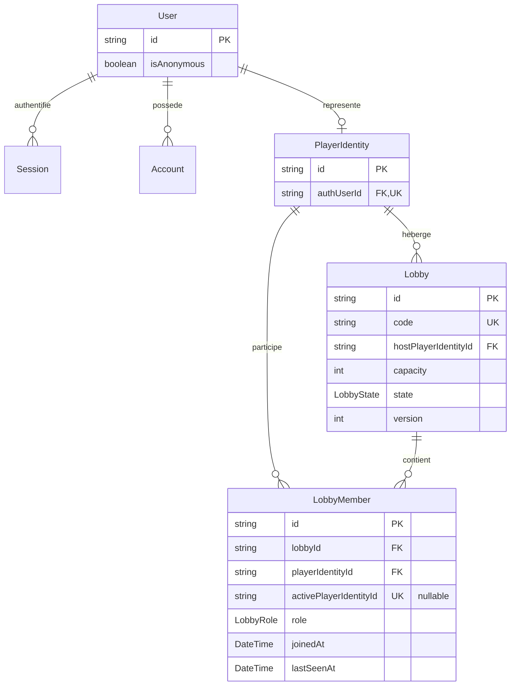
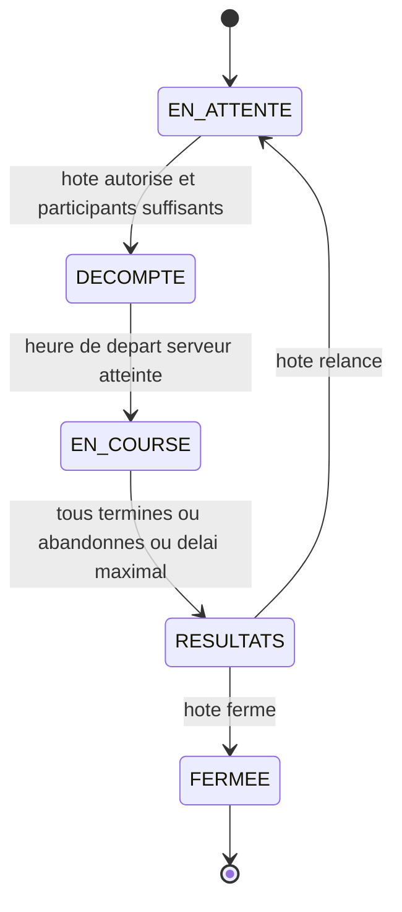

# Architecture et règles de développement

Version initiale du checkpoint 1, 3 octobre 2026. Ce document fixe les frontières à respecter avant toute modification du code. Il ne constitue pas une preuve de fonctionnalité livrée : le statut de chaque exigence appartient à [EXIGENCES.md](EXIGENCES.md), les contrôles réellement exécutés à `docs/verification.md`.

## 1. Références et périmètre

Le projet est un **monolithe modulaire Next.js App Router**, en TypeScript strict, avec Better Auth, Prisma et PostgreSQL. L'interface reste simple : démontrer les opérations réelles avant d'élargir le design ou le jeu.

La structure reprend [l'architecture de Type](https://github.com/Ap0llonn/Type/blob/eb3cbf0943a227d66e8e53ba2d2988d777e4d19c/tempo/docs/architecture.md), vérifiée avec son code à la révision `eb3cbf0943a227d66e8e53ba2d2988d777e4d19c`. On reprend la séparation routes/composition/modules/shared et l'injection superviseur/repository. On ne copie ni son authentification, ni ses secrets, ni son identité visuelle, ni ses données de démonstration.

Le cahier des charges « Web V — Course de frappe multijoueur en temps réel » et les décisions explicites les plus récentes prévalent sur les anciens documents de planification. En particulier, le checkpoint inclut maintenant création de salle, entrée par code et liste des présents en direct. Les anciennes mentions « contrats de salon seulement », « pas de temps réel » et « FR toujours par défaut » ne définissent plus le périmètre actuel. Toute ambiguïté produit doit être nommée et justifiée dans `EXIGENCES.md`, jamais résolue silencieusement dans le code.

Les modules actuels sont `identity` et `lobby`. Depuis le 8 novembre 2026, `lobby` possède aussi la course humaine, son corpus initial et les six bonus de boîtes mystères : ils partagent les invariants transactionnels de salle. Depuis la demande du 9 novembre, la configuration avancée et les bots de course sont implémentés dans ce module (contrat courant en fin de document) ; graphiques et pages d'historique restent futurs. Les descriptions datées d'octobre ci-dessous sont historiques ; les contrats courants de course et de bonus sont précisés en fin de document.

Le 6 octobre 2026, l’utilisateur demande le vrai lobby et précise ensuite que `/[locale]/play` sert uniquement à rejoindre : un champ de code de six caractères, comme dans la maquette, sans création et sans mention de démonstration. La création est désormais proposée à `/play/create` depuis la décision utilisateur suivante. `/play/player?code=…` valide le code côté serveur, résout l’identité et assemble la session invitée officielle puis l’adhésion lobby réelle ; `/play/room` affiche la salle active et sa présence HTTP/SSE. Le format alphanumérique de la maquette et de `SALLE-02` est conservé. La course, les bots, les bonus et la configuration restent futurs.

### Audit borné de la référence Type

L’audit porte sur les fichiers versionnés à `eb3cbf0943a227d66e8e53ba2d2988d777e4d19c`, dont l’arbre récursif complet compte 268 entrées, sans extrapolation aux services externes éventuels :

- **CI absente du dépôt :** aucun workflow GitHub Actions ni autre pipeline dans l’[arbre épinglé](https://github.com/Ap0llonn/Type/tree/eb3cbf0943a227d66e8e53ba2d2988d777e4d19c). Les commandes locales de [package.json](https://github.com/Ap0llonn/Type/blob/eb3cbf0943a227d66e8e53ba2d2988d777e4d19c/tempo/package.json) ne prouvent pas une exécution automatique.
- **Migrations Prisma absentes :** le [dossier Prisma](https://github.com/Ap0llonn/Type/tree/eb3cbf0943a227d66e8e53ba2d2988d777e4d19c/tempo/prisma) contient uniquement le schéma ; le chemin déclaré dans [prisma.config.ts](https://github.com/Ap0llonn/Type/blob/eb3cbf0943a227d66e8e53ba2d2988d777e4d19c/tempo/prisma.config.ts) n’est pas une migration livrée.
- **Serveur WebSocket réel absent :** [realtime/server.ts](https://github.com/Ap0llonn/Type/blob/eb3cbf0943a227d66e8e53ba2d2988d777e4d19c/tempo/src/realtime/server.ts) est un placeholder avec `export {}` ; ses sous-dossiers n’ont que des `.gitkeep`. La [page multijoueur](https://github.com/Ap0llonn/Type/blob/eb3cbf0943a227d66e8e53ba2d2988d777e4d19c/tempo/src/composition/multiplayer/multiplayer-page.tsx) est aussi un placeholder. Aucune dépendance WebSocket directe ou commande de serveur de jeu n’est déclarée ; une bibliothèque ou un client ne suffirait pas à prouver le serveur.
- **FR/EN réutilisable :** [routage next-intl](https://github.com/Ap0llonn/Type/blob/eb3cbf0943a227d66e8e53ba2d2988d777e4d19c/tempo/src/shared/presentation/i18n/routing.ts), [messages partagés](https://github.com/Ap0llonn/Type/blob/eb3cbf0943a227d66e8e53ba2d2988d777e4d19c/tempo/src/shared/presentation/i18n/messages.ts) et [sélecteur de langue](https://github.com/Ap0llonn/Type/blob/eb3cbf0943a227d66e8e53ba2d2988d777e4d19c/tempo/src/shared/presentation/components/navigation/language-switcher.tsx) donnent une référence de locales explicites, cookie et conservation chemin/paramètres/fragment. Le repli anglais de Type est remplacé ici par le repli français requis.
- **Thème sombre fixe :** le [CSS global](https://github.com/Ap0llonn/Type/blob/eb3cbf0943a227d66e8e53ba2d2988d777e4d19c/tempo/src/app/globals.css) impose `color-scheme: dark` et une palette sombre. Ce n’est pas un sélecteur clair/sombre ; le choix système et la préférence persistante sont réalisés séparément dans ce projet.

## 2. Répartition des fichiers

```text
src/
  app/                              Routes, layouts, metadata, redirects, fallbacks
  composition/
    home/ auth/ lobby/ site/ play/  Pages assemblées et workflows intermodules
  modules/
    identity/                       Identité applicative et pont vers Better Auth
    lobby/                          Salles, adhésions, rôles et règles de présence
      public.ts                     Exports de types partageables uniquement
      server.ts                     Façade serveur publique et parseurs serveur
      container.ts                  Câblage privé des dépendances
      contracts/                    Entrées, sorties, schémas de validation
      domain/                       Types, invariants et fonctions métier
      supervisors/interfaces/       Contrat des cas d'utilisation
      supervisors/implementations/  Règles métier et orchestration du module
      repositories/interfaces/      Contrat de persistance sans fournisseur
      repositories/implementations/ Adaptateurs Prisma et transactions
      infrastructure/               Adaptateurs propres au module
      presentation/                 Formulaires, composants et actions du module
  shared/
    contracts/                      OperationResult et types vraiment transverses
    infrastructure/                 DB, configuration, environnement, moteur auth
    presentation/                   UI générique, i18n, thèmes et styles
prisma/                             Schéma, migrations versionnées et seed
tests/                              Unitaires, intégration et navigateur
```

Créer un fichier parce qu'une opération en a besoin, jamais pour remplir cette arborescence. Ne pas ajouter une couche globale `services/`, un conteneur DI générique, un bus d'événements ou un repository générique sans besoin démontré.

## 3. Règles d'import obligatoires

| Emplacement | Dépendances autorisées | Interdit |
| --- | --- | --- |
| `app` | composition, adaptateurs de transport, infrastructure de framework | Règles métier et requêtes Prisma |
| `composition` | `shared`, API publique de plusieurs modules | Containers, repositories et implémentations de superviseurs |
| Module | Ses propres fichiers, `shared` compatible avec sa couche | Autre module, `composition`, `app` |
| `shared` | Autres fichiers partagés et bibliothèques | Tous les modules, `composition`, `app` |
| Superviseur | Contrats/domain du module, interfaces repository, contrats partagés | Next.js, React, Prisma, Better Auth, transport, variables d'environnement |
| Repository concret | Interface propre, mapping domain, infrastructure DB | HTTP, UI, session utilisateur, autre module |

Ces interdictions incluent les imports de types, réexports, imports dynamiques et chemins relatifs contournant les alias.

### Entrées publiques

- `public.ts` exporte uniquement des types sûrs pour le navigateur. Aucun singleton, secret, Prisma ou accès réseau.
- `server.ts` porte `import 'server-only'`. Il expose les opérations publiques typées, les schémas/parseurs nécessaires à la composition et les adaptateurs serveur prévus. Il utilise le container ; les consommateurs ne le font pas.
- `container.ts` est serveur et privé. Il construit repositories et superviseurs, les type par leurs interfaces, et n'exécute aucun workflow.
- Un composant ou une action dans `presentation/` peut être une entrée publique explicitement utilisée par la composition. Cela n'autorise pas les autres imports profonds.
- Les actions serveur sont dans des fichiers dédiés avec `'use server'`. Un composant client peut appeler une action, jamais importer une façade `server.ts` ou un container.
- Les adaptateurs DB/session/configuration sont serveur uniquement. Exception explicite : `identity/infrastructure/auth-client.ts` encapsule le client navigateur officiel Better Auth et ne doit importer aucune configuration serveur.

Conventions : chemins en `kebab-case`, types/interfaces/classes en `PascalCase`, fonctions/variables en `camelCase`. Employer `IdentitySupervisor`, `PlayerIdentityRepository`, `DefaultIdentitySupervisor`, `PrismaPlayerIdentityRepository`, plutôt que des préfixes variables `i` ou des classes en minuscules. Les contrats d'entrée finissent par `Input`, les réponses décrivent le résultat, les méthodes par un verbe. Éviter `utils.ts` ou `manager.ts` sans responsabilité précise.

## 4. Exécuter une opération

```text
Une opération d'un seul module
  page de composition → action du module → superviseur → interface repository
                                                           ↑
                                                  implémentation Prisma

Un workflow intermodules
  route/action/adaptateur temps réel → composition → identity/server
                                                  → lobby/server
```

Le superviseur dépend de l'interface injectée, jamais du repository concret. La composition porte l'ordre entre modules et le mapping de leurs contrats ; les règles de chaque domaine restent dans son superviseur. Un changement de transport ne déplace aucune règle métier.

### Exemple sans ambiguïté : créer une salle

1. Le formulaire de composition envoie uniquement les réglages de la salle. Aucun `playerIdentityId`, statut de compte ou droit d'hôte reçu du navigateur n'est accepté comme identité.
2. L'adaptateur HTTP/action valide l'entrée avec le schéma lobby exposé par `lobby/server.ts` et obtient les headers/cookies de la requête réelle.
3. `composition/lobby` appelle `getCurrentActor` depuis `identity/server.ts`. Cette façade lit la session serveur, puis résout l'identité applicative.
4. Si le résultat est un échec, le workflow le retourne immédiatement. Sinon, il construit un `LobbyActor` appartenant au module lobby depuis l'acteur vérifié, puis appelle son API publique serveur.
5. Le superviseur lobby refuse les invités pour la création, valide les règles métier, puis invoque l'interface repository. Il n'importe jamais `identity`.
6. Le repository crée salle et adhésion hôte atomiquement. L'hôte compte dans la capacité seulement s'il a choisi participant. Il retourne le DTO public et sa version après commit.
7. Le transport renvoie ce résultat. L'UI navigue uniquement sur `ok: true`. La liste temps réel relit un état déjà validé/commité.

Pour rejoindre une salle, la même chaîne autorise invité et compte, vérifie code/état/capacité/adhésion existante et retourne la même adhésion pour un deuxième onglet. Aucun `fetch` interne vers ses propres routes HTTP n'est nécessaire entre composition et superviseur.

## 5. Entrées, sorties et erreurs

Toutes les entrées serveur ont un schéma Zod ou équivalent : corps, paramètres, code, query string et commandes temps réel (`TECH-07`). Les schémas appartiennent au module qui possède l'opération ; les superviseurs n'importent jamais un type depuis un formulaire. Le contrôle client améliore l'expérience, mais ne remplace aucun contrôle serveur.

```ts
type OperationResult<T> =
  | { ok: true; value: T }
  | { ok: false; error: { code: ErrorCode; messageKey: `errors.${ErrorCode}` } };
```

La source des codes est `src/shared/contracts/operation-result.ts` : `VALIDATION`, `UNAUTHENTICATED`, `FORBIDDEN`, `CONFLICT`, `NOT_FOUND`, `ROOM_FULL`, `ROOM_CLOSED`, `RATE_LIMITED`, `PROVIDER_UNAVAILABLE`, `INTERNAL`. Ajouter un code exige son traitement exhaustif, ses traductions FR/EN et ses tests. Un booléen ne représente jamais le résultat d'une commande.

- Succès : DTO minimal sérialisable, pas de ligne Prisma complète ni de session/token. Les timestamps lobby (`joinedAt`, `lastSeenAt` interne) sont des nombres en millisecondes Unix ; `Date` reste un détail de l'adaptateur DB. Ne pas mélanger secondes, millisecondes et chaînes ISO dans un même contrat. La version de salle est un entier sérialisable.
- Échec attendu : résultat discriminé stable. Le repository traduit les erreurs fournisseur en erreurs neutres ; le superviseur les interprète dans son opération. Il ne teste aucun code Prisma `Pxxxx`.
- Échec imprévu : erreur générique `INTERNAL` au client et diagnostic expurgé côté serveur. Ne pas transformer une panne en liste vide ou faux succès. Les pages accueil/auth présentent l'échec sans formulaire lorsque l'identité est indisponible ; seul `UNAUTHENTICATED` autorise le parcours de connexion. `ServerConfigurationError` identifie uniquement les noms des variables invalides dans le diagnostic serveur, jamais leurs valeurs.
- Le transport traduit les codes en statuts HTTP cohérents ; il ne réécrit pas les règles. `401` pour session absente, `403` pour droit refusé, `404` pour absent, `409` pour conflit d'état, `429` pour limitation, `500/503` pour panne.
- Les clés sont traduites à la présentation. Jamais de message SQL, stack trace, mot de passe, cookie, token, email ou secret dans les snapshots publics ou logs de routine.

Trois écarts auth de Type sont à éviter : `SignupResult` est importé mais absent de l’interface ; celle-ci annonce `Promise<boolean>`, alors que l’implémentation annonce `Promise<SignupResult>` sans retourner de résultat après création et que l’[action signup](https://github.com/Ap0llonn/Type/blob/eb3cbf0943a227d66e8e53ba2d2988d777e4d19c/tempo/src/modules/auth/presentation/signup/signup-action.ts) attend `created` ; enfin, login peut retourner `false` sans créer de session, mais son action ignore ce retour et redirige, produisant un faux succès apparent. Une opération réussie doit être démontrée par sa branche de résultat. Sources inspectées : [superviseur auth](https://github.com/Ap0llonn/Type/blob/eb3cbf0943a227d66e8e53ba2d2988d777e4d19c/tempo/src/modules/auth/supervisors/implementations/userSupervisor.ts), [interface auth](https://github.com/Ap0llonn/Type/blob/eb3cbf0943a227d66e8e53ba2d2988d777e4d19c/tempo/src/modules/auth/supervisors/interfaces/iUserSupervisor.ts), [action login](https://github.com/Ap0llonn/Type/blob/eb3cbf0943a227d66e8e53ba2d2988d777e4d19c/tempo/src/modules/auth/presentation/login/login-action.ts). La séparation des erreurs du [repository user](https://github.com/Ap0llonn/Type/blob/eb3cbf0943a227d66e8e53ba2d2988d777e4d19c/tempo/src/modules/user/repository/userRepo.ts) et du [superviseur user](https://github.com/Ap0llonn/Type/blob/eb3cbf0943a227d66e8e53ba2d2988d777e4d19c/tempo/src/modules/user/supervisors/userSupervisor.ts) sert de référence pour la frontière fournisseur/métier.

## 6. Authentification et autorisation

Better Auth possède le protocole d'authentification : endpoints officiels, callbacks, cookies, hachage, sessions et protections associées. `app/api/auth/[...all]/route.ts` est l'exception documentée à la chaîne métier : il branche le handler officiel, sans superviseur/repository artificiel. Les formulaires passent par son client encapsulé. Ne jamais recopier le hasher ou les sessions maison de Type.

L'inscription locale demande email, identifiant et mot de passe, selon la décision validée ; la connexion locale utilise identifiant/mot de passe. GitHub **et** Discord sont requis par `AUTH-01`, même si les E2E passent par les comptes locaux (`TEST-03`). Un provider non configuré est signalé comme indisponible ; ce n'est pas une preuve OAuth réussie.

Chaque opération protégée relit une session serveur valide et autorise l'acteur pour la salle demandée. Un layout, un proxy, un bouton caché ou un identifiant client ne sont pas des contrôles d'accès suffisants. L'ouverture d'un stream valide session et adhésion ; les connexions persistantes doivent aussi cesser d'exposer un état après révocation, expulsion ou fermeture.

Un invité possède une vraie session cookie et un pseudo validé de 3 à 20 caractères. Il peut rejoindre, pas créer ; il n'a ni photo ni historique de profil persistant (`AUTH-02/03`). Son identité technique peut survivre à un rechargement sans devenir un historique public. Aucune fusion invité→compte, suppression automatique d'identité invitée ou liaison de comptes par simple égalité d'email. Pas de récupération de mot de passe promise dans ce lot.

Toute mutation réservée à l'hôte est autorisée côté serveur (`SEC-01`). Les mutations cookie-authentifiées vérifient leur origine et ont une protection CSRF adaptée ; la validation Zod seule ne suffit pas. Limiter les tentatives de code côté serveur (`SALLE-10`). Les appels directs à `auth.api` ne doivent pas contourner silencieusement les protections du handler officiel.

Pour `SALLE-10` (#9), la composition HTTP fixe un budget distinct de **10 commandes de création et 10 tentatives d'entrée par IP**, dans une fenêtre fixe de **60 000 ms depuis la première tentative**. L'infrastructure HTTP générique dans `shared` possède le compteur PostgreSQL atomique ; le module lobby conserve les règles de salle. La onzième tentative retourne `OperationResult` avec `RATE_LIMITED`, `errors.RATE_LIMITED` et HTTP 429. Les saisies invalides et codes inconnus consomment le budget après contrôle d'origine/session ; changer de code, session ou onglet ne le réinitialise pas. Les refus ne repoussent pas la fin de fenêtre, et le budget repart à exactement 60 000 ms. Lecture de salle, départ, SSE et heartbeat n'utilisent pas ce budget, afin de préserver la présence (#10). Le proxy doit écraser `X-Forwarded-For` ; sans en-tête, les appels partagent le budget `unknown`. Politique et limites d'exploitation : [ADR 0001](adr/0001-data-realtime.md).

## 7. Transactions et modèle de données

Le schéma exécutable est `prisma/schema.prisma`, accompagné de migrations versionnées. Ne pas maintenir un second schéma SQL divergent. Le diagramme ci-dessous décrit les relations du socle ; les noms finaux de champs sont ceux du schéma. `Verification` est géré par Better Auth selon son contrat et n'est pas relié artificiellement à un utilisateur.



Règles de stockage :

- `PlayerIdentity.authUserId` est unique ; la résolution concurrente du même utilisateur donne la même identité via upsert puis relecture du gagnant en cas de collision unique concurrente. Les autres erreurs restent des échecs.
- Le code de salle est unique, de six caractères alphanumériques excluant `0 O 1 I L`. Les collisions sont réessayées de façon bornée et sûre, avec une nouvelle transaction après rollback. Ne pas confondre collision de code et conflit d'adhésion : ce dernier ne se réessaie pas avec un autre code.
- Une adhésion représente une identité humaine, avec rôle participant/spectateur et ordre d'arrivée. La clé unique `(lobbyId, playerIdentityId)` empêche les doublons. `LobbyMember.activePlayerIdentityId`, unique et nullable, vaut l'identité pour une adhésion active et `null` quand elle ne l'est plus : elle garantit au plus une salle active par personne (`SALLE-06`). Le repository construit cette valeur depuis l'identité vérifiée, jamais depuis l'entrée client. Un simple `find` avant `insert` ne suffit pas.
- Créer salle+hôte, rejoindre avec contrôle de capacité, quitter avec transfert/fermeture et modifier la version de salle sont des opérations atomiques du repository lobby. Verrouillage ou isolation adéquate protège les dernières places contre les requêtes concurrentes.
- `LobbyBan` conserve l'interdiction d'entrée d'une identité dans une salle après expulsion (`SALLE-07`), avec unicité `(lobbyId, playerIdentityId)`. Retirer l'adhésion active, créer cette interdiction et incrémenter la version appartiennent à la même transaction verrouillée ; une entrée concurrente ne peut réactiver une personne expulsée. Cette donnée interne n'apparaît jamais dans `LobbySnapshot`.
- La capacité est de 2 à 30 **participants**, spectateurs exclus. Le propriétaire peut être spectateur ; son rôle d'hôte est indépendant.
- Le départ volontaire de l'hôte transfère à l'humain authentifié présent depuis le plus longtemps, participant ou spectateur ; sinon il ferme la salle. Une coupure réseau n'est pas immédiatement un départ volontaire.
- Le propriétaire de l'agrégat possède sa transaction. Ni la route ni la composition ne reçoit un `Prisma.TransactionClient`. Ne pas passer un client DB entre modules.
- Si un futur workflow doit écrire dans plusieurs modules, documenter atomicité, idempotence et compensation avant de coder. Une transaction d'un module ne garantit pas le commit d'un autre ; aucune infrastructure de saga/outbox n'est ajoutée sans ce besoin.

La course humaine courante est un agrégat JSON validé dans `Lobby.race`, avec texte, configuration, roster figé, compteur de séquence et frappes. `Lobby.raceSettings` conserve les réglages d'attente ; `PracticeText` possède le corpus initial et sa provenance. `RaceResult` conserve seulement les résultats des comptes humains et leurs échantillons MPM. Le modèle futur de bots, bonus et historique complet reste à développer ; aucun compte d'authentification bot n'est ajouté.

## 8. Machine à états de course

Contrat exigé par `COURSE-01`, implémenté pour les courses humaines le 8 novembre 2026. Les variantes bots/bonus restent futures.



Le contrat `LobbyState` utilise `WAITING`, `COUNTDOWN`, `RACING`, `RESULTS`, `CLOSED`, correspondant respectivement à `EN_ATTENTE`, `DÉCOMPTE`, `EN_COURSE`, `RÉSULTATS`, `FERMÉE`. Le diagramme omet seulement les accents dans ses identifiants Mermaid. Les valeurs techniques ne sont jamais dérivées des traductions.

Le serveur déclenche le décompte seulement avec au moins deux participants dont un humain ; les bots comptent, les spectateurs non. Le texte n'est révélé qu'au début du décompte de trois secondes. Rejoindre est permis seulement en attente ou aux résultats. Les temps, progrès, classement et bonus restent autoritaires serveur. Une reconnexion dans les 30 secondes reprend la même place ; au-delà, le participant est abandonné (`COURSE-02/03/06/08/09`). Les fermetures administratives et absences d'hôte sont des événements de cycle de vie de salle, à distinguer du chemin normal de course.

## 9. ADR initial du temps réel

**Décision S1 :** commandes HTTP même origine et instantanés serveur via SSE sur un processus Next.js persistant hébergé sur VPS. Les ticks SSE observent sans renouveler la présence ; un heartbeat POST du navigateur renouvelle uniquement son adhésion vérifiée toutes les cinq secondes, avec timeout quatre secondes et arrêt à la sortie. Les seuils dix/trente secondes sont communs dans `lobby/contracts/presence.ts`. Voir le correctif de sémantique [ADR 0002](adr/0002-client-presence.md). `TECH-06` autorise cette technologie. Le détail opérationnel est consigné dans [ADR 0001](adr/0001-data-realtime.md).

**Pourquoi :** le checkpoint requiert une liste de présents partagée, pas encore un moteur de course bidirectionnel. SSE fournit un canal serveur→navigateur et une reconnexion native, sans service externe payant. HTTP garde des commandes explicites validables/testables. Une Server Action ne porte pas une connexion persistante.

**Alternatives :** le polling HTTP simple multiplie les requêtes et retarde l'affichage ; WebSocket autorise les échanges bidirectionnels fréquents mais demande son propre protocole et sa gestion de reconnexion. Il reste une option à mesurer pour la course, pas une dépendance ajoutée préventivement.

```text
Navigateur → commande HTTP → composition/lobby → façades → transaction PostgreSQL
Navigateur ← snapshot SSE  ← composition/lobby ← état commité et version de salle
```

Le transport SSE possède connexion, encodage, nettoyage et contrôle du débit ; la composition résout l'acteur et appelle les cas métier. Il ne lit ni repository ni Prisma et n'importe pas les modules entre eux. L'événement contient un DTO sûr et une version monotone. Le client remplace son état par l'instantané ; il ignore une version antérieure et redemande un instantané complet à la reconnexion/trou, sans considérer un accusé client comme état de référence.

**Conséquences et limites à tester :** cookies/session revalidés, plusieurs onglets sans doublon, présence expirée, ressources libérées à déconnexion, absence de cache/buffering proxy, reprise après redémarrage et limites de connexion. PostgreSQL, pas un `Map` mémoire, est l'autorité partagée. Les délais de rafraîchissement et de présence sont nommés/configurés/testés, jamais cachés dans plusieurs timers. Un flux construit en relisant périodiquement la DB reste du polling côté serveur et son coût doit être mesuré. Le futur rythme de course doit atteindre environ quatre mises à jour perçues par seconde (`COURSE-05`) : la validation du roster S1 ne démontre pas cette performance.

## 10. Approche prévue pour les bots

**Décision de conception future, pas moteur implémenté :** simulation pure déterministe dans le domaine de course, appelée par l'horloge serveur. Chaque course persiste sa seed, la version de l'algorithme et sa configuration. Chaque bot dérive un sous-flux pseudo-aléatoire stable ; aucune dépendance métier à `Math.random()`, au navigateur ou à l'heure murale.

Une fonction de transition reçoit l'état du bot, le texte, le temps logique écoulé et la configuration. Elle produit le nouvel état/progrès et les événements. À entrées identiques, la sortie est identique (`BOT-05`). Le calcul par pas temporels définis évite de changer le résultat selon la fréquence réseau.

Les cinq niveaux règlent des plages de vitesse et probabilités d'erreur documentées (`BOT-01`). Accélérations, hésitations et mots difficiles font varier la vitesse ; les erreurs ajoutent un temps de correction conforme au mode de frappe (`BOT-02/03`). Bots identifiés dans l'UI et mêmes règles de bonus/malus que les humains (`BOT-04`). L'état public n'expose que le résultat serveur, jamais une simulation faisant autorité chez le client.

Tests futurs : rejouer une seed, comparer plusieurs découpages de temps, vérifier les bornes et erreurs de chaque niveau, pause/reprise, mêmes bonus et classement. Ne pas inventer une identité Better Auth pour un bot. Si un module `race` ou `bots` devient nécessaire, le relier par composition et contrats publics, jamais par import direct depuis `lobby`.

## 11. UI, langues et contraintes transversales

- Tailwind CSS est requis (`TECH-03`). Les éléments restent accessibles, clavier/mobile, avec états pending/erreur/vide réels. Aucun bouton factice.
- `next-intl` porte `/fr` et `/en`. La sélection explicite persistée prime ; sinon utiliser la langue navigateur parmi FR/EN, avec repli FR pour les langues non prises en charge (`I18N-02`). La langue du texte de course est indépendante de celle de l'UI (`CONF-02`).
- Tous les libellés, erreurs, états vides et métadonnées sont traduits ; nombres/dates passent par le formatage localisé. Aucun texte UI métier codé en dur.
- `next-themes` porte clair/sombre persistant, avec préférence système au premier accès (`DES-05`) ; éviter flash du mauvais thème et divergences d'hydratation du sélecteur. L'adaptateur `shared/presentation/theme/provider.tsx` conserve le bootstrap exécutable en SSR et pendant l'hydratation initiale, puis le rend inerte lors des remontages client ; les effets officiels continuent d'appliquer le thème.
- Le nom et le logo finaux doivent venir de l'étudiant sans IA (`DES-01/02`). Aucun agent ne les invente, ne génère des croquis ou ne présente un placeholder comme identité finale.
- Versions exactes, lockfile pnpm et Node versionnés. Variables dans `.env.example`, secrets hors Git. PostgreSQL jetable pour les tests ; ne jamais réinitialiser une base non explicitement dédiée aux tests.

La configuration de déploiement (`DOC-S1-DEPLOY`, `DOC-FINAL-README`) appartient à l’infrastructure, sans règle métier ajoutée aux modules : `compose.production.yaml` relie explicitement `app` au réseau externe existant `dokploy-network` pour résoudre les hôtes internes des bases Dokploy. `DATABASE_URL` utilise les paramètres internes exacts de la base sur ce réseau. `infra:validate` contrôle le Compose résolu avec des exemples publics ; la connectivité réelle de production reste une preuve distincte. Voir le [guide Dokploy et diagnostic DNS](DEVELOPPEMENT-LOCAL.md#production-avec-dokploy).

Le 7 octobre 2026, après une erreur de table absente signalée par l’utilisateur dans Dokploy, le correctif remplace la migration manuelle documentée par une migration automatique au démarrage de l’image de production : le `CMD` du `Dockerfile` applique les migrations versionnées avec `prisma migrate deploy` avant de lancer Next.js. Un échec interrompt cette chaîne. Le build conserve son URL factice et génère seulement le client Prisma ; aucune mutation DB ne lui appartient. Ce changement reste dans l’infrastructure de livraison, sans déplacement de règles ni modification de migrations existantes.

### Historique : présentation rétro arcade — 4 octobre 2026

La seconde maquette de cette conversation a été approuvée par l’utilisateur, puis demandée en frontend. Elle remplace la direction visuelle provisoire neutre, sans changer le périmètre métier S1. `shared/presentation/ui` possède les primitives génériques Button (type button par défaut), Card, Badge, Field/Input/Select, Icon, Brand, AuthLayout, SiteNavigation, SiteFooter et Shell. Les champs et boutons de soumission métier restent dans identity/lobby ; les submit portent explicitement leur type. `composition/site/SiteLayout` résout l’identité réelle et injecte les contrôles de compte au shell générique. `app/[locale]/layout.tsx` conserve locale/providers et délègue cet assemblage. Les boutons langue conservent chemin, query et fragment ; les thèmes continuent d’utiliser le provider existant.

L’accueil anonyme garde deux entrées visuelles, mais demande la session invitée avant le code et la connexion d’un compte avant la création ; les vrais champs nom, capacité et rôle restent disponibles aux comptes. L’illustration clavier est un SVG décoratif, pas un logo. Le PNG CLAK! fourni par l’utilisateur est copié sans modification dans `public/brand/clak-logo.png`, utilisé par Brand dans la navigation et le footer. L’intégration ne certifie ni la provenance personnelle sans IA, ni l’originalité du nom, ni les croquis ou le favicon requis par DES-01/02. Les deux catalogues et les tokens clair/sombre portent la nouvelle présentation.

### Présentation actuelle : terrain de jeu des claviers — 4 octobre 2026

La demande utilisateur suivante remplace explicitement la direction rétro arcade par une interface ludique inspirée de Kahoot, avec recherche de références, composants réutilisables et illustrations originales. Le [contrat de refonte](ui-playful.md) a été rédigé avant cette réalisation ; le [moodboard, la palette et les typographies](DEMARCHE-CREATIVE.md) consignent les choix et la chronologie sans les attribuer au socle initial. Le thème « terrain de jeu des claviers » décrit la présentation, pas un nouveau nom ou logo. Le PNG CLAK! reste inchangé.

`shared/presentation/ui` conserve les primitives existantes et possède `ActionHeading` (en-tête d’action), `DecorativeImage` (images décoratives sans information nécessaire aux formulaires) et `AuthLayout` (introduction illustrée et panneau de formulaire). `composition/home/HowItWorks` assemble une aide en trois étapes traduites pour les parcours de salle existants. Les formulaires restent dans identity/lobby ; la composition conserve l’identité réelle et les workflows. Aucun contrat serveur, invariant de salle ou transport ne change.

Les illustrations `public/illustrations/keyboard-playground.png` et `keycap-friends.png` ont été générées avec `image_gen`. Ce sont des décors de clavier, pas des logos, favicons ou croquis de marque. Les icônes simples restent des SVG. La police variable Nunito, issue du [dépôt officiel Google Fonts](https://github.com/google/fonts/tree/main/ofl/nunito), est auto-hébergée dans `public/fonts/nunito-variable.ttf` avec sa licence SIL OFL 1.1 dans `public/fonts/OFL.txt` ; le layout de locale la fournit via `--font-nunito`. Les codes de salle conservent une police monospace.

`shared/presentation/styles/tokens.css` porte les surfaces crème/encre, le bleu électrique, le jaune, le corail et la menthe, ainsi que les états clair/sombre, le focus et la réduction de mouvement. Les catalogues FR/EN portent les nouveaux textes. Les vérifications de cette refonte doivent être consignées séparément dans [verification.md](verification.md) : les résultats de la version rétro arcade ne constituent pas une preuve de cette nouvelle présentation. Course, piste de progression, bonus et bots restent futurs.

### Décomposition des composants et menus — 4 octobre 2026

La demande suivante remplace le sélecteur de rôle natif et extrait les blocs de présentation. `shared/presentation/ui/Select` est un contrôle générique avec options non vides, label, nom, valeur initiale et état désactivé. Le bouton combobox commande une liste DOM stylée, avec identifiants par instance, focus conservé, flèches, Home/End, recherche par caractères, Entrée/Espace/Tab et Échap. Un input masqué transmet la valeur du champ à `FormData` ; aucune validation métier n'est déplacée dans ce contrôle. Le menu choisit de s’ouvrir au-dessus ou au-dessous selon l’espace disponible. `LanguageSwitcher` et `ThemeSwitcher` encapsulent les interactions existantes des providers.

`composition/home/HomeEntryCards` assemble les cartes anonymes. `identity/presentation/GuestNameField`, `CredentialFields` et `SocialSignInButtons` affichent les champs et providers ; `AuthForm` conserve verrou, état, protocole Better Auth, erreurs et navigation. `lobby/presentation/LobbyRoleField` fournit les deux rôles traduits au Select partagé. `JoinRoomCard` et `CreateRoomCard` transmettent un `FormData` au callback du parent ; `GuestCreateCard` affiche la restriction réelle. Capacité et rôle passent sur deux colonnes seulement quand l’intérieur de la carte atteint 400 px (container query), afin de conserver la place du libellé et du chevron sur tablette. `ActiveRoomCard` reçoit snapshot, état de connexion, pending et callback de sortie. `LobbyPanel` conserve les payloads HTTP, erreurs, récupération de conflits, heartbeat et stream. Aucun contrat public serveur, transport, invariant DB ou migration ne change. Les tests de menu et formulaires, ainsi que les contrôles finaux, sont consignés dans [verification.md](verification.md).

### Prototype isolé de salon — 5 octobre 2026

#### Première version validée, parcours remplacé par la correction suivante

`app/[locale]/play/page.tsx` délègue uniquement à `composition/play/PlayPage`. Le layout `app/[locale]/layout.tsx` conserve HTML, locale, Nunito et providers langue/thème. Le groupe `app/[locale]/(site)` possède désormais le layout déléguant à `composition/site/SiteLayout` et les routes accueil/login/signup : le groupe ne change pas leurs URLs. La page `/play` reste hors de ce groupe et reçoit son propre shell dans `PlayPage`, avec logo fourni, badge de démonstration, sélecteurs langue/thème, lien d’évitement, main et note de démonstration. Elle ne passe pas par la résolution d’identité du shell réel.

La composition assemble l’entrée publique `lobby/presentation/RoomPreview` et les primitives partagées ; `shared/presentation/styles/play-preview.css` porte les styles de cet écran. `RoomPreview` conserve uniquement l’état React jetable : nom de salle saisi, brouillon de pseudo et style, puis un joueur local confirmé. `PreviewRoomEntry`, `PreviewPlayerEditor`, `PreviewPlayerRoster`, `PreviewAvatar` et `PreviewRaceSettings` sont les composants de présentation du module, reliés par props et callbacks typés. Aucun container, superviseur, repository, appel aux API auth/lobby, stream SSE ou persistance n’est ajouté au prototype.

Le premier formulaire demande un nom de salle de 1 à 60 caractères, puis le salon permet de choisir un pseudo de 3 à 20 caractères après trim et un des quatre styles `cobalt`, `coral`, `mint` ou `butter`. Les avatars sont des SVG décoratifs ; des radios natives et leurs libellés traduits portent le choix. Confirmer ajoute un seul joueur local aux quatre fixtures explicitement marquées comme exemples ; enregistrer remplace cette même entrée, sans doublon. Sortir efface l’état de la maquette. Le décor `public/illustrations/typing-clubhouse.png`, généré avec `image_gen`, est une scène sans texte ni joueur, avec provenance dans `public/illustrations/README.md`. Le nom et le logo fournis ne sont pas générés ou modifiés.

Ces choix divergent volontairement du parcours livré : le **nom** remplace le code uniquement dans la maquette, alors que `SALLE-02` impose toujours un code unique de six caractères dans le vrai salon ; le pseudo est demandé **après** cette entrée visuelle, alors que `AUTH-02` impose une vraie session invitée et le pseudo avant l’adhésion réelle. Les valeurs de langue, longueur, difficulté et bonus affichées par `PreviewRaceSettings` sont des exemples fixes, sans édition ni moteur de course. Le prototype ne réalise ni configuration `CONF-02/04/05/09`, ni course, bonus, bots ou présence réelle.

Pour cette première version, `tests/e2e/play-preview.spec.ts` couvrait une recette limitée à l’entrée et au salon locaux : FR/EN, thèmes clair/sombre, navigation clavier des styles et focus, validation du pseudo, ajout/modification sans doublon, remise à zéro, absence d’appels API et de cookies Better Auth, débordements et axe aux largeurs 360/820/1440 px. Le 5 octobre 2026, les six nouveaux scénarios et les 25 régressions existantes ont passé dans la suite de **31 E2E** de production. Lint, types stricts, frontières, **58 unitaires / 16 fichiers**, **20 intégrations / 11 fichiers** sur PostgreSQL 18.4 jetable avec migrations et replay, ainsi que le build de production ont également passé. Les captures desktop et mobile sombre ont été inspectées ; les preuves et leurs limites sont consignées dans le [rapport daté](verification.md#salon-de-démonstration--5-octobre-2026-historique-avant-pages-dédiées). Ces résultats sont historiques et ne valident pas la correction du parcours décrite ci-dessous.

#### Correction du parcours en trois pages — 5 octobre 2026

La demande utilisateur suivante remplace explicitement l’entrée par **nom de salle** par un **code de six caractères**, suivant l’alphabet du parcours réel, sans `0`, `O`, `1`, `I` ou `L`. Elle sépare le choix du pseudo et du personnage du salon : `/[locale]/play` affiche le code, `/[locale]/play/player` porte la préparation ou la modification du joueur, et `/[locale]/play/room` affiche la scène, la liste et les réglages fixes. Le salon ne contient plus le formulaire de pseudo/styles : son bouton **Modifier** ramène à la page du joueur. La divergence documentée précédemment pour le nom de salle est donc abandonnée ; aucune existence ou unicité de salle n’est vérifiée par cette saisie de démonstration.

Le montage place le shell dans le layout imbriqué `app/[locale]/play/layout.tsx`, délégué à `composition/play/play-layout.tsx`. Les routes `play/page.tsx`, `play/player/page.tsx` et `play/room/page.tsx` délèguent respectivement à `composition/play/play-page.tsx`, `player-page.tsx` et `room-page.tsx`. Cette composition assemble les entrées publiques de présentation de lobby : `room-preview-provider.tsx` possède le contexte client en mémoire ; `preview-code-page.tsx`, `preview-player-page.tsx` et `room-preview.tsx` portent les trois vues et réutilisent les composants de champ, éditeur, liste et réglages. Le provider demeure monté entre les navigations client sous ce layout et conserve code et joueur confirmé. Le groupe `(site)` et la résolution de session des parcours réels restent séparés. Aucun état de joueur n’est conservé dans un stockage navigateur, cookie, URL ou base de données ; le rechargement ou la sortie efface la maquette.

Un lien direct vers la préparation ou le salon sans code renvoie à `/play` dans la locale courante. Avec un code mais sans joueur confirmé, l’accès au salon renvoie à `/play/player`. Ces redirections guident la maquette et ne sont pas un mécanisme d’autorisation serveur. La page du joueur conserve le pseudo de 3 à 20 caractères après trim et les quatre styles `cobalt`, `coral`, `mint`, `butter`. En modification, le formulaire est prérempli depuis le joueur confirmé ; annuler restitue ce joueur inchangé, enregistrer remplace sa seule ligne locale puis retourne au salon. Les fixtures et le résumé des réglages restent explicitement des exemples.

Cette correction conserve l’exception de présentation autorisée : aucun compte, session Better Auth, appel API métier, DB, transport SSE ou moteur de course n’est ajouté. Le pseudo intervient après la saisie du code de démonstration, sans adhésion réelle ; `AUTH-02` continue d’exiger une session et un pseudo avant l’adhésion du parcours réel. Les statuts `SALLE`, `AUTH`, `CONF`, `COURSE`, `BONUS` et `BOT` ne sont pas relevés.

Le 5 octobre 2026, la correction passe lint, frontières, **58 unitaires**, **20 intégrations / 11 fichiers**, le build de production avec les trois routes et **33 E2E / 33** : huit scénarios de démonstration et 25 régressions existantes. La recette vérifie code, routes, accès directs, navigation, modification/annulation, reset au rechargement et à la sortie, clavier/focus et absence d’activité auth/lobby ; ses **36 combinaisons axe** couvrent les trois pages × FR/EN × clair/sombre × 360/820/1440 px. L’inspection CUA confirme les trois étapes, le formulaire prérempli en modification et le salon à 1440 et 360 px, avec thème sombre conservé ; les captures correspondantes sont enregistrées. Le contrôle de types autonome passe après régénération du seul cache `.next/dev/types` ; les imports initiaux de `next-env.d.ts`, le code source, `tsconfig.json` et le build de production restent inchangés. Le [rapport courant](verification.md#parcours-code-et-joueur-sur-pages-dédiées--5-octobre-2026) et l’[inspection du parcours à trois pages](play-preview.md#inspection-du-parcours-à-trois-pages) portent cette preuve ; les 31 E2E précédents restent historiques.

### Parcours de connexion à une salle — 6 octobre 2026

La correction utilisateur remplace le premier montage de `LobbyPanel` dans `/play` : cette route doit rester une entrée par code uniquement, sans formulaire de création ni résolution de session préalable. `composition/play/PlayPage` réutilise le champ et les styles de la maquette ; le code normalisé est transmis à `/play/player?code=…` sans création d’identité ni adhésion à ce stade. Le schéma serveur valide aussi le paramètre sur la page du joueur ; un paramètre absent, dupliqué ou invalide revient à `/play`.

`composition/play/PlayerPage` lit l’acteur réel. Un invité sans session choisit son pseudo dans `identity/presentation/AuthForm`, qui appelle le protocole Better Auth officiel. Son callback de succès permet à `composition/play/JoinPlayerForm` d’appeler la commande publique de présentation lobby. Un acteur déjà connecté confirme simplement l’adhésion. La composition coordonne les deux modules ; les modules ne s’importent pas. L’entrée se fait comme participant. L’accès spectateur reste disponible dans le parcours de l’accueil.

La navigation vers `/play/room` suit uniquement une adhésion réussie. Un code absent ou une salle pleine/fermée reste un échec traduit ; aucun faux joueur n’est ajouté. Un conflit avec une salle existante propose de revenir à cette salle, sans départ automatique. `RoomPage` résout encore l’acteur serveur et monte `LobbyPanel` en mode salle uniquement : salle active, roster serveur, heartbeat, snapshots SSE, sortie explicite vers `/play`. Ni création ni fixtures n’y sont affichées. Le rechargement relit la session et l’état PostgreSQL.

Le shell de `/play` conserve la présentation compacte, la marque fournie, les langues et les thèmes ; le badge et la note de démonstration sont retirés. Les liens du shell principal s’appellent désormais « Rejoindre ». Les anciens fichiers de maquette non montés ont été retirés pendant le rangement ci-dessous ; `play-preview.md` et leurs preuves restent historiques et ne valident pas le parcours réel. La recette courante est consignée dans `verification.md`.

### Organisation de la présentation lobby — 6 octobre 2026

Le rangement demandé par l’utilisateur rattache les fichiers aux responsabilités de `TECH-01/02`, tout en conservant le parcours code/pseudo/salle et les contrats `JOIN`, `SALLE` et présence. Les fichiers de maquette non montés sont supprimés, plutôt que déplacés dans une seconde implémentation de salon.

```text
modules/lobby/presentation/
  entry/
    room-code-entry.tsx + .css    Entrée publique de /play, code uniquement
    create-room-card.tsx          Formulaire de création dédié
    create-room-panel.tsx         Commande et navigation de /play/create
    lobby-role-field.tsx          Champ participant/spectateur
  room/
    lobby-room.tsx                Page de lobby avec scène et code
    lobby-roster.tsx              Présentation des membres réels
    use-lobby-room.ts             Cycle client : lecture, commandes, SSE, heartbeat
    lobby-view-state.ts           Ordre des snapshots et récupération des conflits
  transport/
    lobby-command.ts             Entrée publique navigateur de commande HTTP
    lobby-heartbeat.ts           Transport et arrêt du heartbeat
```

La composition importe les composants publics `entry/room-code-entry` et `room/lobby-panel`, ou `transport/lobby-command` pour coordonner l’adhésion après Better Auth. Elle ne consomme pas le hook ni le reducer privés. `LobbyPanel` garde l’assemblage et la navigation après départ ; `useLobbyRoom` porte l’état client et le nettoyage des connexions. Ses commandes retournent `OperationResult`, avec les mêmes refus et récupération de salle active. Les droits, règles et transactions restent serveur.

Le wrapper d’entrée de maquette est fusionné dans `RoomCodeEntry`. Les noms `Preview*`, le contexte local, les avatars/rosters/réglages de démonstration et leurs traductions inutilisées sont retirés. Le catalogue actif est désormais `play` en FR/EN. Les styles du champ vivent dans `entry/room-code-entry.css`; le shell et le billet joueur sont dans `composition/play/play-layout.css` et `join-player-form.css`. `shared` conserve les primitives et tokens génériques. Les règles de style actives sont conservées avec des classes nommées pour ces vues ; les styles de maquette ne sont pas maintenus dans le bundle.

Les anciens noms de fichiers cités dans les sections historiques et `play-preview.md` décrivent seulement les réalisations passées. Les chemins actifs et les preuves du rangement sont suivis dans `EXIGENCES.md` et `verification.md`.

### Lobby visuel dédié et personnages partagés — 6 octobre 2026

La correction suivante de l’utilisateur précise que le rangement ne devait pas retirer l’interface approuvée : scène de clubhouse, personnages sélectionnables, roster graphique et identifiant du lobby. Cette décision remplace le rendu compact `LobbyPanel`/`ActiveRoomCard`, désormais supprimé. Les fichiers restent rangés par responsabilité.

`/[locale]/play/room` est la page complète du lobby : `composition/play/RoomPage` résout l’acteur puis monte l’entrée publique `lobby/presentation/room/LobbyRoom`. La scène réutilise `typing-clubhouse.png` et les quatre SVG de keycaps de la maquette. Le nom et le code réel à six caractères sont affichés, avec les membres réellement présents et leurs rôles/états. Aucun joueur d’exemple n’est réintroduit. L’accueil présente les liens vers les parcours dédiés ; un succès de création ou d’adhésion ouvre `/play/room`, sans scène de lobby intégrée à l’accueil.

Le dossier `presentation/characters` contient `PlayerCharacter`, `CharacterPicker` et leurs styles. Le choix est proposé avant l’adhésion dans `/play/player`, et dans le formulaire réel de `/play/create` ; le membre peut le modifier depuis le lobby. La composition garde le workflow Better Auth → lobby. `AuthForm` reçoit un slot de présentation générique, sans import lobby ; la session et le pseudo restent validés par le protocole officiel. Pendant une modification d’un membre déjà présent, l’adaptateur navigateur public `transport/startLobbyHeartbeat` garde sa place vivante ; quitter l’éditeur arrête ce heartbeat.

**Contrat :** `LobbyCharacter` est l’union fermée `cobalt | coral | mint | butter`. Création et adhésion acceptent un `character` optionnel validé serveur. Une nouvelle adhésion sans choix reçoit `cobalt`; une adhésion existante conserve son choix si le champ est absent. Un choix explicite modifie uniquement le membre correspondant à l’acteur de session, sans modifier son rôle ni doubler sa place. Les états joignables et les limites de capacité s’appliquent toujours. L’édition utilise la même commande d’adhésion et le même budget IP que celle-ci. Identifiants de membre supplémentaires et valeurs arbitraires restent refusés.

**Données :** `LobbyMember.character` est un enum PostgreSQL non nul avec défaut `cobalt`, ajouté par `20261006142000_lobby_character`. Il appartient à l’adhésion, pas au profil Better Auth : aucun upload, photo de profil ou historique public invité n’est ajouté. Le repository traduit ce champ, verrouille la mutation et incrémente la version ; le snapshot le publie via SSE. Les membres sont ordonnés par date d’arrivée puis identité stable afin que les cartes ne changent pas d’ordre pendant les heartbeats. Le client affiche uniquement la valeur serveur, y compris au rechargement.

Entrées publiques : `entry/create-room-panel`, `entry/room-code-entry`, `characters/character-picker`, `room/lobby-room`, `transport/lobby-command` et `transport/lobby-heartbeat`. Le hook de salle et le reducer restent internes au module. Les routes restent dans `app`; aucun accès Prisma ou règle de salle n’y est déplacé.

La page demeure FR/EN, claire/sombre, avec radios natives, labels, focus et image décorative. Le contraste des choix sélectionnés utilise les tokens de leur carte ; les boutons changent leurs couleurs de thème immédiatement pour éviter un texte clair momentanément affiché sur fond clair. La marque fournie est inchangée. Les preuves et l’application de la migration locale sont consignées dans `verification.md`.

### Infrastructure locale de développement

`compose.yaml` fournit PostgreSQL 18.4, Redis 8.2.10 (AOF), SeaweedFS 4.48 (API S3, bucket privé pour images) et Next.js en développement. Les ports des services de développement sont limités à `127.0.0.1` et les données utilisent des volumes nommés. `compose.production.yaml` lance seulement Next.js et attend un PostgreSQL externe. Cette infrastructure ne crée aucun module métier : PostgreSQL reste la source de vérité du socle, Redis et S3 ne sont pas encore consommés par l’application. Les futurs adaptateurs resteront serveur uniquement, derrière les contrats du module propriétaire. Aucune dépendance SDK inutilisée, aucun changement de transport du lobby et aucune validation d’upload revendiquée. Configuration, cycle de vie et limites : [développement local](DEVELOPPEMENT-LOCAL.md).

## 12. Contrôles obligatoires avant livraison

1. **Contrats/unitaires :** entrées invalides, branches succès/échec, acteur absent, création refusée à l'invité, droits hôte, capacité et transitions. Tests de superviseurs avec repository injecté, pas DB ou réseau caché.
2. **Frontières :** `pnpm check:boundaries` refuse module→module/app/composition, shared→module, composition→container/repository/implémentation et client→serveur, y compris alias et chemins relatifs. Ses fixtures négatives doivent réellement échouer. Un grep nominal ne prouve pas la fermeture transitive client→serveur ; le build complète ce contrôle.
3. **PostgreSQL réel :** migrations depuis zéro, identité concurrente, adhésion idempotente, dernière place concurrente, une seule salle active, collisions de code et rollback atomique. Aucun mock ne compte comme preuve DB.
4. **Sécurité/transport :** session expirée/révoquée, acteur falsifié, commande non-hôte, origine étrangère, limite de tentatives, reconnexion, deux clients recevant l'état partagé et fin propre du stream.
5. **Navigateur :** compte/invité, création/entrée autorisées, erreur sans redirection de succès, double clic, Retour/Avancer/reload, FR/EN et thèmes persistants, clavier/mobile. Les E2E utilisent les comptes locaux, pas OAuth.
6. **Agrégat :** installation verrouillée, Prisma validate/generate/migrations, lint, typecheck, boundaries, unitaires, intégration, build, E2E. GitHub Actions exécute au minimum lint/types/unitaires à chaque push (`TECH-09`).

Tout code applicatif et nouveau script est TypeScript, avec `strict: true`, `no-explicit-any` en erreur et justification précise des suppressions de type (`TECH-02`). Les contrôles non exécutés ou bloqués sont signalés ; une compilation réussie ne prouve ni OAuth réel ni déploiement HTTPS. Changer une frontière exige de modifier ce document et ses tests dans le même changement, avec une raison explicite.

## Précision après revue de concurrence

Les commandes structurelles de salon verrouillent la ligne Lobby en exclusif (FOR UPDATE) sous READ COMMITTED. Les heartbeats la verrouillent en partagé (FOR SHARE), ne réécrivent que le membre concerné et ne changent pas la version structurelle. Cela conserve la transaction d’adhésion/capacité tout en évitant de sérialiser trente mises à jour de présence sur la même ligne. Le superviseur déclenche séparément la réconciliation des expirations ; le repository possède ces primitives de persistance. Une erreur temporaire ne quitte pas le salon côté UI. Voir ADR0001 et les tests présence/reconnexion.

### Politique d’installation Docker ARM64 — 7 octobre 2026

Le conteneur de développement sur Apple Silicon utilise Linux ARM64. La politique `allowBuilds` de `pnpm-workspace.yaml` inclut désormais `@embedded-postgres/linux-arm64`, paquet optionnel déjà verrouillé, dont le postinstall hydrate les liens des binaires de test. Cette autorisation est explicite et limitée au paquet, sans suppression de la validation frozen-lockfile. Aucun contrat métier, secret ou volume de base n’est modifié. La reproduction Docker et le test de régression sont suivis dans `verification.md`.

### Historique : accueil et parcours dédiés — décision utilisateur du 6 octobre 2026

L’utilisateur demande que l’adhésion et la création passent exclusivement par leurs pages dédiées. Cette décision remplace les formulaires auparavant intégrés à l’accueil. `composition/home` affiche une présentation, les deux liens `/play` et `/play/create`, et les étapes explicatives ; aucun formulaire d’identité ou de lobby, aucune commande lobby et aucun roster n’y sont montés. `/play` reste le code seul ; `/play/player` garde la composition identité → adhésion ; `/play/room` reste la salle autonome.

La nouvelle route `app/[locale]/play/create/page.tsx` délègue à `composition/play/CreatePage`. La composition résout la session officielle : les comptes voient l’entrée publique `entry/CreateRoomPanel`, les invités et visiteurs voient les liens de connexion/inscription, une panne présente l’erreur traduite. Le formulaire `entry/CreateRoomCard` contient nom, capacité, rôle et personnage. Les contrats HTTP et les droits serveur sont conservés ; la création réussie ouvre `/play/room`. Une adhésion existante propose de revenir à la salle ou de la quitter explicitement. Le formulaire alternatif `JoinRoomCard` et `HomeEntryPanel` sont supprimés pour conserver une seule entrée de chaque opération.

Le shell reste partagé avec `/play`, en FR/EN et clair/sombre. La configuration PostCSS déclarative `.postcssrc.json` est reconnue par la version Next installée et remplace `postcss.config.ts`, ignoré par son chargeur ; les classes Tailwind sont réellement générées. Les liens de navigation ont un espacement réduit sur mobile pour tenir à 360 px. Les tests de navigation suivent maintenant les pages dédiées.

### Historique : accueil minimal — décision utilisateur du 7 octobre 2026

Cette décision remplace explicitement les deux cartes et les étapes explicatives de l’accueil du 6 octobre. `composition/home/HomePage` possède désormais une introduction courte et un unique CTA traduit vers `/[locale]/play`, suivi de la note d’accès sans compte. La présentation utilise Tailwind et les primitives partagées ; `HomeHero`, `HomeEntryCards`, `HowItWorks`, leurs styles exclusifs et leurs clés de traduction inutilisées sont retirés. Le shell conserve la marque fournie, FR/EN et clair/sombre.

Contrat de navigation : aucun lien de création, formulaire, roster, illustration ou commande lobby dans le contenu de l’accueil. La création reste à `/play/create`, autorisée aux comptes côté serveur. L’adhésion reste le workflow identité → lobby de `composition/play`. Ce changement de présentation couvre `JOIN-01`, `DES-04/06`, `I18N-01` et `A11Y-04`, sans migration ni changement de contrat métier. Tests et preuves dans `verification.md`.

### Profil personnel — décision utilisateur du 7 octobre 2026

La demande de page de profil avance `AUTH-04/05` au-delà du socle S1. `app/[locale]/(site)/profile` délègue à `composition/profile/ProfilePage`. Le shell propose « Mon profil » aux comptes, y compris sur mobile ; la page relit sa propre session et refuse l’édition aux visiteurs/invités. Le module `identity` possède le contrat `Profile` (pseudo, identifiant de connexion nullable, date d’inscription en millisecondes, version de photo nullable), `ProfileSupervisor`, `ProfileRepository`, les composants et le décodage d’image. `public.ts` reste type-only ; `server.ts` expose `getCurrentProfile`, `updateCurrentProfile` et `getCurrentProfilePhoto` sans exporter le câblage.

Le pseudo est trimé, limité à 3–20 caractères et refuse les contrôles. Le repository met à jour seulement `User.name`, donnée d’affichage lue par la session officielle Better Auth ; l’identifiant de connexion, les credentials et le protocole de session restent gérés par Better Auth. Le nom et la photo sont enregistrés par une seule mutation imbriquée Prisma atomique. Les noms des adhésions lobby déjà créées restent leurs instantanés d’adhésion ; les nouveaux acteurs et adhésions utilisent le nouveau pseudo. Aucune dépendance identity → lobby n’est ajoutée.

`POST /api/profile` délègue au transport de composition : origine exacte configurée, session compte, budget 10 commandes/IP/minute, corps multipart réellement borné à 2 Mio + 64 Kio. Le module valide les champs stricts (`displayName`, au plus un `photo`) et refuse doublons/identifiants client. La photo est limitée à 2 Mio avant décodage ; signature et format réellement décodé JPEG/PNG/WebP sont vérifiés. Sharp 0.35.5 limite l’entrée à 16 millions de pixels, refuse images multiples/animées et données corrompues, applique l’orientation puis produit un carré WebP de 256 px sans métadonnées. Un upload invalide n’enregistre pas non plus le pseudo.

La migration additive `20261007130000_profile_photo` ajoute `ProfilePhoto`, une photo par compte, bytes bornés en DB et suppression liée au compte. Ce stockage PostgreSQL des petites sorties redimensionnées évite une transaction distribuée et ne dépend pas du bucket S3 de développement encore inutilisé. L’original et son nom ne sont pas conservés. `GET /api/profile/photo` relit la session, sert uniquement sa propre photo en `image/webp`, `private, no-store` et `nosniff`, sans identifiant de propriétaire fourni par le navigateur. Son schéma strict accepte uniquement une version numérique `v` facultative pour rafraîchir l’image ; champs supplémentaires et versions dupliquées sont refusés. Aucune image distante OAuth n’est chargée implicitement.

La présentation réutilise les cartes, boutons, champs, icônes, tokens et Tailwind existants ; tous les textes sont FR/EN et la date d’inscription suit la locale. Les cinq emplacements de statistiques, la progression et l’historique portent un état explicitement indisponible : course et résultats restent futurs. Aucun zéro, graphique de démonstration, agrégateur ou historique fictif ne réalise `AUTH-06` ou `HIST-01/02`. La navigation conserve l’accueil minimal et la marque fournie. Tests et preuves datées : `verification.md`.

### Navigation commune — décision utilisateur du 7 octobre 2026

La navigation propose désormais Accueil, Rejoindre (`/play`), Voir les salons (`/lobbies`) et Créer une course (`/play/create`), avec leurs traductions FR/EN. Le libellé « Créer une course » est demandé par l’utilisateur ; son destination reste le formulaire réel de création de salle. Il ne livre pas le moteur de course. Ce choix remplace la restriction historique sur l’absence de lien de création dans le shell ; le contenu de l’accueil conserve son unique CTA.

`shared/presentation/ui/SiteNavigation` possède les liens, l’état actif, la présentation responsive et les contrôles génériques de langue/thème. `composition/site/account-controls.tsx` résout la session réelle et fournit connexion + inscription aux visiteurs, profil + déconnexion aux comptes, pseudo + déconnexion aux invités. Les erreurs d’identité ne sont pas interprétées comme une absence de session. `SiteLayout` et `PlayLayout` injectent ce même contrôle dans la même navigation, conservant leurs main/footer respectifs. Le bouton de langue bascule directement entre FR et EN, sans chevron de menu, et conserve chemin, paramètres, fragment et préférence persistée.

La demande porte sur la navigation, alors que `JOIN-02` et les visibilités de `SALLE-03` restent futurs. `/lobbies` délègue à `composition/lobby/LobbiesPage` et annonce explicitement l’explorateur indisponible, avec les vrais liens de code/création. Aucune salle « sur code » n’est publiée par défaut, aucune liste fictive n’est rendue et aucun statut de `JOIN-02` n’est relevé. Les contrats métier, transports et migrations ne changent pas. Tests et preuves dans `verification.md`.

### Bibliothèque d’icônes — décision utilisateur du 7 octobre 2026

L’utilisateur demande une vraie bibliothèque à la place des icônes SVG dessinées dans le code. `shared/presentation/ui/Icon` garde son contrat de noms fermés et de props SVG, mais assemble désormais les composants importés explicitement depuis `lucide-react`. La bibliothèque possède les tracés ; l’adaptateur partagé conserve tailles Tailwind, couleur courante, personnalisation, `aria-hidden` et absence de focus des icônes décoratives. Cette décision remplace les tracés manuels de la primitive Icon pour la navigation, les formulaires, menus et cartes. Les personnages de lobby restent des illustrations propres au jeu et la marque fournie reste inchangée. Aucun contrat métier ni frontière serveur/client n’est modifié. Dépendance exacte et licence dans `dependencies.md`, contrôles dans `verification.md`.

### Accueil simple enrichi — décision utilisateur du 7 octobre 2026

La demande suivante « make a better home page, simple but add some content » remplace la restriction historique d’un seul lien sans étapes. `composition/home/HomePage` possède une introduction sur une surface bleue du thème, un lien principal vers `/play`, une liste ordonnée de trois étapes (code, personnage/pseudo invité, présence réelle) et un encart hôte vers `/play/create` avec restriction aux comptes expliquée. La présentation reste statique : aucun formulaire, roster ou appel métier n’est monté sur l’accueil.

Contrat de présentation : les deux destinations utilisent la navigation localisée existante ; le parcours de création autorise toujours les comptes côté serveur. Les textes sont dans les catalogues FR/EN sous `homeContent` et dans l’introduction existante. Tailwind, les tokens clair/sombre et les primitives Badge, Icon/Lucide et Button sont réutilisés. Aucun nouveau module, contrat serveur, transport, dépendance ou migration. La marque fournie reste inchangée. Course, bonus, bots et explorateur public ne sont pas annoncés comme disponibles. Portée : `JOIN-01`, `DES-04/05/06`, `I18N-01`, `A11Y-02/04` ; tests et preuves distincts dans `verification.md`.

### Expulsion par l'hôte — 12 octobre 2026

La demande d'avancer les fonctionnalités manquantes ouvre la modération `SALLE-07` et son autorisation `SEC-01`, auparavant futures. Le module `lobby` possède `kickLobby(code, targetPlayerIdentityId, actor)` et sa règle pure. `POST /api/lobbies/[code]/kick` route vers la composition existante, qui vérifie l'origine exacte, résout la session officielle et valide le code et le corps strict `{ playerIdentityId: string }`. L'identifiant reçu désigne uniquement la cible ; aucun droit d'hôte ni identité agissante ne vient du navigateur. Le corps est borné comme les autres commandes. Cette commande ne consomme pas les budgets de création/entrée.

Le superviseur refuse d'abord les invités et vérifie l'adhésion propre du compte à la salle demandée. Un appel sans cette appartenance retourne `FORBIDDEN` aussi bien pour un code existant qu'inexistant, sans consulter ou réconcilier une salle étrangère ; la commande ne devient donc pas une voie de recherche de codes hors du budget d'entrée. Sous le verrou exclusif de la salle, la règle réconcilie ensuite la présence expirée puis vérifie que l'acteur reste le compte hôte effectivement membre d'une salle ouverte. Ce précontrôle ne remplace pas l'autorisation atomique. Une commande d'un ancien hôte, d'un membre ordinaire, d'un invité, contre soi-même ou contre une personne absente retourne `FORBIDDEN`. Une expulsion retire un participant ou spectateur et enregistre son interdiction définitive pour cette salle et cette identité, sans empêcher l'accès à une autre salle. La migration additive `20261012100000_lobby_bans` possède cette persistance. Les membres restants reçoivent le snapshot versionné ; la personne retirée perd l'autorisation aux lectures, heartbeats et flux SSE, qui sont revalidés à chaque tick. Aucune liste de personnes bannies n'est diffusée.

Le roster affiche les contrôles seulement à l'hôte courant, avec confirmation/annulation FR/EN et gestion du focus clavier. Le serveur demeure le contrôle d'accès. La course et les invitations ne sont pas encore implémentées : leur abandon/révocation devra être intégré par composition lors de leur livraison. Une nouvelle identité invitée n'est pas assimilée silencieusement à une ancienne par pseudo ou IP ; l'interdiction est liée à l'identité de session, pas à une identification externe de la personne. Statut et preuves locales dans `EXIGENCES.md` et `verification.md`.

### Salons publics — décision utilisateur du 12 octobre 2026

La demande « make the public lobby feature, wire it to the page see lobbies » remplace explicitement l'attente `/lobbies` du 7 octobre. Portée : visibilité publique de `SALLE-03`, explorateur partiel `JOIN-02`, validation `TECH-07`. Le module `lobby` possède `LobbyVisibility = PUBLIC | CODE`, `listPublicLobbies()` et le DTO minimal `PublicLobbySummary` : code, nom, capacité, compte des participants et spectateurs, nom affiché de l'hôte et état. `public.ts` reste type-only et `server.ts` expose les schémas et le service existant. Aucune dépendance entre modules n'est ajoutée.

La création propose « Publique / Sur code ». Le schéma strict et le domaine valident la visibilité ; l'absence du champ conserve `CODE` pour les anciens clients. La migration additive `20261012110000_public_lobbies` ajoute l'enum, le champ non nul avec défaut `CODE` et l'index visibilité/état/date. Les salles existantes ne sont jamais publiées par migration. La visibilité reste celle de la création ; aucun changement de visibilité ou mode Privée/invitation n'est simulé.

`GET /api/lobbies` délègue à la composition et retourne `OperationResult<PublicLobbySummary[]>`, sans cache. Le schéma de query accepte uniquement une query vide. La lecture anonyme est autorisée pour ces résumés publics ; elle ne donne aucun accès au roster ni aux commandes, qui conservent session officielle, capacité, bannissements et adhésion unique. Aucun identifiant de personne, email, timestamp de présence, liste de membres ou bannissements n'est publié.

Le repository filtre `PUBLIC`, exclut `CLOSED`, exige au moins un compte avec adhésion active dans la fenêtre de présence et sélectionne les membres encore vivants. La liste est bornée aux 100 premières salles par création puis ID. Le superviseur exclut les personnes expirées et compte les rôles séparément. Un hôte expiré est présenté par son successeur déterministe (plus ancien compte vivant, puis ID) ; sans successeur, la salle est invisible. Cette lecture ne renouvelle aucune présence et n'écrit aucune succession ; les commandes de salle réconcilient et persistent toujours leur état sous verrou. La liste reste un aperçu : l'entrée revérifie les règles au moment de rejoindre.

`composition/lobby/LobbiesPage` lit l'état à la requête et assemble l'entrée publique `presentation/browser/PublicLobbies`. Celle-ci affiche résumés, erreur réelle ou état vide en FR/EN avec les tokens clair/sombre. Un polling HTTP toutes les cinq secondes actualise sans navigation, borne chaque requête à quatre secondes, évite les chevauchements et annule à la sortie. Le bouton Actualiser permet une nouvelle lecture après panne. Une salle en attente ou aux résultats ouvre `/play/player?code=…` pour choisir rôle/personnage et obtenir la session invitée officielle si nécessaire. L’entrée publique `entry/LobbyRolePicker` ajoute le choix participant/spectateur au formulaire de composition, auparavant fixé à participant ; modifier son personnage dans une adhésion existante ne propose pas de changement de rôle. Une salle pleine reste accessible aux spectateurs ; décompte/course n'offrent pas l'entrée. La salle dédiée affiche sa visibilité persistée.

`JOIN-02` reste partiel : la langue, la complexité et leurs filtres dépendent de la configuration de course future. Le polling cinq secondes ne prouve pas une diffusion instantanée, une charge soutenue ou une recette VPS. `SALLE-03` reste partiel pour Privée et les liens d'invitation. Les tests et les contrôles réellement exécutés sont consignés dans `verification.md`.

### Salle sans navigation et modales partagées — décision utilisateur du 12 octobre 2026

La demande suivante retire la barre de navigation pendant l'entrée et dans la salle, afin qu'un lien du site ne ressemble plus à une sortie de l'adhésion. Elle remplace la navigation commune du 7 octobre pour `/play/player` et `/play/room` uniquement. `composition/play/PlayNavigation` utilise le chemin localisé client pour omettre le slot de navigation dans ces deux écrans ; le layout garde lien d'évitement, main et footer. `/play` et `/play/create` conservent leur navigation. Le bouton Quitter appelle toujours la commande serveur avant de retourner à l'entrée ; l'éditeur de personnage conserve sa présence et son retour à la salle. Ce changement de présentation ne réécrit pas la session, les règles de reconnexion ni l'expiration de présence. La navigation par l'historique du navigateur n'est pas assimilée à un départ volontaire.

`shared/presentation/ui/Modal` fournit une fenêtre contrôlée avec titre/description accessibles, dimension mobile, tokens clair/sombre, fond occultant, verrouillage du défilement, annulation par Échap/clic extérieur et restauration du focus. Elle utilise [`dialog.showModal()` natif](https://developer.mozilla.org/en-US/docs/Web/HTML/Reference/Elements/dialog), qui place la fenêtre au premier plan et rend le reste de la page inerte. Le contenu et les commandes sont injectés ; aucun module métier n'est importé dans shared. `ConfirmationModal` assemble annuler/confirmer, un verrou contre les doubles soumissions et l'état d'une commande `OperationResult<unknown>`. Elle ferme sur succès, présente l'erreur traduite sur refus/panne et bloque l'annulation pendant la commande.

`lobby/presentation/room/LobbyRoster` ouvre cette confirmation à côté du roster, hors des cartes de membres. Le focus initial va à Annuler ; une annulation revient au bouton d'expulsion. Si la cible disparaît ou les droits d'hôte sont perdus, la fenêtre n'est plus rendue ; le heading du roster sert de repli de focus lorsque le bouton a disparu. Le callback d'expulsion retourne désormais le résultat réel de `send` au lieu d'un callback void. Les règles d'expulsion restent dans lobby et ses transactions ; aucune mutation ou migration de données n'est ajoutée. Les contrôles concernent `SALLE-06/07/08`, `SEC-01`, `DES-05/06`, `A11Y-02/04` et `I18N-01`. Cette décision remplace la confirmation intégrée à la carte décrite dans le lot d'expulsion précédent.

### Retour précis des doublons à l'inscription — 12 octobre 2026

La demande utilisateur précise qu'une adresse déjà utilisée doit être identifiée dans le retour d'inscription. Portée `AUTH-01`, `I18N-01`, `A11Y-04` ; propriétaire identity. Le protocole officiel Better Auth reste inchangé : dans la version installée, l'inscription email existante retourne `USER_ALREADY_EXISTS_USE_ANOTHER_EMAIL`, alors que le plugin username retourne `USERNAME_IS_ALREADY_TAKEN` pour l'identifiant pris.

`identity/contracts/mapAuthError` traduit ces codes en clés fermées `authErrors.emailTaken` et `authErrors.usernameTaken` ; le code historique `USER_ALREADY_EXISTS` conserve la même signification email. Le formulaire existant présente ces retours dans son alert traduite et conserve les champs pour correction. Une adresse prise propose connexion ou autre email ; un identifiant pris demande un autre identifiant. Cette précision remplace le message partagé `errors.CONFLICT`, qui évoquait une salle et ne convenait pas à ces refus d'inscription. Les codes de connexion, validation, limitation et panne inconnue gardent leur traitement ; aucun message fournisseur brut n'est exposé. Aucun code de commande partagé, endpoint de recherche de comptes, prélecture d'email, adaptation du hasher/session, récupération ou fusion de compte n'est ajouté. La preuve couvre codes HTTP officiels, absence de nouveau compte/session sur refus et correction réelle dans le navigateur, sans modifier une base de développement/production.

### Partie rapide — 12 octobre 2026

La demande d'ajouter une fonctionnalité manquante ouvre `JOIN-03` et applique `DEC-06`, auparavant futurs. Le module propriétaire est `lobby` : `findQuickLobby(playerIdentityId?)` retourne `OperationResult<PublicLobbySummary | null>`. Le superviseur choisit la salle publique en attente ou aux résultats avec le **plus petit nombre de places de participant restantes**, puis la date de création la plus ancienne, puis l'ID stable. Il compte uniquement les participants dont la présence n'a pas expiré, exclut les salles pleines ou sans compte hôte vivant/successeur, et les bannissements de l'identité vérifiée. Le résumé public et le choix rapide utilisent la même fonction pure `summarizePublicLobby` ; aucune présence ou succession n'est écrite par cette sélection.

Le repository fournit les candidats PostgreSQL par pages internes de 100 salles ordonnées par ID, avec dates de création numériques et bannissements internes. Le superviseur parcourt toutes les pages et ne conserve que le meilleur candidat : la limite de 100 de l'explorateur ne limite pas la partie rapide. Les règles de choix restent dans le superviseur ; Prisma, les filtres de lecture et les erreurs fournisseur restent dans le repository. Aucun changement de schéma ou migration supplémentaire.

`GET /api/lobbies/quick` route vers la composition, valide une query strictement vide, résout la session réelle si elle existe et refuse toute panne d'identité. Seule `UNAUTHENTICATED` autorise le choix anonyme ; aucune session invitée n'est fabriquée. La réponse non mise en cache est `OperationResult<{ room: PublicLobbySummary | null; canCreate: boolean }>`, sans roster, identité, bannissement ou date interne. `canCreate` dépend uniquement du compte de la session officielle. Aucun ID reçu du navigateur ne désigne l'acteur.

`composition/lobby/QuickPlay`, assemblé dans `/lobbies`, demande une nouvelle sélection au clic, avec verrou des doubles clics, timeout de quatre secondes, arrêt à la sortie et erreurs traduites. Une salle trouvée ouvre le parcours localisé `/play/player?code=…`, qui conserve le vrai pseudo/session invitée, personnage, rôle et commande d'entrée. Sans candidat, un compte reçoit un lien de création explicite ; visiteur et invité reçoivent un état vide avec possibilité de réessayer ou d'utiliser un code. Cette sélection ne réserve aucune place, ne crée aucune salle automatiquement et ne fait quitter aucune adhésion. La commande d'entrée revérifie sous transaction capacité, état, bans et unicité DB ; une salle remplie entre la sélection et l'entrée retourne le refus existant. Le cycle de course reste futur. Les contrôles locaux ne démontrent ni charge soutenue ni déploiement VPS ; voir [verification.md](verification.md#partie-rapide--12-octobre-2026).

### Course humaine — demande utilisateur du 8 novembre 2026

La demande « make the race », après la proposition d'une course humaine complète, ouvre COURSE-01–11 et les réglages/résultats nécessaires. Le propriétaire est **lobby** : salle, appartenance, course et résultats doivent évoluer sous le même verrou PostgreSQL. Une extension du module évite une transaction répartie entre modules. `DefaultRaceSupervisor` reçoit `LobbyRepository`, `RaceTextRepository` et une horloge injectée ; son domaine reste indépendant du transport, de Next.js, de React et de Prisma. Le container câble seulement. Les façades sont `server.ts` et les types de `public.ts`.

`POST /api/lobbies/[code]/race/[command]` est une route fine. La composition résout la session réelle, vérifie l'origine et le code, refuse les paramètres de query et borne le corps à 8 Kio en lecture progressive. Chaque commande a un schéma strict : `configure`, `start`, `progress`, `abandon`, `replay`, `close`. Aucun ID d'acteur, rôle, score ou horodatage du navigateur n'est accepté. Le superviseur vérifie l'appartenance puis le repository reprend le verrou exclusif de salle avant de réconcilier la présence et d'autoriser la commande.

En attente, l'hôte choisit FR/EN, 10–100 mots, correction obligatoire/libre et temps absent ou 30–600 secondes. Les réglages sauvegardés sont diffusés par les snapshots. La migration additive `20261108140000_human_race` fournit deux passages originaux rédigés pendant cette implémentation assistée, sans auteur externe inventé ; leur provenance est conservée en DB. Le début du passage est sélectionné selon le nombre de mots. Ce petit corpus de pratique ne réalise pas le dictionnaire aléatoire, les niveaux de complexité ni les options avancées CONF-03–07. Le texte ne figure dans aucun snapshot d'attente.

Le démarrage exige l'hôte compte présent et au moins deux participants humains ; un hôte spectateur est permis. La transaction fige texte/roster/configuration, génère l'ID de course et place `startsAt` trois secondes après l'horloge serveur. Le texte est révélé à ce moment, au début du décompte. Les lectures et commandes avancent les échéances depuis l'horloge serveur, y compris après redémarrage ; aucune minuterie mémoire n'est l'autorité. Les entrées en décompte/course restent refusées ; la session existante reprend sa place par lecture et heartbeat.

Le navigateur groupe les insertions/suppressions toutes les **250 ms**, au plus 32 opérations par lot. Une insertion contient un seul caractère ; `null` représente Retour arrière. Le serveur impose ID de course, séquence suivante, participant actif, fenêtre de course, minimum 80 ms entre lots nouveaux et budget d'insertion à 30 caractères/seconde avec tolérance initiale de 8 et réserve plafonnée à 32. Un numéro déjà acquitté identique ne recompte pas les frappes. Les lots en retard, les anciens IDs et les bonds impossibles sont refusés ; un échec réseau renvoie le même lot. Cela limite les sauts, sans prétendre certifier matériellement un clavier humain ni remplacer un test de charge.

Les frappes retenues augmentent les compteurs serveur correct/total/erreurs, y compris les erreurs corrigées ; Retour arrière n'efface pas l'erreur historique. En correction obligatoire, une erreur bloque toute insertion suivante jusqu'à suppression. En libre, les positions parcourues avancent malgré les erreurs et celles-ci diminuent la précision. MPM net/brut et précision suivent l'annexe A ; à temps nul MPM=0, sans frappe précision=100 %. La progression est la longueur validée du préfixe en obligatoire, ou les positions parcourues en libre. Le client prévisualise uniquement sa frappe ; le serveur fournit les scores et le classement.

SSE conserve la composition et les revalidations d'identité/adhésion : environ un snapshot par seconde en attente/résultats et toutes les 250 ms en décompte/course, sans chevauchement des lectures. Les frames portent version de salle et horloge serveur ; le client ignore les versions anciennes. Chaque personne ne reçoit que **son propre brouillon/séquence**, jamais ceux des autres. Le roster de course est figé ; les spectateurs suivent la piste sans zone de frappe. Les pages de course ont des contrôles langue/thème locaux sans réintroduire une barre de navigation. Sous 640 px, la zone de frappe est remplacée par un conseil de clavier physique. Les animations de piste respectent `prefers-reduced-motion`.

La course finit après toutes les arrivées/abandons ou au délai serveur. Une absence de plus de 30 secondes, un départ volontaire confirmé, une expulsion ou fermeture abandonne la place encore en frappe. L'ordre est terminés par heure serveur d'arrivée, temps écoulé par progression, puis abandons par progression ; l'ID départage les égalités exactes. Un abandon reste observable dans la salle. Les résultats présentent podium et tableau avec MPM net/brut, précision, erreurs, temps et statut. L'hôte prépare une nouvelle attente avec les mêmes membres et peut modifier les réglages, ou ferme la salle.

La transaction écrit les résultats des **comptes uniquement**, avec unicité `(raceId, playerIdentityId)`, métriques et échantillons MPM. Les invités restent dans l'état opérationnel de la course courante ; le replay et la fermeture effacent cet agrégat. Les graphiques, records personnels, historique paginé et réouverture d'un ancien résultat restent futurs. Les bots restent futurs ; la demande suivante ouvre les bonus décrits ci-dessous. Le rythme SSE et la mise en lots sont implémentés ; la charge à 30 participants, Lighthouse et le VPS ne sont pas prouvés par la recette locale.

### Boîtes mystères — demande et accord utilisateur du 8 novembre 2026

La correction « aider les retardataires » et l'accord sur les six effets ouvrent BONUS-01–04. Les mentions historiques de bonus futurs ne définissent plus leur périmètre actuel. `lobby` reste le propriétaire ; `domain/race-bonuses.ts` porte distribution et effets purs, `DefaultRaceSupervisor.useItem` passe par le même `LobbyRepository.mutate` et verrou exclusif PostgreSQL. Pas de nouveau module, transport ou dépendance. Le plan et la [spécification approuvée](superpowers/specs/2026-11-08-mystery-boxes-design.md) distinguent les demandes utilisateur des choix de réalisation.

`RaceSettings.bonuses` active les boîtes (défaut true pour les nouvelles courses), modifiable par l'hôte en attente. Un agrégat de course ancien sans ce champ est relu avec false ; ses règles ne changent pas en plein milieu. Les champs JSON nouveaux ont des défauts de lecture et le texte personnel reprend le texte initial si absent. Aucune migration ne réécrit des courses existantes.

Aux premiers franchissements par le meneur de 25, 50 et 75 %, le serveur marque le checkpoint définitivement et donne une boîte aux participants encore en frappe qui sont derniers ou à **plus de 25 points** du meneur. Les égalités en dernière place sont incluses, les égalités avec le meneur exclues ; les abandons et spectateurs sont exclus. Le meneur et les écarts utilisent `progress / text.length` de chaque personne, y compris un meneur déjà arrivé pour déclencher les checkpoints traversés dans son dernier lot. Plusieurs seuils franchis en un lot sont chacun traités une fois. Maximum trois objets reçus, utilisés ou non ; ni refresh, ni reconnexion, ni recul après un détour ne redonnent de boîte.

Le tirage pondéré FNV-1a dépend de l'ID de course généré côté serveur, de l'identité et du checkpoint. Pool : raccourci ×4 s'il reste des mots supprimables ; détour ×3 et brouillard ×3 s'il existe un meneur actif distinct ; bouclier ×2 sans bouclier déjà actif ; éclaircie ×4 uniquement sous brouillard ; petit coup de pouce ×2. Le tirage est reproductible après redémarrage, sans promesse cryptographique. Les protections neutres peuvent rester en réserve après un changement de rang ; les premiers ne collectent pas de nouvelles aides tant qu'ils ne répondent pas au critère de retard.

Six effets activés manuellement :

| Type | Règle serveur |
| --- | --- |
| Raccourci | Retirer jusqu'à trois mots entiers du suffixe non commencé |
| Détour | Ajouter « encore trois mots » / « three more words » au meneur encore en frappe |
| Brouillard | Masquer les lettres des mots futurs du meneur pendant exactement 4 000 ms ; le mot courant reste lisible |
| Bouclier | Absorber le prochain détour ou brouillard, puis disparaître ; pas de cumul |
| Éclaircie | Retirer immédiatement son propre brouillard actif |
| Petit coup de pouce | Retirer un mot entier du suffixe non commencé |

Une suppression conserve le premier mot contenant des lettres restant à taper, même si le brouillon s'arrête exactement à la fin du mot précédent. Elle ne peut donc terminer automatiquement la course ni laisser quelqu'un bloqué à 100 %. Les attaques sélectionnent à l'activation le premier participant encore en frappe par progression relative, puis ID stable en égalité ; la personne agissante doit être distincte. Aucune modification d'un résultat déjà terminé/abandonné. Si l'effet est inutilisable (protection déjà active, brouillard absent, aucune cible ou aucun mot supprimable), retour `CONFLICT`, objet conservé. Un brouillard actif n'est pas prolongé par une nouvelle attaque. L'horloge serveur possède l'expiration ; la présentation l'anticipe depuis l'horloge de snapshot.

`POST /api/lobbies/[code]/race/item` accepte strictement `{ raceId, itemId }`, jamais un type, une cible ou un acteur fourni par le navigateur. La composition résout la vraie session, vérifie origine, code et corps borné. Sous verrou, le domaine autorise membre/participant/course et propriété de l'objet. `usedAt` et l'effet sont écrits ensemble ; rejouer la même activation est idempotent, y compris deux onglets concurrents. Tous les résultats restent `OperationResult<LobbySnapshot>`.

Chaque joueur possède désormais `text` et `textRevision`. Les lots `progress` portent la révision (défaut 0 pour les anciens clients). Une nouvelle séquence préparée sur une ancienne révision retourne `CONFLICT` sans compter les frappes ; le client relit son état et reprend les opérations non acquittées. Lors d'un raccourcissement, la normalisation conserve l'intention des retours arrière : supprimer une insertion située au-delà de la nouvelle arrivée ne supprime pas un caractère valide antérieur. Les lots déjà acquittés ne sont pas rejoués. Le texte déjà tapé reste inchangé ; les compteurs correct/total/erreurs et les MPM ne sont jamais augmentés par un bonus. Piste, écarts et classement des non-arrivés utilisent la longueur personnelle.

Les snapshots partagent checkpoints, événements d'attribution/application/blocage, longueurs et états de protection/brouillard ; seuls le propriétaire reçoit son texte personnel, brouillon, révision et inventaire disponible. L'historique d'événements est borné par 30 participants × 3 objets × 2 événements. La piste montre les trois boîtes et le journal traduit, aussi visible aux spectateurs ; la cible reçoit le signal explicite et l'état temporaire. L'inventaire présente les six icônes Lucide, descriptions et vrais boutons autorisés. Les résultats affichent le nombre de bonus reçus. FR/EN, clair/sombre et conseil de clavier physique mobile restent en place ; aucune animation n'est nécessaire aux effets.

La migration additive `20261108150000_race_bonuses` ajoute `RaceResult.bonusesReceived` avec défaut 0 et contrainte DB 0–3. Les invités restent exclus de l'historique. La recette utilise PostgreSQL jetable ; après validation, seule cette migration en attente est appliquée au `typing_dev` du Compose du projet, cible vérifiée et gardée par code avant exécution. Aucun reset ni migration de base inconnue/production. Preuves et limites dans [verification.md](verification.md#boîtes-mystères--8-novembre-2026).

### Configuration de course §4.5 — demande utilisateur du 9 novembre 2026

Cette demande ouvre CONF-01–11 et remplace les anciennes mentions « configuration avancée/bots futurs » pour le périmètre livré ici. Le propriétaire reste **lobby** ; `RaceSettings` étend le contrat existant, `configureRace` porte les règles et `DefaultRaceSupervisor` coordonne génération et transaction. Aucun import entre modules ni identité Better Auth pour un bot. Transport inchangé : `POST /api/lobbies/[code]/race/configure`, composition d'identité réelle, origine vérifiée et schéma strict ; la lecture/SSE publie les réglages commis sans publier de texte en attente.

L'hôte compte présent peut configurer en **WAITING et RESULTS**, jamais COUNTDOWN/RACING. Les résultats gardent leur configuration et leur roster figés ; les réglages modifiés préparent seulement la prochaine course. Le replay conserve ces réglages. La transaction verrouillée contrôle capacité 2–30, participants humains + bots et visibilité `PUBLIC | CODE`, puis écrit tout atomiquement et incrémente la version. Une réduction sous l'occupation actuelle retourne `ROOM_FULL` sans changement partiel. Les spectateurs, dont l'hôte s'il choisit ce rôle, ne comptent pas. L'adhésion, les résumés publics et la partie rapide comptent aussi les bots. La visibilité privée par invitation de SALLE-03 reste un lot distinct non implémenté.

Champs : langue FR/EN indépendante de l'UI, 10–100 mots exacts, temps absent ou 30–600 secondes, mode cohérent/aléatoire, complexité facile/moyenne/difficile, ponctuation/chiffres/majuscules/accents, inclusions/exclusions, correction obligatoire/libre, bonus, bots avec niveau individuel et capacité/visibilité. Les defaults de lecture préservent les anciens agrégats ; les anciens bonus restent désactivés s'ils étaient absents. Les migrations additives `20261109120000_race_configuration` et `20261109120100_dictionary_words` créent `PracticeWord`, ajoutent les passages littéraires réels et le sous-ensemble Hunspell vérifié sans réécrire une course en cours. [CORPUS.md](CORPUS.md) fixe sources, droits, critères numériques et comportement exact des options ; il remplace le corpus original assisté pour les nouveaux départs.

Le repository de texte expose corpus/dictionnaire en DTO ; le domaine transforme, classe et choisit avec un hasard injecté. Le superviseur relit les réglages sous verrou avant démarrage et refuse un conflit si la configuration a changé pendant la lecture du corpus. Le texte est figé dans l'agrégat de course, pas régénéré par client ou par snapshot. Les erreurs fournisseur restent neutres dans le repository.

Les bots sont des places opérationnelles dans `raceSettings.bots`, avec identifiant local unique et niveau 1–5. Au départ ils deviennent `RacePlayer.kind = bot`, avec ID préfixé par l'ID de salle, personnage, nom numéroté et état de frappe ; aucun `LobbyMember`, compte/session ou résultat d'historique n'est créé pour eux. Il faut au moins deux participants **dont un humain participant**, même si l'hôte est spectateur. Les clients n'envoient jamais leurs progrès.

La simulation `race-bots.ts` version 1 utilise l'ID de course persistant comme seed FNV-1a, l'ID du bot et le numéro de frappe. `botAlgorithmVersion = 1`, `nextAt` et le compteur sont persistés dans `Lobby.race` ; les événements sont rejoués dans l'ordre chronologique, puis ID stable en cas d'égalité. La découpe des lectures ne modifie pas le résultat à entrées identiques. Les vitesses cibles sont 15/30/45/65/85 MPM, erreurs 10/7/4/2/1 %, variation de délai de 0,8–1,2 et multiplicateur 1,25 sur mots longs/caractères accentués ; le brouillard multiplie le délai par 1,5. En obligatoire une faute consomme une suppression avant de reprendre ; en libre elle avance et compte comme erreur. Les bots utilisent les mêmes fonctions de distribution/application des bonus, à leur prochaine frappe. Ils suivent le même classement/timeout et sont identifiés sur la piste. Leur progression reste pilotée par les observations/commandes serveur, comme les échéances humaines ; ce n'est pas une horloge autonome sans observateur. Les tests ne constituent pas une validation de charge à 30 joueurs ni une certification exhaustive de BOT-01–05.

L'UI reste dans `presentation/race` avec contrôles natifs/partagés, traductions FR/EN, thèmes et résumé partagé visible des spectateurs. L'ajout/retrait/niveau des bots est enregistré avec le reste des réglages. Les réglages doivent être sauvegardés avant lancement. Aucun déploiement ni modification de base existante n'est autorisé par la recette locale.

### Réglages derrière un engrenage — décision utilisateur du 9 novembre 2026

Cette demande remplace l'affichage du grand panneau de réglages directement dans le salon. `LobbyRoom` propose un lien avec icône Lucide Settings et nom accessible FR/EN vers `/[locale]/play/room/settings`, en attente et aux résultats. Le bouton Démarrer reste dans l'en-tête de la salle pour l'hôte ; il conserve les gardes deux participants dont un humain. Le salon ne rend plus ni formulaire ni résumé complet des réglages.

La route fine exporte `RoomSettingsPage` depuis la composition play. Les deux pages résolvent l'acteur depuis la session serveur et utilisent la présentation lobby avec la même lecture autorisée, les mêmes commandes, SSE et heartbeat. L'éditeur maintient donc la même adhésion, sans rejoindre ou quitter à chaque navigation. La navigation générale reste cachée sur cette page ; un lien explicite retourne à la salle, avec les contrôles locaux de langue/thème. Tous les membres peuvent consulter le résumé partagé sur la page, l'hôte seul reçoit le formulaire. Si un autre onglet démarre la course, l'éditeur retire le formulaire et affiche l'état verrouillé. Les gardes serveur demeurent l'autorité.

Ce choix de présentation relève de DES-04/05/06, A11Y-04, I18N-01 et CONF-12. La diffusion temps réel des réglages est conservée sur la page dédiée ; l'ancienne obligation de les afficher en permanence dans le salon est remplacée par la décision utilisateur récente. Aucun changement de schéma, de migration ou de règle métier.

### Frappe directe et boîtes personnelles — décision utilisateur du 9 novembre 2026

La nouvelle demande retire le champ de saisie visible et remplace les boîtes communes déclenchées par le meneur. L'utilisateur confirme ensuite que la remontée du dernier doit **raccourcir le texte restant**, sans modifier les statistiques, pour viser le milieu du peloton (exemple 10e vers 5e). Propriétaire : lobby, contrats COURSE-04/05, BONUS-01–04, A11Y-04 et I18N-01.

**Contradiction explicitée :** BONUS-01 du PDF demande les checkpoints du meneur et l'éligibilité dernier/écart >25 points. La décision récente demande des checkpoints personnels et des objets aussi pour le deuxième. La version 2 suit cette décision utilisateur ; elle ne doit pas être présentée comme une réalisation littérale de BONUS-01. Les règles précédentes restent décrites historiquement ci-dessus et sont conservées uniquement pour les agrégats de courses déjà commencées.

`RaceState.bonusRulesVersion = 2` est fixé au départ des nouvelles courses ; les anciens agrégats sans version sont relus en version 1, avec leur distribution et leurs effets initiaux. Chaque joueur, humain ou bot, conserve `boxCheckpoints` dans l'agrégat JSON. Franchir ses propres 25/50/75 % collecte au plus une boîte par seuil et trois objets par course. Avancer le meneur ne consomme ni ne distribue les boîtes des autres. Les seuils collectés restent collectés après un recul proportionnel dû à un malus, une reconnexion ou un redémarrage. Les spectateurs et joueurs qui ne sont plus en frappe ne collectent rien ; bonus désactivés = aucune distribution. La piste rend l'état de chaque couloir depuis ses propres seuils ; la liste commune de seuils ne sert plus qu'aux courses version 1.

Le classement courant des personnes en frappe et arrivées détermine la puissance au moment du tirage : rang <= max(2, ceil(N/3)) = léger (1), rang > ceil(2N/3) = puissant (3), sinon moyen (2). Le premier reçoit seulement des aides défensives ou un mot retiré ; les suivants peuvent recevoir raccourci, détour ou brouillard. Les objets inutiles au tirage sont exclus. Poids : coup de pouce 1, raccourci 2 pour les poursuivants, bouclier 1 si absent, éclaircie 2 sous brouillard, détour 1 et brouillard 1 si une cible existe ; **remontée 6** dans le tiers arrière d'un peloton d'au moins quatre lorsqu'un raccourcissement vers le milieu est possible. Tirage reproductible par course/joueur/seuil. La force gagnée est persistée dans l'objet et ne monte pas si on le garde en réserve.

Raccourci retire jusqu'à 1/2/3 mots non commencés ; détour ajoute 1/2/3 mots au meneur actif ; brouillard dure 1,5/2,5/4 secondes. Les objets antérieurs sans force conservent trois mots/quatre secondes. Coup de pouce, bouclier et éclaircie gardent leur règle. Une petite attaque peut permettre à un deuxième très proche de passer devant ; personne n'est automatiquement déclaré arrivé.

Le nouvel objet **remontée** vise le rang ceil(rang courant / 2), au minimum deuxième. Il calcule le point médian entre les progressions des deux personnes encadrant ce rang, puis retire le plus grand suffixe de mots entiers qui rapproche le joueur sans dépasser cette cible. Exemple vérifié : 10e devient 5e dans un peloton de dix. Le rang exact dépend des espacements et de la longueur des mots ; il n'est pas forcé. Il reste toujours le mot courant à terminer, les frappes/progrès déjà réalisés, erreurs, précision et MPM ne changent pas. Le texte et sa révision sont modifiés côté serveur, et les frappes en vol utilisent la resynchronisation existante. Une remontée gardée en réserve et devenue inutile en première/deuxième place est refusée sans consommation.

La frappe se fait directement sur le passage affiché : plus de champ ou label de saisie visible sous le texte. Une capture native transparente couvre le passage, conserve le clavier, le focus, la lecture assistée et le label accessible ; le curseur/couleurs restent dans le texte. Cliquer le passage place le focus et le contour de focus est visible. Coller/déposer et les modifications hors suffixe restent refusés ; les lots, erreurs et métriques restent validés serveur. Le conseil de clavier physique sur petit écran et le mode spectateur sont conservés.

Aucune migration SQL requise : les nouvelles données sont dans l'agrégat JSON validé. Les résultats comptes conservent le nombre d'objets reçus comme avant. La preuve de dixième vers cinquième est un scénario contrôlé, pas une garantie de victoire ou de rang pour tout tirage.

### Effets visuels des bonus — demande utilisateur du 9 novembre 2026

Le module lobby ajoute un retour visuel distinct pour les sept objets, sans modifier les règles, la distribution, les scores, les contrats serveur ou le transport. `presentation/race/bonus-feedback.ts` sélectionne uniquement les événements serveur confirmés `applied` ou `blocked`, récents de moins de 2 400 ms. Les événements `received`, futurs, anciens et doublons d'ID ne redéclenchent pas d'impact. Au plus deux notifications locales sont visibles simultanément. Les destinataires voient l'impact, l'émetteur d'une attaque voit une confirmation d'envoi, et les autres membres voient l'icône d'impact sur le couloir de la cible.

`RaceBonusFeedback` et son CSS restent privés à la présentation lobby. Raccourci : papiers découpés verts ; détour : balises en zigzag corail ; brouillard : nuages aux bordures ; bouclier : contours protecteurs cyan ; éclaircie : lumière et rayons dorés ; coup de pouce : petites étincelles ; remontée : traînées de vitesse bleu/menthe. Une attaque bloquée produit des éclats de bouclier, jamais une fausse animation de malus réussi. Les icônes Lucide sont partagées dans le module avec l'inventaire et la piste ; aucune nouvelle dépendance ou identité visuelle inventée.

Le brouillard périphérique reste visible seulement tant que `self.fogUntil` est actif ; le bouclier reste visible tant que le serveur le confirme. Ils reprennent correctement après rechargement, puis disparaissent à expiration/consommation ; une ancienne impulsion de brouillard ou de protection est également retirée dès qu’elle n’est plus vraie. Les petits impacts de couloir suivent aussi l'horloge courante de présentation, même sans nouvelle frame SSE ; le montage et la fin de course libèrent naturellement ces éléments. La sélection des animations ne modifie jamais l'état métier.

Les effets sont décoratifs (`aria-hidden`) : le journal traduit existant annonce déjà les véritables événements. La couche fixe utilise `pointer-events: none`, ne vole ni focus ni clavier et laisse le centre du passage lisible. Pas de tremblement de page ou de clignotement rapide. Animations CSS limitées aux transformations/opacités, particules bornées ; aucune boucle JavaScript d'animation ou bibliothèque ajoutée. En mouvement réduit ou affichage lent, les particules et mouvements sont supprimés ; bordures statiques, icônes et textes conservent l'information. Les dialogues natifs restent au-dessus grâce à leur couche supérieure.

Exigences concernées : BONUS-03, DES-05/06, A11Y-02/03/04 et I18N-01. Pas de migration ni de changement de règles v1/v2. Les preuves couvrent les sept effets et le blocage, les thèmes/langues, le clavier, le mobile et le mouvement réduit dans `verification.md`.


### Course stable et activation au ramassage — décision utilisateur du 9 novembre 2026

Cette décision remplace l’inventaire visible, les boutons d’activation et le journal visible décrits précédemment. Les courses à boîtes personnelles (v2), y compris les agrégats v2 déjà enregistrés, appliquent désormais chaque nouvel objet au ramassage, sous le verrou transactionnel de salle. `distributeMysteryBoxes` sélectionne un effet utilisable avec le classement courant, écrit réception, application et `usedAt` au même horodatage serveur. L’ordre stable des joueurs/seuils détermine la résolution des ramassages simultanés ; l’état est réévalué entre deux effets. Un brouillard déjà actif sans bouclier exclut un second brouillard du tirage. Les seuils atteints sont figés avant les effets du ramassage pour chaque joueur ; un raccourci peut rendre un seuil suivant accessible lors de l’avancement serveur suivant. Les trois boîtes restent personnelles et les métriques viennent uniquement des frappes.

Les objets v2 conservés avant ce changement sont automatiquement essayés à l’avancement, dès qu’ils sont utilisables. La commande serveur `item` reste validée/autorisée pour les anciens clients et ses répétitions ne rejouent pas un objet déjà consommé. Les agrégats historiques v1 conservent leur distribution ancienne ; leurs objets utiles sont désormais consommés automatiquement à l’avancement serveur, eux aussi. Aucun client ancien n’est nécessaire pour les activer. Aucun nouveau contrat intermodule, schéma DB, transport ou migration SQL.

En décompte/course, `LobbyRoom` réserve la fenêtre au jeu avec un en-tête compact. `RacePanel` conserve les mêmes emplacements pour piste et frappe : piste de hauteur réservée avec défilement interne et couloir personnel épinglé en tête (rang réel conservé), passage dans une fenêtre de hauteur stable avec suivi du curseur interne, zone d’actions réservée. Le décompte, les erreurs et les effets décoratifs se superposent sans pousser ces zones. Le focus initial utilise `preventScroll` ; aucun effet ne déplace le focus. Le bandeau de partage quitte l’affichage actif et revient hors course. Sur petit écran, le conseil de clavier physique et la piste défilante sont conservés.

`RaceBonusLog` remplace l’inventaire par des annonces traduites `sr-only`, sans bouton ni espace dans la mise en page. Seules applications et attaques bloquées sont annoncées, pour éviter une double annonce réception/application au même instant. Les sept effets visuels et le mode mouvement réduit restent actifs. Les changements répondent à BONUS-03, DES-05/06, A11Y-02/03/04 et I18N-01. Les descriptions plus anciennes d’activation manuelle sont historiques ; preuves et limites dans verification.md.


### Tous les coureurs visibles et petit passage — décision utilisateur du 9 novembre 2026

Cette demande remplace la piste à défilement interne de la décision précédente. Propriétaire : présentation du module lobby, COURSE-04/05, DES-05/06 et A11Y-02/04. `RaceTrack` répartit tous les participants dans une grille sans défilement : une colonne par groupe d’au plus six coureurs sur écran de frappe, au maximum cinq colonnes pour trente ; jusqu’à huit coureurs, une colonne sur mobile, deux jusqu’à dix-huit et trois au-delà. La hauteur restante est partagée entre les rangées. Chaque coureur garde son personnage, pseudo/rang, progression, arrivée et boîtes personnelles. Les MPM/statuts restent accessibles et sont visuellement retirés des petites cartes des pelotons de plus de six pour laisser de la place aux noms. Le couloir personnel reste le premier visuellement avec son rang réel ; il ne dépend plus d’une position sticky.

La zone de texte conserve une position fixe pendant la course et sa hauteur est réduite à deux lignes de texte avec leur marge intérieure (`calc(3.8em + 1.6rem)`), environ 96–114 px selon la largeur. Les compteurs, l’aide et les actions gardent leur place. `RacePassage` fait défiler uniquement son contenu pour ramener le curseur dans la fenêtre après frappe, correction, bonus de texte ou redimensionnement ; le défilement garde des lignes complètes et un `ResizeObserver` est déconnecté au démontage. Aucun déplacement du focus ni défilement de page. Le conseil de clavier physique sur mobile est conservé. Aucun changement de règles de course, DB, migration, contrat public, traduction métier ou transport.


### Menu déroulant partagé dans toute l’application — 9 novembre 2026

Demande utilisateur : un composant dropdown commun à tous les menus de choix. Propriétaire : `shared/presentation/ui/dropdown.tsx`, générique et sans import métier. Il remplace `Select` et les deux listes natives restantes ; les descriptions historiques de `Select` plus haut ne définissent plus l’API courante. `Dropdown` est utilisé pour les rôles de participation, les visibilités de création/salle, la langue du texte, le mode, la complexité, la correction et le niveau individuel des bots. Les valeurs et libellés traduits restent fournis par leurs présentations métier.

Contrat TypeScript : options non vides `{ value, label, icon? }`, label accessible, nom de champ optionnel, état désactivé ; soit `defaultValue` pour un formulaire non contrôlé, soit `value` + `onValueChange` pour une valeur contrôlée. Une entrée masquée transmet la valeur nommée à `FormData`. Les niveaux de bot restent convertis/validés dans la présentation lobby et les schémas serveur restent l’autorité. Le composant partagé ne connaît ni bot, ni rôle, ni règle de salle.

Combobox/listbox/option avec IDs uniques, focus conservé, flèches, Home/End/PageUp/PageDown, recherche par caractères, Entrée/Espace, Tab et Échap. L’option active de navigation est distinguée de la valeur confirmée (`aria-selected`) ; clic extérieur, perte de focus et Échap annulent la navigation non confirmée, Tab confirme avant de poursuivre le focus. Les thèmes, icônes, hauteur tactile et placement selon la place disponible sont conservés dans les styles communs `dropdown-*`. Aucun import serveur, nouvelle dépendance, changement d’identité, de transport, de DB ou migration. Exigences DES-05/06, A11Y-02/04, I18N-01 et CONF-01–12 ; preuves dans verification.md.

## Métriques du profil — 9 novembre 2026

AUTH-06 : la composition résout le compte courant puis lit les résultats via la façade lobby. Le repository lobby agrège les MPM, précision et courses, et expose les 100 derniers résultats (date puis ID décroissants). Présentation lobby : historique par pages de 10 et graphique des 30 derniers MPM finaux. Le rang est calculé par le même tri métier que le podium, incluant invités et bots, puis persisté pour les comptes à la clôture transactionnelle. Une victoire exige rang 1 et statut FINISHED. Migration nullable : les anciens rangs restent inconnus et ne sont pas inventés ; un message explique leur exclusion des victoires. L'historique complet au-delà de 100 courses et les pages détaillées de résultats restent futurs.


### Coffres renforcés — 9 novembre 2026

Demande utilisateur : effets plus perceptibles (BONUS, module lobby). Pour les coffres personnels : brouillard 3/5/8 secondes selon la force ; détour et raccourci 2/4/6 mots ; coup de pouce 2 mots. Bouclier, nettoyage, rattrapage et limite de trois coffres inchangés. Les règles historiques version 1 sont conservées. Tests : `race-bonuses.test.ts` et `race-personal-boxes.test.ts`.


### Compléments du profil — 10 novembre 2026

AUTH-06 / HIST-02 : le profil propose aux invités la création de compte. La présentation lobby ouvre les détails personnels persistés dans chaque ligne : MPM brut, erreurs, durée, en FR/EN, sans nouvelle requête ni nouvel accès intermodule. Identité, photo, édition, cinq métriques et graphique restent présents. HIST-02 reste partiel : ces détails personnels ne constituent pas la page complète des résultats multijoueurs et graphiques. La limite de 100 courses et les anciens rangs inconnus restent explicites. Vérifications : 6 tests ciblés profil/historique, types et frontières ; lint ciblé. Build, intégration et E2E non exécutés pour cette modification de présentation.


### Conservation invité → inscription — 10 novembre 2026

Décision utilisateur prioritaire : sauvegarder les résultats de tous les humains, invités inclus, dans RaceResult ; les bots restent exclus. Cela remplace les anciennes règles « résultats comptes uniquement » sans ouvrir la page profil aux invités. Les résultats survivent au reset et à la fermeture de salle.

Le hook officiel Better Auth onLinkAccount est injecté depuis composition/auth dans le handler officiel. Sur /sign-up/email uniquement, identity réaffecte transactionnellement la PlayerIdentity de la session anonyme vérifiée au nouvel utilisateur compte vérifié en DB. L'identité stable conserve résultats, rangs et adhésions ; aucune copie ni recalcul des courses. Les anciens invités dont les résultats n'ont jamais été persistés ne peuvent être reconstruits. Pas de rattachement par pseudo, email ou ID navigateur ; aucune fusion à la connexion à un compte existant. Sans cookie invité valide, aucune récupération automatique. OAuth ne constitue pas une preuve de ce parcours d'inscription locale.

Tests : tests/integration/guest-signup-history.test.ts (course invitée finie, persistance, inscription authentique, autre invité inchangé, nouvelle connexion et métriques/historique) ; régressions race.test.ts adaptées aux résultats humains ; scénario navigateur ajouté dans tests/e2e/race.spec.ts. Aucun nouveau schéma DB nécessaire.


### HIST-02 — résultats archivés et podium, 10 novembre 2026

Le module lobby sauvegarde un RaceArchive immuable par course terminée dans la même transaction que RaceResult. Le JSON validé contient le classement et les métriques de tous les participants (humains et bots) et leurs échantillons MPM, sans brouillons, cookies ou sessions. Migration 20261110160000_race_archive. La composition /profile/races/[raceId] résout le compte depuis la session réelle ; lobby autorise la lecture uniquement avec un résultat personnel pour cette course. Un non-participant reçoit le même NOT_FOUND qu’une archive absente. L'identité invitée conservée à l'inscription garde son droit d'accès. Les archives survivent au reset et à la fermeture du salon.

Depuis le profil, chaque course ouvre le classement complet et les courbes individuelles. Les anciennes courses sans archive affichent une indisponibilité explicite : ni classement des invités/bots ni échantillons perdus ne sont inventés. Le podium partagé avec la fin de course révèle les concurrents dans l'ordre 3, 2, 1 avec délais de 1,2 s, socles bronze/argent/or et couronne. Les résultats détaillés apparaissent après la révélation ; prefers-reduced-motion affiche tout immédiatement. Aucune génération de nom, logo ou dessin d'identité de marque.


### Bouclier remplacé par onde de choc — 10 novembre 2026

Décision utilisateur : retirer le bouclier des tirages et proposer un pouvoir actif. Le module lobby ajoute shockwave : activation automatique au ramassage, ajout de 2/3/4 mots selon la force à tous les concurrents TYPING strictement devant l'acteur, humains ou bots. Aucun effet sur les concurrents derrière, à égalité ou terminés. Sans cible, le pouvoir n'est pas tiré pour les coffres personnels. Chaque cible reçoit un événement traduit et un feedback visuel ; la réutilisation est refusée. Les anciennes données shield restent lisibles pour compatibilité, sans nouveau tirage de bouclier. Pas de migration SQL. Tests race-bonuses et suite unitaires.


### Célébration de victoire renforcée — 10 novembre 2026

Demande utilisateur : révélation du podium plus spectaculaire. Présentation lobby uniquement : impact bref avec tremblement local, halo doré, confettis déterministes décoratifs, saut du personnage et annonce FR/EN synchronisés à la révélation du rang 1. La célébration exige un rang 1 FINISHED : aucun faux vainqueur si tous abandonnent ou expirent. Le classement et les règles métier restent inchangés. prefers-reduced-motion supprime tremblement, saut et confettis ; les annonces et résultats restent visibles immédiatement. Tests : race-podium.test.tsx et scénario navigateur de victoire réelle dans race.spec.ts.


### Projecteur et centrage — 10 novembre 2026

Correction de styles concurrents entre race.css et tokens.css : grille explicite de trois colonnes, gagnant toujours centré, même avec deux concurrents. Présentation uniquement : voile noir plein écran décoratif et non bloquant, projecteur gauche/droite puis ciblage de la marche du vainqueur, révélation et confettis synchronisés après l'introduction de 3 s. Les coordonnées du gagnant suivent redimensionnement et défilement. Le voile disparaît en fin d'animation, sans flash répété ; animations réduites : aucun voile ni balayage. Le podium sans FINISHED ne déclenche pas la séquence.


### Son et rythme du podium — 10 novembre 2026

Présentation lobby : troisième place à 0 s, deuxième à 2,4 s, puis recherche de la première à 4,8 s et victoire à 8,4 s pour trois places. Avec deux concurrents, deuxième à 0 s, recherche à 2,4 s et victoire à 6 s. Le voile/projecteur n'est plus joué durant les révélations bronze/argent. Roulement synthétisé Web Audio durant la recherche, fanfare originale synchronisée à la victoire ; bouton son traduit FR/EN et aria-pressed. Aucune requête audio externe ni piste sous copyright. Le contexte audio et ses nœuds sont nettoyés au démontage. Le son peut nécessiter une interaction si le navigateur bloque l'autoplay ; la prochaine interaction tente la reprise sans rejouer une séquence passée. Couper/réactiver agit sur le volume sans recommencer la timeline. En reduced-motion : pas de roulement ni projecteur, fanfare immédiate si autorisée.


### Célébration volontairement excessive — 10 novembre 2026

Demande utilisateur : exagération comique de la victoire. Présentation lobby : 96 confettis, trois ondes de choc, pancartes FR/EN, fan-club décoratif. Web Audio synthétise un fond de foule filtré, 65 claquements d'applaudissements, dix clameurs à formants et trois doubles klaxons, en plus du roulement et de la fanfare. Aucun enregistrement de personnes ni ressource externe. Un compresseur commun limite l'accumulation des couches ; mute et nettoyage AudioContext conservés. Reduced-motion supprime les pancartes animées, ondes et confettis et laisse le fan-club statique. Aucun changement des règles ou données de course.


### Confettis permanents et enregistrements réels — 10 novembre 2026

Demande utilisateur prioritaire : confettis en boucle tant que les résultats sont montés, masqués en reduced-motion. Les bruitages synthétiques (fanfare, foule, klaxons et roulement) sont remplacés par deux enregistrements locaux décodés via Web Audio : public/audio/drum-roll.wav (Kevin MacLeod, CC BY 3.0, extrait de lecture pendant la recherche) et public/audio/crowd-cheer.ogg (Starlite, domaine public, applaudissements et cris à la victoire). Sources, licences, transformations de lecture et date figurent dans public/audio/credits.txt, accessible depuis un lien traduit sur les résultats. Pas de requête à un tiers pendant la partie. Gain, compresseur, mute, nettoyage du contexte et reprise après interaction conservés. Le son de foule reste fini ; seuls les confettis sont permanents.


### Historique sans podium — 10 novembre 2026

La consultation /profile/races/[raceId] affiche désormais immédiatement le tableau et les courbes, sans podium, projecteur, confettis, commandes audio ni lecture sonore. La composition passe showPodium=false au composant de résultats partagé. La cérémonie reste active à la fin d'une course en direct. Aucun changement de données ou de droits d'accès.
