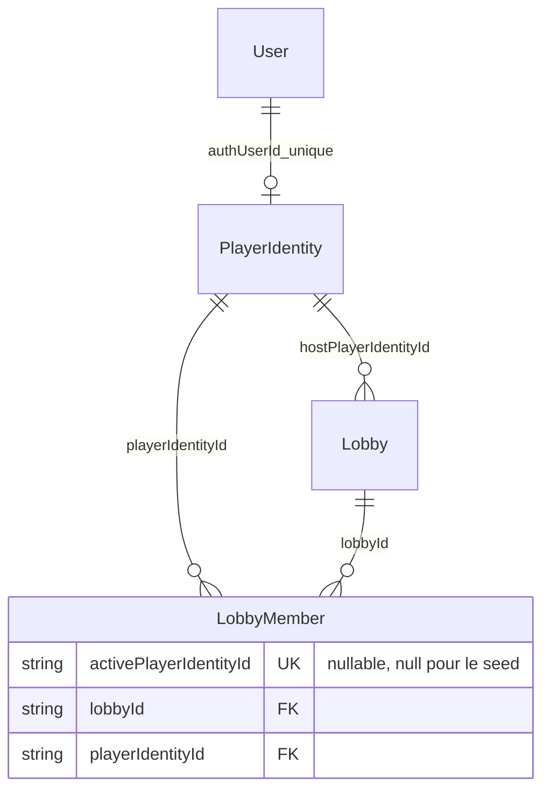

# Seed de recette du socle Sprint 1

Story [#4](https://github.com/Ap0llonn/web5-multiplayer-typing/issues/4). Le seed sert à inspecter le modèle et ses relations dans une base locale de développement/test. Il ne fournit ni identifiants de connexion ni preuve OAuth et ne simule pas une partie jouable.

## Exécution

Après `pnpm db:generate` et les migrations d’une base locale dédiée nommée, par exemple, `typing_dev` ou `typing_test` :

```sh
pnpm db:seed:s1
```

La commande lit `DATABASE_URL` dans l’environnement ou `.env`. Elle refuse `NODE_ENV=production`, toute origine autre que `localhost`, `127.0.0.1` ou `::1`, tout nom ne finissant pas par `_dev`/`_test`, et les URL avec paramètres ou fragment. Aucun secret Better Auth ou OAuth n’est nécessaire. Une URL locale ne garantit pas à elle seule qu’une base est jetable : sélectionner explicitement une base dédiée, jamais un tunnel vers une cible réelle.

Pour vérifier sans conserver de base ni configurer `.env` :

```sh
pnpm exec node --import tsx scripts/test-stack.ts db:seed:s1
pnpm test:integration
```

Le premier harnais crée sa propre DB PostgreSQL, applique les migrations, exécute le seed puis supprime uniquement sa stack temporaire. Pour examiner les données durablement, utiliser une base locale dédiée puis la première commande.

## Données créées

- Deux utilisateurs explicitement synthétiques, `seed-s1-host` et `seed-s1-guest`, avec adresses réservées sous `example.invalid` ; le deuxième représente la forme technique d’un invité
- Deux `PlayerIdentity`, liées aux utilisateurs par la clé étrangère unique `authUserId`
- Une salle de démonstration **fermée**, `seed-s1-room`, code `SEED23`, capacité 2, hôte lié à la première identité
- Deux adhésions inactives, avec `activePlayerIdentityId = null`, sans occuper une place active ni apparaître comme joueurs connectés
- Aucune ligne `Account`, `Session` ou `Verification`, aucun mot de passe/token, aucune photo, course ou statistique

Ces utilisateurs ne permettent donc **pas de se connecter**. Pour une recette UI, s’inscrire par le formulaire réel ou entrer comme invité, puis créer/rejoindre une nouvelle salle. La salle fermée du seed ne peut pas être rejointe.



Le diagramme complet du socle et les contraintes de code/capacité sont dans [ARCHITECTURE.md](ARCHITECTURE.md). La paire `(lobbyId, playerIdentityId)` est unique ; la clé active nullable impose une seule salle active par joueur. Le code à six caractères respecte l’alphabet qui exclut `0/O/1/I/L`. Le rôle d’hôte et le rôle participant/spectateur sont distincts.

## Idempotence et protections

`prisma/seed-s1.ts` est un outil de maintenance du schéma, hors des routes et façades applicatives. Ses accès Prisma ne créent aucune nouvelle API métier ni exception aux frontières entre modules. Il n’est lancé ni au démarrage serveur ni automatiquement en production.

Les IDs sont stables et les upserts n’écrasent aucun champ existant. Toute la création est dans une transaction ; un verrou transactionnel PostgreSQL réservé au seed sérialise ses exécutions concurrentes. Un conflit d’ID, de code ou de relation annule la transaction. Les gardes vérifient les identifiants et relations de la fixture existante avant de l’utiliser. Aucune suppression/reset ni remplacement d’utilisateur existant. Une erreur est expurgée : aucune URL DB ou erreur fournisseur détaillée dans la sortie.

Tests PostgreSQL réels dans `tests/integration/seed-s1.test.ts` :

1. ID invité déjà occupé par une autre donnée : refus et rollback du nouvel hôte/identité, donnée existante inchangée
2. Deux premiers runs concurrents puis un nouveau run : mêmes utilisateurs/identités, une seule salle fermée, deux adhésions inactives, aucun compte ou session ajouté, donnée tierce inchangée
3. Refus avant connexion des cibles de production, distantes, non dédiées, malformées ou avec paramètres ; aucun nom d’utilisateur/mot de passe DB dans l’erreur

Ces tests ne démontrent pas un seed complet de TECH-04. Le corpus de textes, les courses/résultats et l’historique attendent leurs entités et fonctionnalités futures ; ils ne sont pas ajoutés artificiellement au socle S1. Aucune donnée de production n’a été chargée par ce seed.
