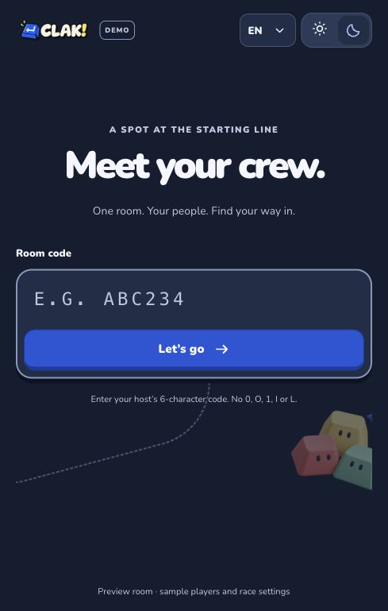
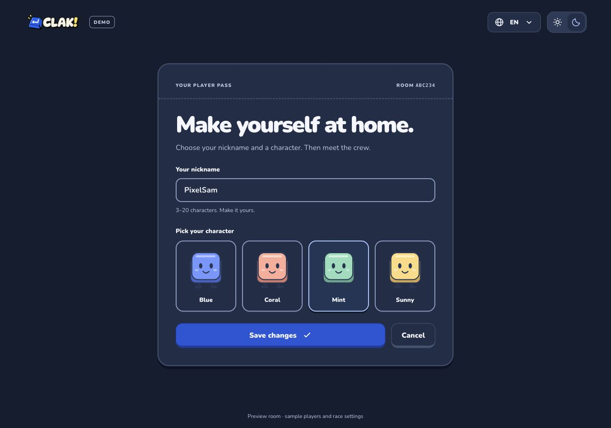
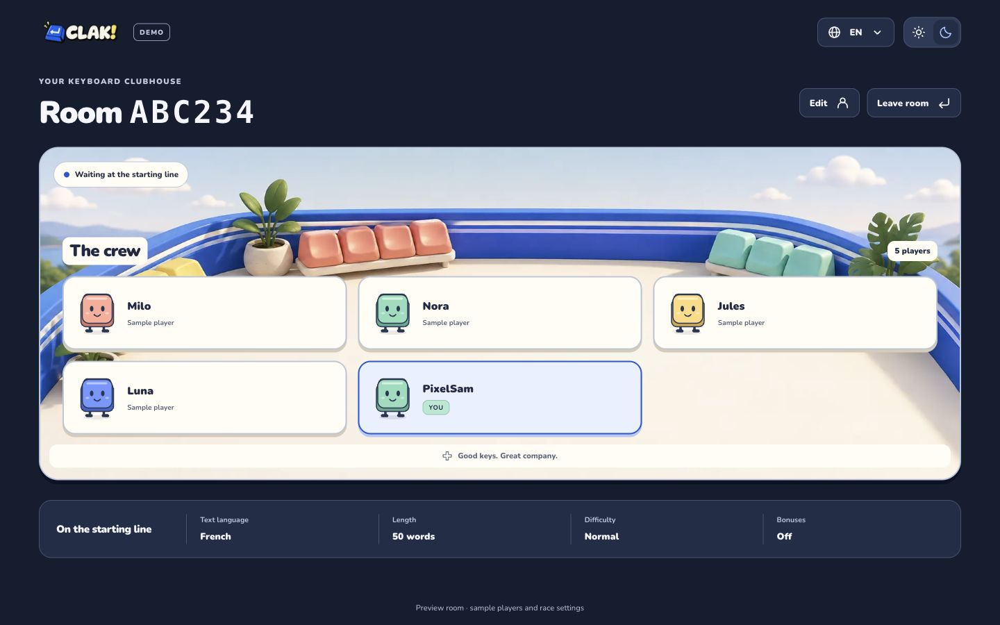
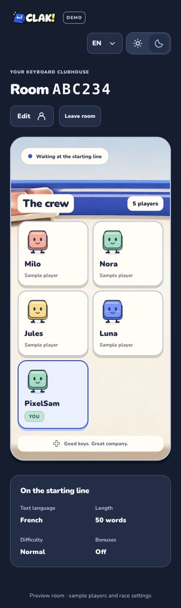
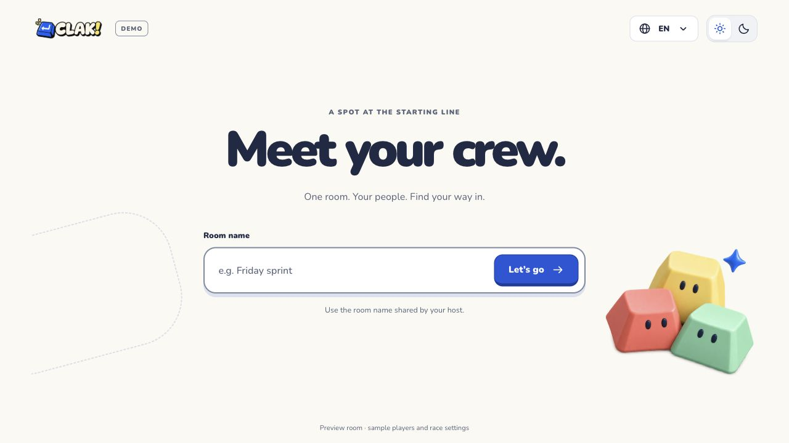
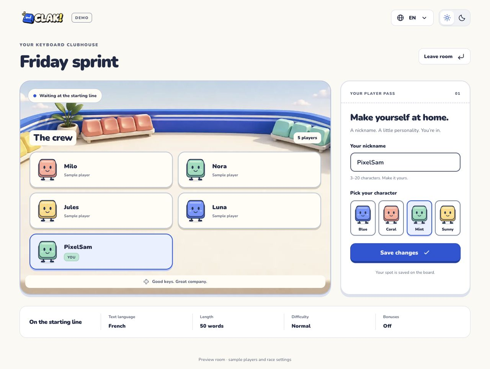
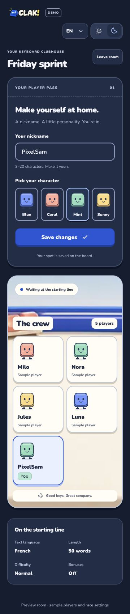

# Entrée et salon de démonstration — 5 octobre 2026

> Historique : ce contrat de maquette a été remplacé le 6 octobre 2026 par le parcours réel code → session/pseudo → adhésion à la salle. `/play` reste réservé au code ; la création est à l’accueil. Voir `ARCHITECTURE.md` et `verification.md` pour le comportement courant.

## Correction demandée : trois pages et code de salle

La demande suivante remplace l’entrée par nom et le formulaire inclus dans le salon : `/play` reçoit un code de six caractères, `/play/player` est une page dédiée au pseudo/personnage, puis `/play/room` affiche seulement la liste, les réglages et un bouton Modifier (avec Quitter). Le format du code reprend `roomCodeSchema` du module lobby, avec trim et mise en majuscules, sans `0 O 1 I L`. Cette validation locale ne vérifie pas l’existence d’une salle.

Le layout `/play` conserve le shell et un provider de présentation du module lobby. Son état React reste local entre les navigations client des trois pages ; aucun stockage, cookie, API ou session métier n’est ajouté. Une URL de setup/salon ouverte directement ou rechargée sans cet état revient à l’entrée. Un salon avec code mais sans joueur confirmé revient au setup. Modifier ouvre le setup prérempli ; les changements restent en brouillon jusqu’à Enregistrer, et Annuler conserve le joueur confirmé. Quitter efface l’état. La dernière demande prévaut sur le contrat initial ci-dessous, conservé comme historique.

Rattachement : présentation DES-04/05/06, I18N-01/02 et A11Y-01 à 04 ; format de SALLE-02 réutilisé sans nouvelle salle serveur. Test rouge avant changement : après code `ABCDEF`, l’URL reste `/fr/play` au lieu de `/fr/play/player`. Recette finale : trois URLs, validation code/pseudo, setup sans roster, salon sans champs/radios, édition/annulation, navigation historique, remise à zéro, gardes, FR/EN, deux thèmes et dimensions. Les **33 E2E finaux passent**, dont huit scénarios du prototype et 25 existants ; [résultats et limites](verification.md#parcours-code-et-joueur-sur-pages-dédiées--5-octobre-2026).

## Réalisation de la correction

`composition/play/PlayLayout` monte le shell commun et l’entrée de présentation `RoomPreviewProvider`. Les trois fichiers de route délèguent aux pages de composition, qui exposent `PreviewCodePage`, `PreviewPlayerPage` et `RoomPreview`. Le provider possède code, joueur confirmé et brouillon nom/style ; les vues utilisent le routeur localisé existant. Les callbacks de confirmation, annulation, modification et sortie ne commandent que cet état en mémoire.

`PreviewRoomEntry` réutilise `roomCodeSchema` ; le champ tolère une marge d’espaces autour du code, mais le code canonique contient exactement six caractères autorisés. `PreviewPlayerEditor` garde le formulaire et les quatre radios dans un billet centré de 620 px maximum. Le salon possède maintenant une seule scène pleine largeur, une grille de trois colonnes au bureau/deux sur mobile et les deux actions Modifier/Quitter. Le résumé des réglages reste un exemple fixe. Aucun nouvel asset, logo ou migration n’est nécessaire.

## Inspection du parcours à trois pages

Build de production local inspecté dans le navigateur : entrée par code, page dédiée au pseudo/personnage, salon sans formulaire, puis Modifier ouvre les choix confirmés avec Enregistrer/Annuler. Le salon est inspecté à 1440 px et à 360 px : trois/deux colonnes, code lisible, actions accessibles et réglages sous la scène. Le thème sombre existant est conservé ; le viewport de test est remis à sa taille normale. Le prototype est ouvert dans le navigateur sur la page de modification.

Ces captures montrent la présentation et des fixtures ; elles ne prouvent aucune salle réelle, présence multijoueur ou course. FR/EN × clair/sombre × 360/820/1440 px sur les trois pages est également couvert par 36 contrôles axe WCAG A/AA, sans débordement.

## Décision initiale avant réalisation (historique)

L’utilisateur demande une nouvelle page inspirée d’une salle d’attente Kahoot, avec un layout différent : d’abord un seul champ de nom de salle, ensuite pseudo et thème de personnage, et un petit résumé des réglages de course. Il autorise explicitement des mocks. Le prototype est isolé à `/fr/play` et `/en/play`, avec un badge de démonstration visible. Direction : **clubhouse des claviers**, scène miniature de terrasse, touches personnages, grille de joueurs à gauche et billet personnel à droite ; résumé des réglages en bas. Le nom et le logo fournis restent inchangés.

## Contrat initial et frontières (historique)

- `app` route seulement. Le layout de locale conserve les providers et un groupe `(site)` conserve le shell de l’accueil/auth sans changer leurs URLs. La nouvelle page possède son propre assemblage immersif dans `composition/play`.
- `lobby/presentation/RoomPreview` possède un état local jetable : entrée, nom de salle, brouillon du pseudo/style et joueur confirmé. Les composants de champ, éditeur, avatars, liste et résumé reçoivent leurs props et callbacks typés.
- Nom de salle 1–60 caractères ; pseudo 3–20 après trim ; quatre styles visuels. Rejoindre affiche le salon ; Prêt ajoute une seule ligne locale ; Modifier remplace cette ligne ; Sortir réinitialise le prototype. Aucune persistance, session, commande HTTP, SSE, mutation de DB ni course simulée.
- Les autres personnes sont des fixtures visibles dans le contexte de démonstration. Les réglages affichés sont des exemples fixes, sans commande de démarrage ou promesse d’une course opérationnelle. FR/EN, clair/sombre, clavier, 360 px et mouvement réduit restent requis.

## Divergences initiales avec le métier livré (historique)

Le nom de salle remplace le code uniquement dans ce prototype. SALLE-02 exige toujours un code unique de six caractères pour le vrai parcours. Le choix du pseudo après l’entrée inverse l’ordre AUTH-02 uniquement dans cette maquette sans identité réelle. Le panneau de réglages ne livre pas CONF-02/04/05/09 : ces réglages et le moteur de course restent futurs. L’autorisation de mocks dans cette nouvelle demande ne permet pas de transformer ces états locaux en succès Better Auth ou en salle réellement rejointe.

Rattachement de présentation : DES-04/05/06, I18N-01/02 et A11Y-01 à 04. Les statuts des fonctions serveur ne sont pas relevés par ce prototype.

## Recette initiale (historique)

Rouge d’abord : route `/fr/play` absente (404). Puis navigateur : entrée focalisée, validation du pseudo, styles au clavier, ajout/modification sans doublon, sortie, absence de commandes auth/lobby, FR/EN, thèmes, dimensions et axe. Repasser lint, types, frontières, unitaires, intégration PostgreSQL jetable, build et E2E des parcours réels existants. Résultats et limites consignés dans `verification.md`.

## Réalisation initiale (historique)

`composition/play/PlayPage` assemble le logo fourni, le badge démo, les sélecteurs partagés et `RoomPreview`. L’entrée comporte un seul champ de nom de salle. Le salon sépare la scène et les joueurs du billet personnel ; sur mobile, le billet passe en premier. `PreviewRoomEntry`, `PreviewPlayerEditor`, `PreviewAvatar`, `PreviewPlayerRoster` et `PreviewRaceSettings` portent les blocs de présentation. Les quatre personnages sont des SVG simples ; le décor de terrasse est une image originale générée avec `image_gen`, dont le [prompt final](../public/illustrations/README.md#typing-clubhousepng) est conservé.

Les brouillons du pseudo et du personnage restent distincts du joueur confirmé : « Prêt » ajoute une seule ligne locale et « Enregistrer » la remplace. « Quitter » vide ces états. Les titres reçoivent le focus à chaque changement d’écran ; les personnages utilisent des radios natifs dans des cartes personnalisées, avec flèches et focus visible. Le statut local est annoncé sans prétendre établir une connexion temps réel.

La nouvelle entrée est accessible depuis la navigation et le footer du site. Les URLs de l’accueil, de la connexion et de l’inscription restent identiques après leur déplacement dans `(site)`. Le thème et la langue réutilisent les préférences existantes ; le contenu du prototype reste volontairement jetable.

## Inspection initiale dans le navigateur (historique)

Captures du build de production local : entrée en anglais, salon confirmé avec joueur local, puis salon sombre à 360 px. Le billet personnel reste accessible avant la liste sur mobile ; les réglages se répartissent sur deux colonnes. Ces captures ne prouvent aucune salle réelle ou course.

