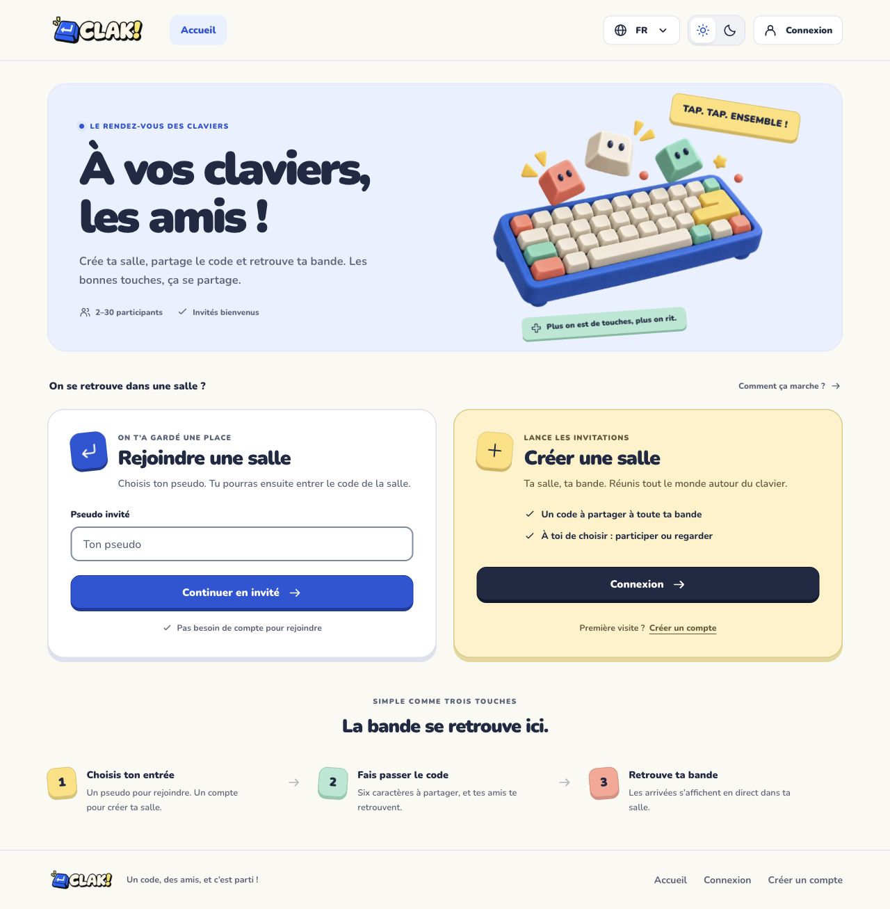
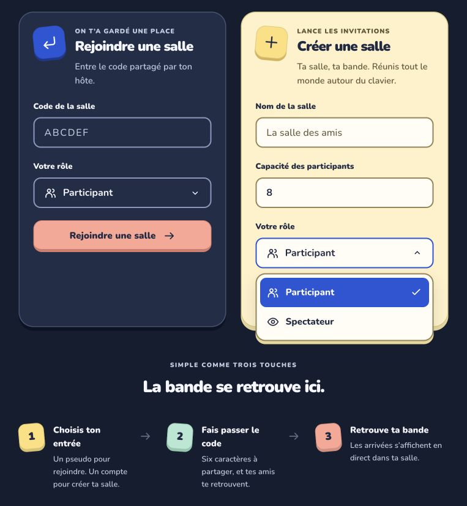
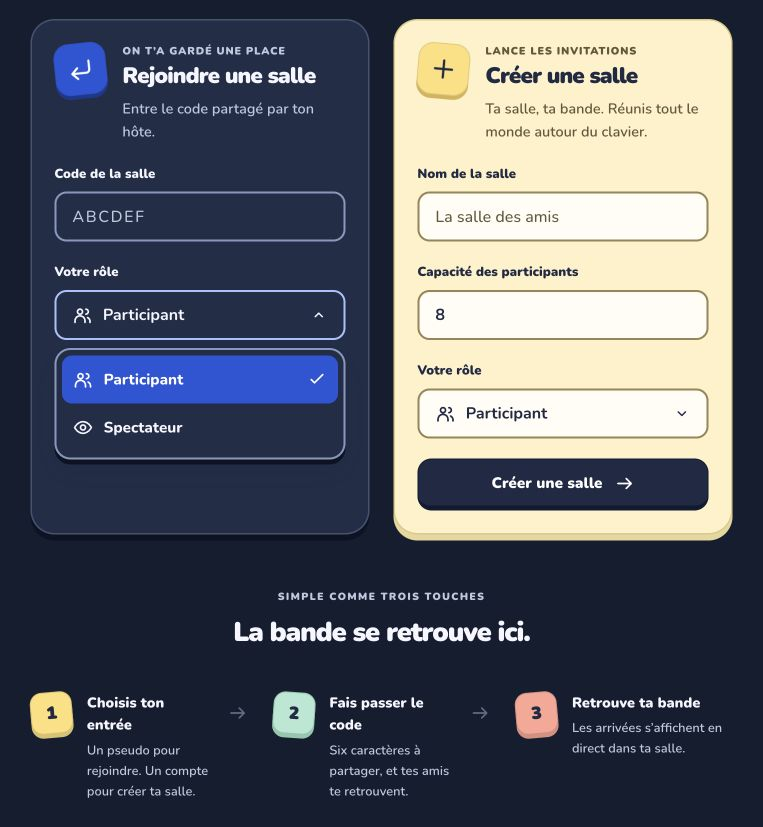

# Direction UI ludique — 4 octobre 2026

## Décision avant réalisation

La demande utilisateur du 4 octobre demande une interface ludique inspirée de Kahoot, des composants réutilisables et des images originales. Elle remplace la présentation « rétro arcade » précédente pour DES-03/04, sans modifier le périmètre S1. Direction : **terrain de jeu des claviers**, avec touches en volume, surfaces crème, bleu électrique, jaune beurre, corail et menthe. Il s’agit d’un thème d’interface, pas d’un nouveau nom ou logo. Le PNG CLAK! fourni reste inchangé ; les exigences de création personnelle DES-01/02 restent ouvertes.

## Références consultées

| Référence officielle | Observation retenue | Adaptation |
| --- | --- | --- |
| [Kahoot Play](https://kahoot.it/) | Code et action de rejoindre immédiatement repérables | Deux parcours réels clairement séparés, rejoindre avant créer |
| [Duolingo — langage des formes](https://blog.duolingo.com/shape-language-duolingos-art-style/) | Silhouettes simples, arrondies, couleurs franches, espace négatif | Touches expressives et boutons tactiles, sans reprendre les personnages |
| [Blooket](https://www.blooket.com/) et [entrée de jeu](https://play.blooket.com/play) | Famille d’illustrations cohérente et entrée rapide | Une même famille de touches 3D décoratives sur accueil et authentification |
| [Poki](https://poki.com/) | Accès direct aux actions de jeu | Cartes d’entrée directement sous l’illustration, aucun faux catalogue |

## Contrat et propriété

- `shared/presentation/ui` possède les primitives génériques, les illustrations décoratives et leurs états visuels. Les images n’encodent aucun texte nécessaire à la navigation.
- `composition/home` assemble le hero, les entrées authentification/salle et une courte aide traduite ; `composition/auth` garde son orchestration.
- `identity/presentation` et `lobby/presentation` gardent les formulaires, validations et commandes existantes. Aucun contrat serveur, invariant de salle ou protocole d’authentification ne change.
- Couleurs pilotées par tokens clair/sombre ; Tailwind pour la mise en page. Nunito variable auto-hébergée pour titres et texte, monospace réservé aux codes/touches. Police et licence OFL conservées sous `public/fonts`, source : [Google Fonts](https://github.com/google/fonts/tree/main/ofl/nunito).
- Images générées avec l’outil intégré `image_gen`, stockées sous `public/illustrations`. Aucun logo, favicon ou croquis de marque généré. Icônes simples conservées en SVG dans la famille existante.
- DES-05/06, I18N-01/02, A11Y-01 à 04 : FR/EN, thèmes persistants, focus, navigation clavier, 360 px et réduction de mouvement restent obligatoires.

## Recette prévue

Un test navigateur doit d’abord constater l’absence de la nouvelle illustration. Après réalisation : chargement des images, absence de débordement mobile/desktop, illustrations ignorées des lecteurs d’écran, parcours réels, FR/EN et clair/sombre. Exécuter lint, types, frontières, unitaires, intégration PostgreSQL jetable, build et suite navigateur. Les résultats seront consignés dans `verification.md` ; aucun résultat n’est présumé ici.

## Réalisation

`ActionHeading` partage les en-têtes de cartes entre accueil et formulaires du lobby. `DecorativeImage` centralise les deux PNG transparents, leurs dimensions, tailles adaptatives et alternatives décoratives. `HowItWorks` décrit uniquement les opérations de salle disponibles. Les boutons, champs, cartes, navigation, avatars et code de salle reprennent les nouveaux tokens. Les animations décoratives sont désactivées avec la préférence de mouvement réduit.

Les fichiers et prompts finaux de génération sont dans [public/illustrations/README.md](../public/illustrations/README.md). Le test rouge a constaté l’absence de l’illustration avant l’implémentation. La revue a conduit à séparer le contraste des contrôles de celui des cartes et à neutraliser le texte de création pour les comptes déjà connectés. La recette finale et ses limites sont consignées dans [verification.md](verification.md).

## Composants et sélecteur personnalisé — demande suivante

La demande suivante cible les blocs encore regroupés et le menu natif du champ de rôle. Rattachement : DES-04/05/06, I18N-01/02 et A11Y-01 à 04. Le composant générique `Select` appartient à `shared/presentation/ui` : options et libellé fournis par le consommateur, valeur initiale, nom du champ et état désactivé. Il présente un bouton combobox et une liste d’options dans le thème ; un input masqué transmet la valeur à `FormData`. Aucune règle métier ni validation serveur ne lui appartient.

Le clavier suit le [modèle de combobox sans saisie WAI](https://www.w3.org/WAI/ARIA/apg/patterns/combobox/examples/combobox-select-only/) : flèches, début/fin, recherche par caractères, validation Entrée/Espace/Tab, annulation Échap. Le focus reste sur le contrôle et la liste possède ses propres identifiants. La recette doit reproduire l’absence de menu DOM avant réalisation, puis vérifier la vraie création en spectateur, l’indépendance des deux champs, le clavier, les thèmes, les traductions et le menu ouvert à 360 px.

Les formulaires rejoindre/créer et la salle active restent des composants de `lobby/presentation`, avec les callbacks de commande injectés par `LobbyPanel`. Les champs et boutons sociaux restent dans `identity/presentation`, avec Better Auth, erreurs et navigation dans `AuthForm`. La navigation partage les contrôles de langue et thème ; les cartes anonymes restent dans `composition/home`.

La recette a aussi détecté un chevron qui débordait à 768 et 820 px : les champs capacité/rôle utilisent maintenant la largeur de leur carte (deux colonnes à partir de 400 px intérieurs). Les six scénarios du sélecteur couvrent le clavier, les formulaires, les menus ouverts à 360 px et les largeurs 768/820/900 px. La suite complète atteint 25 E2E PASS. Inspection réelle des menus français sur surface jaune et sombre ; captures ci-dessous. Les contrôles et limites sont détaillés dans [verification.md](verification.md).

